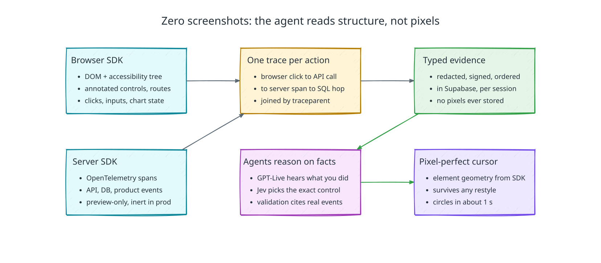

  <picture>
    <source media="(prefers-color-scheme: dark)" srcset="https://utrace.dev/brand/utrace-logo-white.svg">
    <source media="(prefers-color-scheme: light)" srcset="https://utrace.dev/brand/utrace-logo.svg">
    
  </picture>

<h1 align="center">uTrace</h1>

  <a href="https://utrace.dev">utrace.dev</a> ·
  <a href="https://youtu.be/tXNdiliB3_Y">DEMO</a> ·
  <a href="docs/PRD.md">Product spec</a> ·
  <a href="docs/ARCHITECTURE.md">Architecture</a>

uTrace is a fleet of forward-deployed agents for product teams. It plugs into
the places where a product's customers already give feedback, identifies the
Product Signals in it, and turns them into validated implementation work: it
interviews the customer behind each one while they use the product, builds the
agreed change in isolation, live during the interview when it fits, and has that
same customer validate it before a pull request opens.

## Why uTrace

Product teams already hear a steady stream of feedback in Discord servers,
Reddit posts, X threads, customer calls, and support channels. Finding feedback
isn't the bottleneck. Synthesizing that scattered customer truth into structured
product improvement is: someone has to uncover the pain point or unmet need
behind each request, mostly through probing interviews, and then build and check
the change. That works at a small scale, but as a company grows, human bandwidth
can't keep up with every feedback loop.

Human forward-deployed engineers sit close to customers, product behavior, and
the code. uTrace automates that role for high-volume feedback, closing each loop
on its own, so it scales with the company without adding headcount.

## How it works

Diagram key

1. A customer asks for a feature or reports a problem where they already give
   feedback, such as the client's Discord server or helpdesk.
2. Intake records it as a Product Signal and sends the customer, its originating
   user, a private invitation with a reward offer, such as an invoice credit.
3. In a voice interview, the agent separates the requested solution from the
   underlying job and pain while the user shows the workflow in a seeded preview
   of the product.
4. The Implementation Gate decides what gets built: the agreed change live during
   the interview, larger work async after it, or nothing.
5. A coding agent builds the change in an isolated workspace. It starts drafting
   as soon as the user claims their invitation, so a live change is ready to try
   moments after they agree to it; only the gate's approval lets a draft reach
   them.
6. The same user tries the new version and confirms each acceptance criterion
   they agreed on. If it falls short, the agent offers a change, which goes back
   through the gate while the client's iteration budget allows.
7. Validated work, once every required check has passed, becomes one draft PR
   and a Case File for the product team, and the user's customer account earns
   the reward for taking part. When nothing is built, or a version falls short
   with no further change, the Case File explains why, and no PR opens.

## What clients and customers get

**The client (product team)** gets validated work instead of raw feedback:

- A Case File for every case, built from recorded evidence rather than model
  claims: what the customer needs and why, the product behavior observed before
  and after the change, what was built and checked, the risks, and the next
  action. When nothing is built, or the change falls short, it explains why.
- One draft PR, only for validated work, bound to the exact version the customer
  validated. uTrace never merges; production merge stays with the team.
- A dashboard of cases in progress and Case Files with their PRs.

**Customers** get their request heard and acted on:

- A short voice interview inside their own workflow, instead of a form or a
  ticket that goes nowhere.
- The change built while they talk, or soon after, and the chance to try it
  before anything ships.
- A reward for taking part, such as an invoice credit on their customer account,
  whether their feedback is positive or not.
- Privacy across products: what they share with one client is never visible to
  another.

## What the client controls

- **SDK integration:** the product commits uTrace's browser and server SDKs to
  its normal branch. They run only in previews; production excludes the active
  runtime.
- **Autonomy Policy:** which implementation paths uTrace may take, allowed and
  blocked code areas, required checks, and the iteration budget: how many
  Implementation Attempts one Product Signal may use. Each case keeps the policy
  it started with.
- **Outreach Offers:** a budget for fixed rewards, such as invoice credits, for
  customers who take part. uTrace reserves each reward before inviting anyone,
  the agent can't negotiate it, and earning it never depends on positive
  feedback.
- **Stopping work:** owners and admins can stop any active case, with a reason.

## The interview

The originating user works across two browser tabs:

- **Session tab:** the voice call, a live transcript, an animated agent
  character, and progress while the change is built.
- **Preview tab:** an isolated copy of the product with seeded data, where a
  browser extension shows the same character, call controls, and an agent
  cursor.

The agent talks over full-duplex voice and can be interrupted. It asks short,
context-aware questions while the user reproduces the workflow, and it never
exposes code or diagnostics: it asks about the screen the user reopened, not
about the endpoint that failed. Its cursor points at and circles the exact
control it's talking about, but it can't click, type, or submit for the user.
The user can pause or end the interview at any time, or leave and come back
through a private return link.

Validation is structured. The same user repeats the workflow on the exact new
version and dataset, and the outcome is validated, partially validated, not
validated, or unclear. Anything short of validated leads the agent to offer a
change while the iteration budget allows. A dropped connection interrupts
validation instead of failing it.

## Isolation and safety

- Each Interview Session gets its own running copy of the product, from
  frontend to seeded database, in Vercel Sandbox, and each new version gets a
  separate one.
- The user's preview switches to a new version all at once, only after its fast
  checks pass, so they never see a half-built or broken page. The slower checks
  finish while they try it, and a PR waits for all of them.
- The coding workspace can change code but holds no customer data or production
  credentials, and it never becomes the copy the user sees.
- Previews replace email, payments, webhooks, and other side effects with
  recorded stand-ins.
- A copy that held data is deleted when its case no longer needs it, never
  reused.

## Structured observation instead of screenshots

uTrace never interprets screenshots. The product's own instrumentation tells
the agents what happened.

Diagram key

- The [browser SDK](packages/utrace-browser-sdk) registers the product's
  annotated controls with their live geometry, so the agent cursor points at
  the exact control.
- One `traceparent` joins a click, the API call, the
  [server SDK](packages/utrace-server-sdk) span, and the database query beneath
  it.
- Redaction runs in the page, sensitive fields never leave it, and no pixels are
  stored.

## Stack

| Part | Technology |
| --- | --- |
| Control plane API and worker | Python and FastAPI on Supabase Compute |
| Data, auth, realtime, storage, queues | Supabase |
| Web surfaces and preview front door | Next.js on Vercel |
| Previews and coding workspaces | Vercel Sandbox |
| Voice | Pipecat on Daily: Deepgram Flux, GPT-6.1 Sol Ultrafast, ElevenLabs |
| Reasoning and code changes | OpenAI GPT-6.1 Sol, coding in Codex; Ultrafast for gate decisions and code changes |
| Intake, flow classification, and acknowledgement decisions | TypeSafe AI Jev |
| Delivery | GitHub draft PRs, Stripe invoice credits, Discord |

## Repository map

| Path | What lives there |
| --- | --- |
| [`apps/api`](apps/api) | FastAPI control plane and worker |
| [`apps/web`](apps/web) | utrace.dev: landing, session tab, client dashboard |
| [`apps/browser-extension`](apps/browser-extension) | The agent character, controls, and cursor in the preview tab |
| [`apps/preview-front-door`](apps/preview-front-door) | Routes each session's preview origin to its sandbox |
| [`packages/utrace-browser-sdk`](packages/utrace-browser-sdk) | Structured browser observation and the target registry |
| [`packages/utrace-server-sdk`](packages/utrace-server-sdk) | Preview-only OpenTelemetry for the client's backend |
| [`packages/utrace-contracts`](packages/utrace-contracts) | Versioned schemas shared by Python and TypeScript |
| [`supabase`](supabase) | Declarative schema, migrations, and project config |
| [`docs`](docs) | Product spec, architecture, scenario, and diagrams |

## Learn more

- [The Shopalytics demo journey](docs/SCENARIO.md)
- [Architecture](docs/ARCHITECTURE.md), with one page per component in [`docs/arch-components`](docs/arch-components)
- [Product requirements](docs/PRD.md)
- [Deployment runbook](deploy/README.md)

## License

Copyright (C) 2026 Rithvik Manikandan. All rights reserved; see
[LICENSE](LICENSE).
