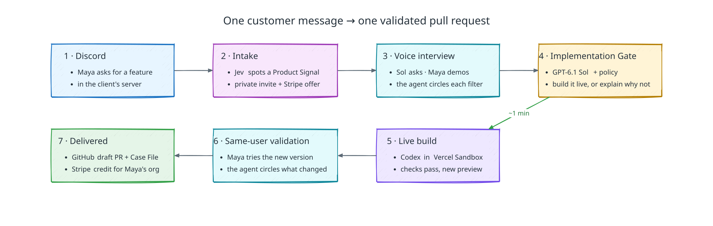
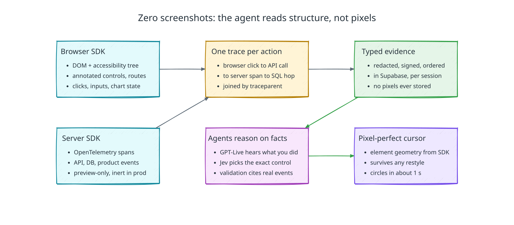
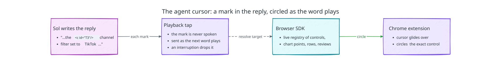

  <picture>
    <source media="(prefers-color-scheme: dark)" srcset="https://utrace.dev/brand/utrace-logo-white.svg">
    <source media="(prefers-color-scheme: light)" srcset="https://utrace.dev/brand/utrace-logo.svg">
    
  </picture>

<h1 align="center">uTrace</h1>

  <a href="https://utrace.dev">utrace.dev</a> ·
  <a href="docs/SCENARIO.md">Demo journey</a> ·
  <a href="docs/ARCHITECTURE.md">Architecture</a> ·
  <a href="docs/PRD.md">Product spec</a>

uTrace is a forward-deployed product agent for product teams. When a customer
asks for something in the product's community, uTrace interviews them by voice
while they use the product, builds the agreed change live in an isolated
preview, and has the same customer validate it before a pull request opens.

## How it works

1. A customer's message in the client's Discord becomes a Product Signal, and
   the customer gets a private invitation.
2. In a voice interview, the agent works out the job behind the request while
   the customer shows the workflow in a seeded preview of the product.
3. The Implementation Gate decides whether the agreed change can be built live.
4. A coding agent implements it in an isolated workspace while the conversation
   continues.
5. The customer tries the new version and confirms each agreed check.
6. Validated work becomes one draft PR and a Case File for the product team, and
   the customer's organization earns an invoice credit for taking part.

## Structured observation instead of screenshots

uTrace never interprets screenshots. The product's own instrumentation tells
the agents what happened.

- The [browser SDK](packages/utrace-browser-sdk) registers the product's
  annotated controls with their live geometry, so the agent cursor points at
  the exact control.
- One `traceparent` joins a click, the API call, the
  [server SDK](packages/utrace-server-sdk) span, and the database query beneath
  it.
- Redaction runs in the page, sensitive fields never leave it, and no pixels are
  stored.

## The agent cursor

While the agent recaps a request, walks through a new version, or shows the
customer where something is, its text model puts a mark with the control's ID
before the words that name it. The mark is never spoken: as the next word plays,
the browser extension circles that control in the customer's preview. Controls,
chart points, table rows, and reviews are all declared targets in the page's
registry, so no screenshot is read.

## Stack

| Part | Technology |
| --- | --- |
| Control plane API and worker | Python and FastAPI on Supabase Compute |
| Data, auth, realtime, storage, queues | Supabase |
| Web surfaces and preview front door | Next.js on Vercel |
| Previews and coding workspaces | Vercel Sandbox |
| Voice | Pipecat on Daily: Deepgram Flux, GPT-6.1 Sol Ultrafast, ElevenLabs |
| Reasoning and code changes | OpenAI GPT-6.1 Sol in Codex |
| Intake and attention decisions | TypeSafe AI Jev |
| Delivery | GitHub draft PRs, Stripe invoice credits, Discord |

## Repository map

| Path | What lives there |
| --- | --- |
| [`apps/api`](apps/api) | FastAPI control plane and worker |
| [`apps/web`](apps/web) | utrace.dev: landing, session tab, client dashboard |
| [`apps/browser-extension`](apps/browser-extension) | The agent character, controls, and cursor in the preview tab |
| [`apps/preview-front-door`](apps/preview-front-door) | Routes each session's preview origin to its sandbox |
| [`packages/utrace-browser-sdk`](packages/utrace-browser-sdk) | Structured browser observation and the target registry |
| [`packages/utrace-server-sdk`](packages/utrace-server-sdk) | Preview-only OpenTelemetry for the client's backend |
| [`packages/utrace-contracts`](packages/utrace-contracts) | Versioned schemas shared by Python and TypeScript |
| [`supabase`](supabase) | Declarative schema, migrations, and project config |
| [`docs`](docs) | Product spec, architecture, scenario, and diagrams |

## Learn more

- [The Shopalytics demo journey](docs/SCENARIO.md)
- [Architecture](docs/ARCHITECTURE.md), with one page per component in [`docs/arch-components`](docs/arch-components)
- [Product requirements](docs/PRD.md)
- [Deployment runbook](deploy/README.md)

## License

Copyright (C) 2026 Rithvik Manikandan and Ming Lu. All rights reserved; see
[LICENSE](LICENSE).
