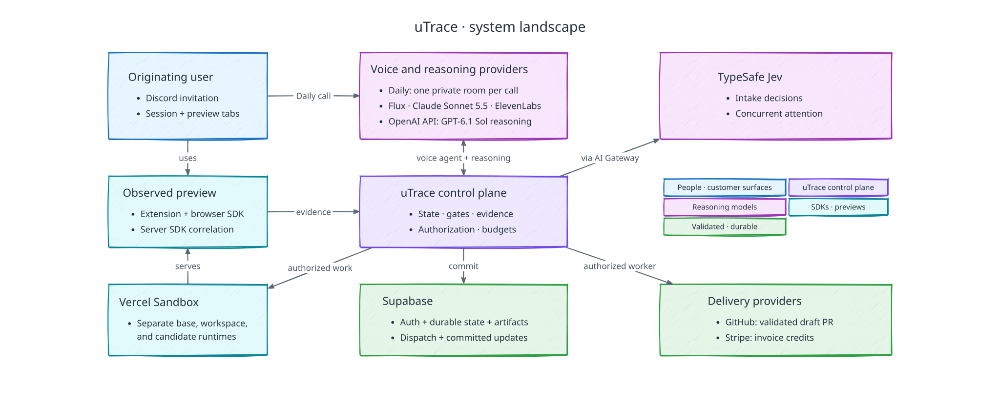
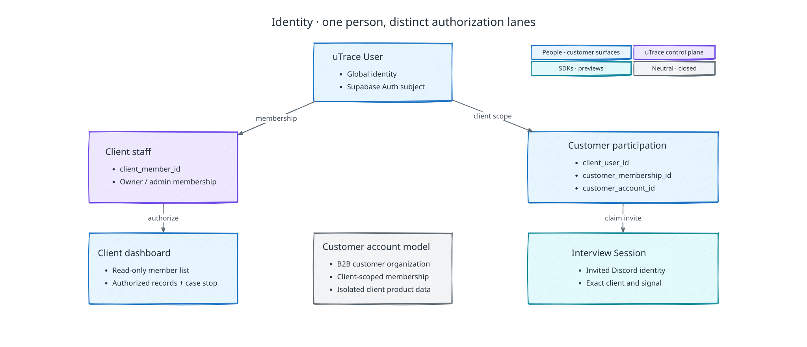
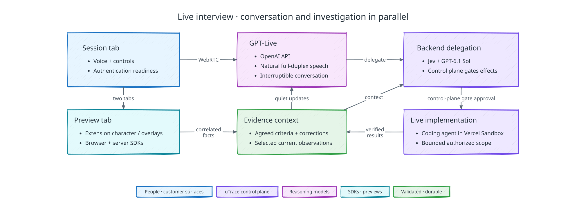
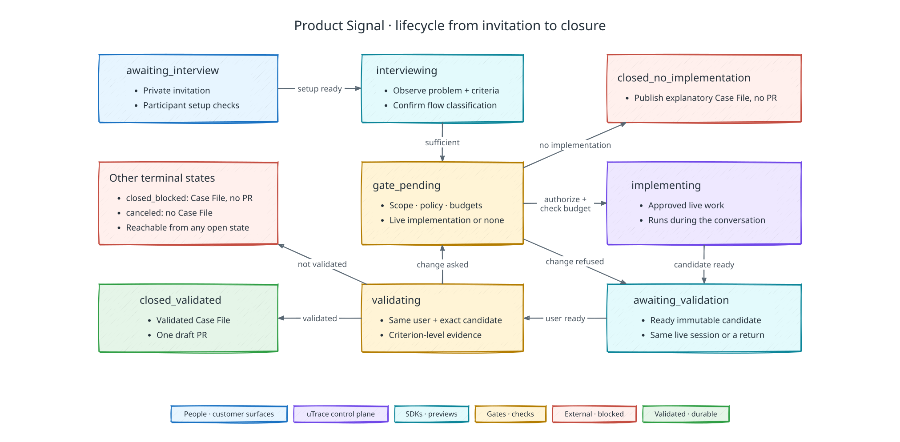
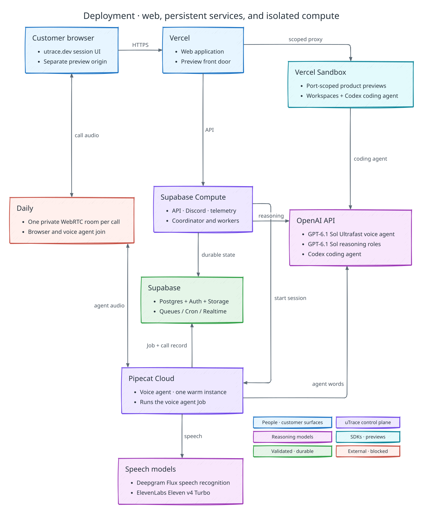

# uTrace architecture

uTrace is a closed-loop product system. It turns customer signal into evidence,
evidence into bounded product work, and product work into a result the same
customer validates.

This document maps the demo system and its component relationships. The linked
component specifications under [arch-components](./arch-components/) carry the
detailed contracts, state machines, permissions, failure rules, and provider
boundaries. The [PRD](./PRD.md) owns product scope and vocabulary. These documents
specify the system to build: where code in this repository still differs, the
documents are the target.

## Product loop

The [product-loop diagram in the PRD](./PRD.md#product-thesis) shows the
shared flow and its distinct outcomes. The [Shopalytics demo](./SCENARIO.md)
is the journey this system exists to run.

### Demo scope

The system supports exactly what the [PRD's product scope](./PRD.md#product-scope)
names, and the [scenario's acceptance boundary](./SCENARIO.md#acceptance-boundary)
defines when it works. Nothing beyond that boundary is authorized runtime
behavior.

## System

The system has one durable authority and several specialized execution planes.

The voice agent handles conversational voice: a Pipecat pipeline in the worker
that joins the call's private Daily room, hears the participant through Deepgram
Flux, writes its words and calls uTrace's tools with GPT-6.1 Sol on the OpenAI
API's Ultrafast service tier, and speaks through ElevenLabs. Every other reasoning
role runs GPT-6.1 Sol at its own pinned effort, on the Ultrafast tier for
Implementation Attempts and the Fast tier otherwise, because its speed is what a
waiting participant feels: between the participant's agreement and the preview they
validate, pre-gate code investigation and Implementation Attempts, inside Codex in
a Vercel Sandbox, and Implementation Gate proposals; intake assistance; and Case
File drafting. The code investigation and the case's
implementation workspace are prepared while the interview runs, so the gate and
the coding agent start from them the moment the participant agrees. Jev is the default intake
decision model. During interviews it concurrently assesses relevance, claim
relationships, criterion-level evidence gaps, retrieval/model routing, which
activity to acknowledge, and which agreed checks a new version already showed. It
also proposes the interview-established flow
classification. The [Jev decision contract](./arch-components/cross-component-contracts.md#jev-decision-contract)
defines question types and acceptance checks. Jev neither serializes every spoken
turn nor grants authority.

uTrace calls every model provider directly from its own runtime; no provider's
agent platform owns orchestration. The
[deployment contract](./arch-components/deployment.md#model-access) defines model
access and configuration.

The control plane validates model proposals, maintains authoritative state, and
authorizes effects. Supabase Postgres holds durable workflow records, Storage
holds artifacts, Queues/Cron dispatch work, and Realtime distributes committed
updates. Realtime is neither voice transport nor proof that a command executed.

Each client's Product Overview, a short source-linked summary of the product,
travels whole with the contexts that need product knowledge, so no search index
sits on the live path. Exact repository investigation uses scoped filesystem
reads in Vercel Sandbox. The system keeps interview context explicit and does not
add a live-session semantic index.

### Implementation stack

The control plane and persistent backend workers use Python, with
FastAPI serving the HTTP API. Web surfaces, the browser extension, and the browser
and initial Node.js server SDKs use TypeScript. The coding agent is the Codex CLI,
run inside the workspace sandbox. The
[shared contract package](./arch-components/cross-component-contracts.md#versioning-and-compatibility)
provides versioned schemas, bindings, and runtime validation across both languages.

### Component map

| Plane | Detailed architecture |
| --- | --- |
| Shared foundations | [Cross-component contracts](./arch-components/cross-component-contracts.md), [identity and access](./arch-components/identity-and-access.md), [policy and permissions](./arch-components/policy-and-permissions.md), [client configuration](./arch-components/client-configuration.md) |
| Signal and experience | [Signal and outreach](./arch-components/signal-and-outreach.md), [interview and voice](./arch-components/interview-and-voice.md), [browser extension](./arch-components/browser-extension.md), [validation](./arch-components/validation.md) |
| Product observation | [Browser SDK and shared runtime](./arch-components/browser-sdk.md), [Server SDK](./arch-components/server-sdk.md), [telemetry and evidence](./arch-components/telemetry-and-evidence.md) |
| Control and reasoning | [Control plane](./arch-components/control-plane.md), [context assembly](./arch-components/context-assembly.md) |
| Implementation and preview | [Preview runtimes and seeding](./arch-components/preview-runtime-and-seeding.md), [implementation controller](./arch-components/implementation.md), [preview build](./arch-components/preview-build.md), [preview front door](./arch-components/preview-front-door.md) |
| Output and records | [Client outputs and GitHub](./arch-components/client-outputs.md), [Outreach Offers and invoice credits](./arch-components/outreach-offers.md), [durable data and schema](./arch-components/data-and-schema.md), [evaluation and observability](./arch-components/evaluation-and-observability.md) |
| Platform boundaries | [Deployment](./arch-components/deployment.md), [security](./arch-components/security.md), [failure recovery](./arch-components/failure-recovery.md) |

## Component relationships

### Identity, tenancy, and session anchoring

Identity relationships keep client staff access separate from customer participation.

Supabase Auth authenticates; uTrace membership, invitation, and policy records
authorize access. The [identity contract](./arch-components/identity-and-access.md)
defines global identity, client-scoped participation, and separate staff access.

Session, preview, and extension credentials join server-side without sharing
application cookies or storage. The mandatory session tab anchors voice and
controls; the separate preview tab hosts the product and extension UI. The
[browser extension contract](./arch-components/browser-extension.md) owns tab binding.

### Intake and signal coordination

The intake flow commits a routing outcome before outreach begins.

Jev supplies routine semantic decisions from pinned intake context; application
code enforces policy and commits them before outreach. The
[routing contract](./arch-components/signal-and-outreach.md#routing-context-and-cognition)
owns conditional assistance and blocked decisions. A second-model review or
narrative is not mandatory.

### Live conversation, attention, and observation

The runtime connects conversation, observation, and concurrent backend work.

Participant browser, extension, identity, and voice setup must pass before
interviewing. Problem discussion may then begin while the preview prepares. Observation-dependent work additionally requires the complete preview
and browser/server evidence path. Losing that path stops dependent work without
necessarily ending healthy conversation.

The [voice contract](./arch-components/interview-and-voice.md) owns backend-authorized
call setup, the voice agent's pipeline, application cues, and conversation evidence.
The [context assembler](./arch-components/context-assembly.md) supplies revisioned
inputs so controllers can reject results invalidated by changed requirements or corrections.

The extension presents the agent and controls; the browser SDK supplies structured
product observations and the server SDK supplies correlated spans. The
[telemetry contract](./arch-components/telemetry-and-evidence.md) joins this
preview-only evidence path without duplicate capture or screenshot inference.

### Authority and lifecycle

The Product Signal lifecycle tracks each case, keeping implementation and validation outcomes explicit.

The control plane commits state and dispatch intent atomically before external
work. Reconnect reads durable state. Model proposals, provider results, and
notifications cannot bypass the [shared contracts](./arch-components/cross-component-contracts.md).

[Control Plane](./arch-components/control-plane.md) owns transitions and dispatch;
[Policy and Permissions](./arch-components/policy-and-permissions.md) owns pinned
authority and deny-only revocation. Provider execution and engineering repair
cannot manufacture evidence or bypass transition guards.

### Implementation and preview

The [implementation controller](./arch-components/implementation.md) grants a
fenced workspace lease only after gate approval. It enforces scope, checks, and
budgets, and it accepts only the output it verifies itself.

The [preview runtime](./arch-components/preview-runtime-and-seeding.md) owns the
seeded dataset copies. It remains separate from the coding workspace.
[Preview Build](./arch-components/preview-build.md) deploys immutable candidate
artifacts; the [preview front door](./arch-components/preview-front-door.md) routes
the session origin to a ready candidate without exposing sandbox URLs or provider
credentials.

[Failure Recovery](./arch-components/failure-recovery.md) owns reason-specific
stopping, client withdrawal, bounded resumption, and reconciliation.

### Validation, Case Files, and dashboard

The [validation controller](./arch-components/validation.md) joins the originating
user's criterion-level confirmation with observations from the exact candidate
and dataset. Its frozen result authorizes delivery.

[Client Outputs](./arch-components/client-outputs.md) verifies evidence, delivers
the exact draft PR when eligible, and seals the Case File. Its published core is
immutable. The authenticated dashboard exposes authorized product records and
controls without granting lifecycle-editing authority.

### Data, deployment, and evaluation

The deployment map places each workload at its owning service.

[Data and Schema](./arch-components/data-and-schema.md) owns durable records,
artifacts, and their cleanup contracts.
[Deployment](./arch-components/deployment.md) and [Security](./arch-components/security.md)
define service, credential, and tenant boundaries.

[Evaluation and Observability](./arch-components/evaluation-and-observability.md)
separates automated tests and demo-harness checks from operational tracing.
Verification never changes product state or supplies missing user evidence.

### Outreach Offers and invoice credits

The [Outreach Offers controller](./arch-components/outreach-offers.md)
reserves credit-issuance allowance before outreach and records participation-based
entitlements. Its backend Stripe adapter issues invoice credits in the Stripe
sandbox that stands in for the client's billing account. Issuance stays separate
from case closure and Case File publication; model and preview runtimes have no
billing authority.

## Active provider lookup

| Architectural role | Active provider or system |
| --- | --- |
| Staff and participant authentication | Supabase Auth; explicit uTrace authorization; Discord sign-in for participants |
| Customer Surface | One configured Discord server per client |
| Full-duplex voice call | Pipecat (`pipecat-ai` 1.12) voice agent in the worker; one private Daily room per voice connection, created by the backend |
| Speech recognition and turn detection | Deepgram Flux (`flux-general-en`) |
| Voice agent text model | GPT-6.1 Sol (`gpt-6.1-sol`), Ultrafast tier, through the OpenAI Responses API over WebSocket |
| Speech synthesis | ElevenLabs Eleven v4 Turbo (`eleven_v4_turbo`) |
| Implementation Gate proposals, intake assistance, Case File synthesis | GPT-6.1 Sol (`gpt-6.1-sol`), Fast tier, through the OpenAI Responses API |
| Code investigation and implementation harness | Codex CLI running GPT-6.1 Sol inside Vercel Sandbox: Ultrafast tier for Implementation Attempts, Fast tier for code investigation |
| Default intake decisions and concurrent typed semantic attention | TypeSafe AI Jev (`typesafe-ai/jev`) through Vercel AI Gateway |
| Durable workflow state | Supabase Postgres |
| Artifacts and evidence objects | Supabase Storage |
| Committed application notifications | Supabase Realtime |
| Durable dispatch and scheduling | Supabase Queues and Cron; uTrace Jobs and authority in Postgres |
| Persistent API, Discord, telemetry, session coordination, workers | Supabase Compute (private alpha) in the uTrace Supabase project |
| Server-side credential custody | Supabase Compute project secrets |
| Isolated implementation and preview compute | Vercel Sandbox |
| Web surfaces and preview front door | Vercel |
| Branches, diffs, and PRs | GitHub |
| Outreach Offers invoice credits | Stripe customer invoice credit balance, in a Stripe sandbox |
| Operational tracing | OpenTelemetry plus uTrace durable events and evidence; Vercel Observability, Web Analytics, and Speed Insights for the web surfaces |

Model and provider configuration is versioned at dispatch. Providers execute their
assigned roles; they do not decide authorization or whether the user validated a
change. No model is ever substituted for another. Exact vendor
integration details and reference links live in the owning component
specification.
