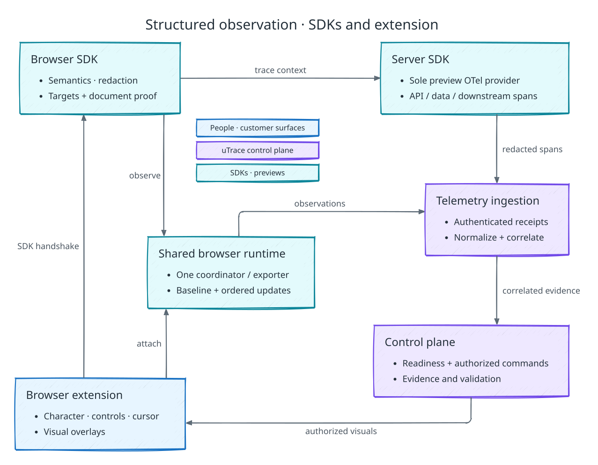

# uTrace PRD

## Product thesis

uTrace is a fleet of forward-deployed agents for product teams.

By integrating with a product's user community and autonomously closing long-running feedback loops, it identifies [Product Signals](#product-signal) and turns them into validated implementation work, scaling linearly with company growth without adding headcount.

It is not a mere tool but the following end-to-end software factory:

Diagram key

The key insight is that product teams at growing or mid-size organizations already find a steady stream of feedback in their Discord servers, Reddit posts, X threads, customer calls, and support channels. The bottleneck is not "finding feedback," but synthesizing that scattered customer truth into structured product improvement by uprooting pain points and unmet needs, primarily done through probing user interviews. While this works on a small scale, increased growth creates a knee in the graph: human bandwidth cannot linearly scale to fulfill the demands of maintaining such feedback loops.

uTrace erases that bottleneck. It plugs into where customers already talk, identifies Product Signals, invites the right users into agent-led interviews, observes their product workflows, asks context-aware probing questions, connects the answers to code, implements changes, and actually validates the modified workflows with the same users before handing the client product team any final output.

## Positioning

uTrace is best understood as a team of forward-deployed agents.

Human forward-deployed engineers sit close to customers, product behavior, and technical implementation details. uTrace automates their function for high-volume customer feedback and product improvement loops.

uTrace is not purely:

- a customer support automation, because the output is product work rather than ticket deflection
- a session replay, because it actively asks questions based on user telemetry
- an observability platform, because traces are inputs for broader understanding of the customer's situation
- a coding agent, because code changes are gated on customer evidence and telemetry
- a voice agent, because voice is just the live interview interface for a broader product-engineering loop

It is made up of parts of all of those.

## Product scope

The demo runs one B2B client, configured manually by uTrace, with one Discord
server and one authorized code repository for its product. It supports Feature
Request Flow, live implementation with
[changes asked for during validation](#changes-during-validation), a manually
prepared synthetic dataset, Outreach Offers with invoice credits in a Stripe
sandbox, and the client dashboard views listed under
[Client dashboard](#client-dashboard).

The demo does not include self-service onboarding, automatic customer-data
preparation, Bugfix Flow, Sensitive Account escalation, corroboration, async
implementation, revisions after unsuccessful validation, preview site isolation, or
production billing.

## Account model

uTrace has two account classes.

### uTrace Client

A uTrace Client is a company that uses uTrace to improve its product. One client organization represents one product and has exactly one owner and zero or more admins. A client has a Discord [Customer Surface](#customer-surfaces) (server), integrates both components of the [uTrace SDK](#utrace-sdk) into its normal application branch (usually `main`) for preview-only instrumentation, and receives [Case Files](#outputs) with potential PRs. In the demo, uTrace performs the client's configuration; see [Client configuration](#client-configuration).

### uTrace User

A uTrace User is a customer of one or more uTrace Clients who participates in
agent-led interviews. Each participant belongs to a customer-organization account
within the client product.

uTrace User identity is global across uTrace, but participation and data are scoped per client. One client must not see another client's interview history, product telemetry, or customer context.

Global user memory may include communication preferences, participation count, and contact preferences. Client-scoped memory may include prior interviews, product-specific workflow context, frustrations, validation outcomes, and account metadata for that client only.

## Customer Surfaces

A Customer Surface is any platform where user feedback or behavior may warrant a [Product Signal](#product-signal).

The client's one Discord server is the demo's Customer Surface, with its watched
channels set in the client configuration. Interview invitations and return links
are private (DMs) and bound to the originating user's Discord identity. The
[outreach contract](./arch-components/signal-and-outreach.md) defines delivery,
identity, and contact-budget enforcement.

## Product Signal

A Product Signal is not raw customer feedback. It is the [Intake Router](#intake-router)'s recorded finding that customer feedback plausibly points to a product failure, feature gap, workflow friction, or other opportunity worth investigating.

A *case* is the end-to-end work associated with one Product Signal, including any
interview, implementation, validation, and closure. The [output rules](#outputs)
determine whether it produces a Case File.

A Product Signal should identify:

- affected user goal or workflow
- expected behavior or requested capability
- current behavior/suspected failure or product gap
- customer evidence
- impact, frequency, or urgency
- potential gain from acting on it

The reporter whose concern creates a Product Signal becomes its originating
user and sole interview and validation participant. In the demo, every routed
report that warrants investigation opens its own Product Signal; matching later
reports to an existing one is outside the demo.

## Intake router

The Intake Router determines whether incoming user feedback warrants a Product Signal and invites the reporter to an interview.

Routine intake creates a source-backed record; a generated narrative is optional. The
[routing contract](./arch-components/signal-and-outreach.md#routing-context-and-cognition)
defines classification, conditional reasoning, and policy enforcement.

### Flow type

The router first decides whether the feedback warrants a Product Signal or is
noise, such as unrelated content or a question resolved with a factual pointer
and no product investigation. An existing capability alone does not classify
feedback as noise: the user may be describing meaningful workflow friction. Noise
ends the flow immediately: uTrace may send the user a brief pointer, but no
interview, implementation, or client output follows.

Otherwise, Jev assigns an initial flow type before the interview invitation. The
demo supports Feature Request Flow: the user asks for or implies a need for a new
or changed capability. Feedback that Jev classifies as a product failure belongs to
Bugfix Flow, which the demo does not run; intake
holds it without creating a Product Signal.

The interview confirms the classification from the user's account and observed
product evidence before the Implementation Gate.

### Actionability

Every Product Signal in the demo leads to an interview invitation. Implementation
eligibility happens later at the [Implementation Gate](#implementation-gate), after
user probing, workflow evidence, telemetry, and code/product context.

## Outreach Offers

Clients can authorize a budget for fixed invoice-credit rewards through Stripe.
Each reward reduces the originating user's customer organization's future bills
for the client's product. The demo issues Stripe invoice credits in a
uTrace-controlled Stripe sandbox that stands in for the client's billing account.

The private invitation states the credit amount and currency, recipient
organization, billing use, and completion conditions, including the possibility
of multiple sessions. uTrace reserves the amount against the client-authorized
issuance budget before sending an offer; the agent cannot negotiate or increase
it. This budget is an allowance to issue credits, not money deposited with uTrace.

One offered reward covers the case's required participation:

- A completed interview followed by the gate choosing no implementation earns
  the reward.
- A case with live implementation requires participation through validation.
- If uTrace or the client ends the case, the reward is earned when the
  participant fulfilled everything requested of them up to that point.
  Client-initiated stops follow the same earning rules as technical blockers,
  scope limits, and execution-budget exhaustion. Pre-participation stops earn
  no reward.
- Voluntary cancellation, declining a required continuation, or abandoning
  outstanding participation before completion earns no reward. A temporary
  interruption does not itself establish abandonment.

Honest negative feedback does not disqualify participation. Reward eligibility
never depends on a favorable verdict, a PR, or a merge. Once earned, a reward
remains owed even if credit issuance fails.

uTrace's backend issues the earned credit to the organization's existing Stripe
Customer as a customer balance adjustment. Stripe applies available credit
automatically to future finalized invoices. The
[Outreach Offers](./arch-components/outreach-offers.md) contract owns customer
mapping, reservations, and issuance recovery.

## Core flows

### Feature Request Flow

The agent should separate the requested solution from the underlying job, pain, workflow, and impact. It should probe why the user wants the feature, what they are trying to accomplish, how often the need appears, and whether a workaround exists today.

If the requested solution would actually alleviate the underlying pain, the agent proceeds to the [Implementation Gate](#implementation-gate). If not, it proposes more fitting solutions and proceeds once the user agrees on one. If the user never agrees, the session closes, the Implementation Gate records no implementation, and the Case File records the underlying pain, the user's ask, and the disagreement.

### Shared stopping rules

If the originating user participates but the pinned interview and evidence-gathering budget is exhausted before uTrace has sufficient evidence, the Implementation Gate records no implementation. Its Case File records the evidence gathered, the remaining uncertainty, and insufficient evidence as the blocker.

A user who declines the initial invitation, cannot be reached for that invitation, or opts out before participation follows the cancellation path and produces no Case File; a technical readiness or infrastructure failure follows its recovery or blocker path instead.

## Implementation Gate

The Implementation Gate evaluates the interview-established classification, evidence, scope, and remaining budgets before any implementation. It chooses:

- live implementation
- no implementation

The gate selects live work when the approved scope can be completed within the
live constraints. If no implementation proposal passes the gate, uTrace produces
an explanatory Case File without a PR. Explicit participant cancellation remains a
separate no-output path. Async implementation, for work that does not fit the live
session, is outside the demo.

The Implementation Gate should consider:

- reproduction clarity
- user confirmation
- telemetry evidence
- boundedness
- likely code area
- sensitive surfaces
- risk
- [Autonomy Policy](#autonomy-policy)

## Autonomy Policy

Autonomy Policy is part of the client configuration and is fixed before runtime. A Product Signal pins the applicable configuration release for its whole lifecycle; later changes govern new Product Signals only.

Client owners and admins may stop an individual active case, withdrawing further
work authority with an audited reason. Offboarding, credential revocation, and
platform security prohibitions may also remove authority immediately. These are
denials, not permission to rewrite evidence, approve work, or resume a closed case.
There is no per-action request for client approval.

Policy knobs:

- allowed implementation paths
- allowed/blocked code surfaces
- required checks/tests
- how many Implementation Attempts one Product Signal may use

## Client configuration

uTrace configures the demo client with scripts rather than through a self-service
flow. The configuration covers the product, repository, data, and policy
boundaries, and the client's application still meets the supported application
contract: repository access, environment configuration, startup commands, health
checks, preview authentication, SDK installation, and seeding configuration. The
[client configuration contract](./arch-components/client-configuration.md) owns
the release, its verification by the demo harness, and the SDK build profiles.

## uTrace SDK

The uTrace SDK has mandatory browser and server components. Clients commit the
integration, dependency declarations, and product annotations to their normal
maintained application branch, usually `main`. Preview-specific build and startup configuration loads
the instrumentation in base and candidate (validation) previews. Production excludes the active
runtime, and any retained annotation helpers are inert.

The embedded browser component captures high-fidelity DOM, accessibility, route, API, interaction, and product-semantic context. The server component instruments the client backend and emits correlated API, database, downstream-service, product-domain, and backend-error spans, plus cache and queue spans where the client's required product path has an adapter.

Existing production observability does not replace the server SDK. Its
[preview instrumentation contract](./arch-components/server-sdk.md) owns
OpenTelemetry setup, correlation, redaction, and export.

The diagram separates instrumentation from the extension's user interface and
shows how their observations reach the control plane. The shared browser runtime
prevents duplicate collection. All three components are mandatory; missing
components block observation-dependent interviewing and validation.

Diagram key

### Automatic browser signals

Captured automatically:

- authenticated uTrace session identity and W3C trace-context propagation
- route changes
- clicks, focus, input metadata without raw sensitive values
- form submit events
- network/API summaries
- frontend errors
- performance timings
- safe DOM snapshots
- safe accessibility tree snapshots
- visible labels and roles where safe
- bounds and structured targets for pointing/highlighting

### Automatic server signals

Captured by the mandatory uTrace server SDK:

- inbound API route, method, status, and duration
- framework handler and controller spans
- downstream service calls
- database operation summaries
- cache and queue operation summaries, where an adapter for that library is part of the client's release
- backend exceptions and error classifications
- product-domain spans declared safe for uTrace
- browser-to-server trace-parent correlation

The server SDK must not export secrets, credentials, unrestricted request or response bodies, unrelated production traces, or fields excluded by client redaction policy.

### Annotated SDK signals

Declared by the client:

- sensitive fields and screens
- business entities such as workspace, policy, incident, billing plan, or user
- important workflow milestones
- safe field values that may be discussed in interviews
- destructive or side-effecting actions
- domain-specific severity and priority tags

Screenshot or vision interpretation is not part of the product-understanding path.

## Session experience

A session is a live encounter for interviewing or validation. A case can span
multiple sessions when the originating user leaves and returns.

Interviews start from a uTrace Session Link. The originating user signs in with
Discord; the invitation is bound to that Discord identity and the relevant
client. Claiming it starts participant setup and prepares the isolated preview. Before
interviewing, uTrace verifies a supported browser, extension installation and
permissions, account linking, and voice setup. If required setup is impossible
or its bounded setup window expires, uTrace explains the blocker and closes
without an interview, Case File, or reward.

The live interview is voice-only. The voice agent handles full-duplex conversation
and interruption while backend agents investigate and implement concurrently. The
agent remains conversational, asks useful questions, and avoids repeated filler
or continuous progress narration. Text communicates setup and connection status;
it does not replace the voice interview.

After participant setup passes, greeting and initial problem discussion may begin
while the preview prepares. Questions and claims that depend on current
product activity, and all validation, wait for the complete correlated observation
path. A telemetry interruption restricts those activities without automatically
silencing an otherwise healthy conversation.

The application maintains conversation context and explicitly supplies relevant
observations and implementation findings. Agreed scope, acceptance criteria,
open questions, and validation evidence remain durable outside model memory.
Transcript fragments can be incomplete or corrected; a fragment, a pause, or an
isolated “yes” does not establish consent, scope, or successful validation.

The user-facing agent identity should be:

> [Name], a product agent helping the [Client] team analyze the feature request.

The agent should explain that it will ask short questions while the user reproduces the workflow, can see structured product events from the session, and may point out fields or buttons.

### Agent character

The uTrace session tab represents the voice agent with a friendly Rive-authored animated character. The character remains visible throughout the call, reflects durable control-plane interview state, and is accompanied by text (e.g. Thinking...) for the current status.

The character is composed of vector animations such as idle, listening, thinking, speaking, acknowledgement, concern, and completion.

### Separate preview tab

The interview UX uses two tabs:

- uTrace session tab: voice call, live transcript, connection state, progress, and session status
- preview tab: the isolated product environment where the user performs the workflow, with the browser extension providing the persistent agent character, controls, cursor, and overlays

The session tab is the mandatory live-session anchor. The user may switch to the preview tab while leaving it open. Departure, cancellation, pause, and temporary disconnection have different outcomes; closing a tab is not proof that the user rejected the work. The reason-specific rules in [Implementation Progress](#user-facing-implementation-progress) govern continuation and resumption.

This avoids cramming the call interface and client product into one page. It also avoids iframe, CSP, and cookie issues that many real products would have.

### Telemetry language boundary

The agent may use telemetry and code/repo context internally. It must not expose internal implementation details to the interviewee.

Good user-facing language:

- "I noticed you reopened the same screen after saving. Were you checking whether your changes were preserved?"
- "It looks like the page changed after you applied that filter. Is this the state you expected to see?"
- "I noticed you went back to the list view after opening the details page. Were you checking whether the change carried over?"

Bad user-facing language:

- "The backend span returned a 422 from the save endpoint."
- "I inspected the repository and suspect the validation schema is stripping a nested field."
- "The click event emitted an internal target id, so the issue is probably in the frontend handler."

Technical details belong in the Case File, not in the user's live interview.

## Browser extension

The preview tab is accompanied by a Manifest V3 Chrome extension. The extension activates only after the user selects the preview tab and it completes an authenticated handshake with the embedded browser SDK for the active uTrace session.

### Agent character and controls

The extension renders a small, draggable circular agent surface inside the selected preview tab. This surface continues the Rive-authored agent character introduced in the uTrace session tab and remains synchronized with control-plane interview state. The character will not be accompanied by status text as in the session tab.

Hovering over the character expands four separate rounded control pills from behind it: Return to session tab (above), Mute or Unmute (left), Pause or Resume (right), and End interview (below). Clicking and dragging the center moves the character and collapses the controls until release.

### Agent cursor and product overlays

The extension renders an agent cursor and structured product overlays inside the preview tab.

The agent should be able to point, circle, highlight, label, and mark structured product elements so the user knows exactly what it is asking about. Targets resolve through the embedded browser SDK's structured target registry rather than through screenshot interpretation or ungrounded screen coordinates.

Visual guidance must use an authorized, current target in the bound preview tab.
Every intent and result is auditable, including rejected or stale targets. The
[browser extension contract](./arch-components/browser-extension.md) defines
command authorization, execution, and result reporting.

### Permission boundary

Visual commands include moving the cursor, pointing, highlighting, circling, labeling, scrolling a target into view, and clearing overlays.

The agent observes and provides visual guidance. It cannot click, type, submit,
or navigate the product on the user's behalf. User preferences can disable
visual guidance.

## Preview Runtime Allocations, implementation workspaces, and session data

A preview runtime and an implementation workspace are different resources.

A Preview Runtime Allocation gives an Interview Session or Preview Version exclusive access to a full running copy of the client's product: frontend, backend, database, embedded browser SDK, Server SDK, seeded data, authentication handoff, and telemetry path. It grants product access, not code-writing authority.

An Implementation Attempt receives a separate isolated code workspace and an attempt-scoped fenced Environment Lease. Read-only investigation may inspect an authorized repository checkout before the gate; only an authorized Implementation Attempt may change code in its workspace. It contains no client data or production credentials and never becomes the customer-facing product runtime.

uTrace keeps a small warm pool of unclaimed full preview runtimes built from a pinned client template. At interview start:

1. uTrace claims one base Preview Runtime Allocation for the Interview Session.
2. uTrace installs the dataset defined by the pinned seed manifest.
3. The originating user's scoped authentication handoff is installed in the allocation.
4. The preview front door gives the session one stable uTrace-owned origin routed to that allocation.
5. The agent and user conduct the interview against the full product runtime.

Each Product Signal has its own base allocation and candidate lineage. Every
candidate binds an immutable Preview Version, dataset, and validation record.

When an allocation containing seeded data is no longer needed and required artifacts have been extracted, uTrace terminates the instance outright. It is never reset and returned to the pool. Fresh provisioning replenishes the pool. An implementation workspace is likewise destroyed after its required artifacts are durable.

### Seed data

The demo installs a manually prepared, representative synthetic dataset from a
seed manifest pinned by digest. Base and candidate previews use the same dataset
identity, and the preparation preserves the relationships and properties the
workflow depends on. A synthetic field must not be represented as unchanged
production evidence. The [seeding contract](./arch-components/preview-runtime-and-seeding.md#seed-manifest)
owns installation and verification.

## Implementation loop

Live implementation uses the [isolated resources](#preview-runtime-allocations-implementation-workspaces-and-session-data)
defined above. The [implementation contract](./arch-components/implementation.md)
owns workspace authority, checks, artifacts, and cleanup.

### Live implementation

The [product-loop diagram](#product-thesis) defines the path through the gate,
candidate, validation, and delivery. During implementation, the agent reads exact
files, applies the approved change, and runs required checks while conversation
continues. Once checks pass, uTrace confirms the candidate preview runs correctly and its telemetry is bound properly, then makes it available via the user’s existing preview URL.

If authorized work no longer fits the live session, uTrace checkpoints it and
closes the case with a blocker Case File. An outage or departure never turns live
work into a different kind of work.

### Changes during validation

Each Implementation Gate approval authorizes one Implementation Attempt. Technical
retries and check-fix cycles stay inside that attempt and use its time, cost, and
other execution budgets.

While trying a new Preview Version, the originating user may ask for something to
be different in it. Once they agree out loud on the change and the checks that now
apply, the case goes back through the Implementation Gate, and an approved change
starts a new Implementation Attempt from the previous version's files while the
conversation continues. The pinned Autonomy Policy limits how many Implementation
Attempts one Product Signal may use; the demo client allows three. A refused
change, or one beyond that limit, leaves the user validating the version they
have, and the agent says why.

If validation is unsuccessful, uTrace closes the case with an explanatory Case
File and no PR. The demo makes no further attempts after an unsuccessful outcome.

## User-facing implementation progress

During live implementation, the user stays on the session tab with concise visual progress state: reproduction captured, making changes, preparing
the preview, or ready for validation. The agent speaks about progress when it
helps the user understand a meaningful change or answer a question. It does not
narrate tool calls or make unnecessary, repeated acknowledgments.

Stopping is reason-specific:

- **Pause control (session tab or extension):** stop voice and observation, and
  prevent new live implementation steps. Already-dispatched operations settle or checkpoint with their outcome
  recorded. Resume requires fresh readiness.
- **Temporary connection or voice loss:** current authorized live implementation and
  checks may continue within the bounded reconnection window and pinned budget.
  Validation waits for the same user.
- **“Finish later” or departure during live work:** checkpoint and stop new live
  implementation. The originating user can return through their dashboard or a
  private return link within the pinned return window, with bounded reminders.
  Expiry closes the case.
- **Cancellation:** stop the attempt, revoke authority, and clean up unneeded
  previews. Deliver no Case File or PR.
- **Technical blocker:** preserve evidence while bounded recovery remains possible.
  An unrecoverable blocker or recovery expiry closes the case; it is not a
  participant rejection.
- **Client stop:** owners/admins stop further work and uTrace notifies the user.
  After participation, deliver a blocker Case File; before participation, deliver
  no Case File. Apply the existing Outreach Offers earning rules.
- **Work no longer fits the live session or its budgets:** deliver a blocker Case
  File.
- **Unsuccessful validation:** deliver a Case File with the unmet criteria as the
  blocker.

Pause, departure, and recovery do not permit indefinite resumption or running
resources. The [failure-recovery contract](./arch-components/failure-recovery.md)
owns deadlines, resource checkpointing, terminal cleanup, and notifications.

Once validation has succeeded, routine Case File publication, PR delivery, and
cleanup may finish after the user leaves unless authority is withdrawn.

## Structured user validation

Implementation requires validation by the same user using the same session data shape.

The agent asks the user to repeat the exact workflow that motivated the request
or try the newly created feature. The validation result should be structured:

- validated
- partially validated
- not validated
- unclear

The transcript may include richer user language, but Case Files and internal evaluations need a structured validation outcome.

Partial, negative, or unclear validation records the unmet criteria and closes the
case with an unvalidated Case File.

A successful outcome requires the originating user's confirmation and affirmative
observed evidence appropriate to each acceptance criterion on the exact Preview
Version and agreed dataset. Agree on observable criteria during the interview.
One natural workflow can support several criteria; each criterion does not need
separate browser and server events. Missing irrelevant telemetry does not block
success, but silence or an absence of errors cannot prove a required behavior.
A corrected statement invalidates the affected earlier claim until resolved.

Validation avoids repeating discovery questions or demonstrations when one pass
supplies the required evidence. Connection loss produces an interrupted
validation, not a negative verdict or an assumed success.

## Outputs

### Case File

The Case File is the primary output for the client product team. It is a
structured data record rendered as an authenticated page. All published sections
form an immutable core.

The Case File includes:

- Summary: Product Signal, user, account/workspace, validation result
- Customer evidence: source message, interview excerpts, expected vs actual behavior, impact, workaround
- Product trace: criterion-level observed evidence and coverage limits, route, DOM/accessibility target, API/backend spans, errors, before/after validation
- Implementation Gate decision: live implementation or no implementation
- Implementation: repository, branch, PR, diff summaries/files touched, tests/checks, cleanup state, and the validated preview build identity
- Risk: blast radius, assumptions, follow-up checks
- Next action: review/merge the PR, assess the blocker, or take no action

### PR

A validated implementation produces one draft PR in the product
repository, bound to the exact candidate the originating user validated. The PR
links the authenticated Case File and identifies its validated commit and tested
base. Validation does not automatically apply to later PR edits or a different
merge result. uTrace never merges automatically and never
opens a PR for unvalidated work.

### No implementation Case File

For a Product Signal with no implementation, uTrace should produce a Case File that is explicit about why no implementation happened. Acceptable reasons could include security risk, excessive scope, unclear evidence, Autonomy Policy denial, or strategic non-fit.

### Client dashboard

The client dashboard includes in-progress cases and Case Files with their PR
links. Owners and admins can stop an active case with a reason. The Outreach
Offers view shows the authorized issuance budget, reserved and remaining
allowance, earned credits, and issuance status. Only the owner can authorize or
increase the budget. Setup, integration, membership, and data lifecycle
management are outside the demo.

## State and system of record

uTrace state and evidence must survive disconnection, worker failure, and provider
retries. Records remain scoped to the client, originating user, and exact work
they describe. Dashboards and session views reflect recorded state rather than
unverified model claims. [Data and Schema](./arch-components/data-and-schema.md)
defines authoritative stores, artifact provenance, and cleanup.

## Verification

Automated tests and the demo harness verify the demo journey: intake, setup,
observation, conversation, visual guidance, live implementation, validation,
delivery, Outreach Offers, and cleanup. Test results cannot authorize runtime
transitions. The [evaluation and observability contract](./arch-components/evaluation-and-observability.md)
owns those checks and operational tracing. The product does not include
fine-tuning, a training corpus, or a model-promotion curriculum.

## Success criteria

The demo succeeds when the [scenario's acceptance boundary](./SCENARIO.md#acceptance-boundary)
passes and these hold along the way:

- Intake creates one Product Signal and one private invitation from the canonical request.
- Conversation remains useful and interruptible while implementation runs, without constant progress narration.
- The complete SDK path correlates browser observations and server spans; the required extension presents the synchronized character, controls, cursor, and overlays.
- Participant setup passes before interviewing; problem discussion can then begin during preview preparation, while observation-dependent probing and validation wait for full readiness.
- The agent asks context-informed questions without exposing internal code or diagnostics.
- Agreed scope, acceptance criteria, corrections, observations, and implementation results remain consistent across concurrent agents.
- Pause, departure, cancellation, disconnection, and blockers produce their specified outcomes.
- The same originating user validates the exact candidate before any PR is opened; production merge remains human-owned.
- The Case File explains the validated work, and cancellation retains its separate no-output outcome.
- The Outreach Offer reserves client-authorized credit allowance and issues an
  invoice credit to the customer organization for completed participation,
  independently of whether feedback is positive.
