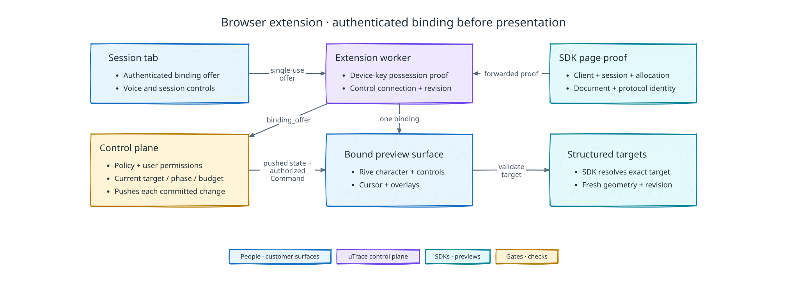

# Browser extension

[Back to uTrace architecture](../ARCHITECTURE.md)

The following diagram shows how the extension binds an authenticated session to one preview surface:

## Command boundary

The extension supports the character, controls, observation, cursor, pointing,
highlighting, overlays, and explicit scrolling for visual guidance. Clicking,
typing, submission, and product navigation by the agent are deferred.

## Component boundary

- The initial browser companion is a Manifest V3 Chrome extension. It is a
  required interactive surface during product interviews and never owns
  durable workflow truth.
- The extension service worker owns installation lifecycle, account-linked
  device identity, authenticated tab bindings, the control-plane connection,
  routing, compatibility checks, recovery, and temporary checkpoints.
- A content script owns the extension-rendered character, controls, agent
  cursor, and product overlays in the bound document.
- A narrow main-world bridge connects the content script to the embedded SDK
  and shared browser observation runtime. It owns no user interface, session
  credential, authorization decision, or durable state.
- The popup and settings pages own installation status, account-link status,
  Chrome permission health, protocol compatibility, current connection and
  binding status, global action preferences, device-local orb settings, sign
  out, installation revocation, and troubleshooting. They cannot start an
  interview, bind an arbitrary tab, configure one client, expose transcripts or
  telemetry, or issue product commands.

## Installation, identity, permissions, and packaging

- Installation and setup happen once for the individual uTrace User, not once
  per client or interview. The extension remains inert until an authenticated
  live session supplies a valid binding offer and page proof.
- Setup links the installation to the user's global `utrace_user_id` inside the
  control plane and registers a device public key. The extension retains the
  corresponding non-exportable private key rather than a reusable bearer
  credential. It proves possession to obtain short-lived credentials.
- The control plane maps the authenticated person to the applicable
  client-scoped `client_user_id`; the extension never receives the global
  identity graph. A new browser or reinstall requires account linking again.
  Signing out or revoking an installation blocks new bindings and revokes
  active extension authority. An installation the control plane no longer
  holds as linked, because it was revoked elsewhere or never existed there, is
  refused on the control connection; the extension drops its local record and
  device key and offers account linking again.
- The manifest requests `storage`, `scripting`, `identity`, and `alarms`.
  `alarms` may wake reconnect work for an active session but cannot become a
  permanent background poller.
- `https://*/*` and `http://*/*` are declared as optional host permissions and
  requested together during one-time extension setup. uTrace does not use
  `activeTab` or ask for host access per client, tab, or interview.
- The extension does not request `tabs`, `webNavigation`, `webRequest`,
  `cookies`, `debugger`, `userScripts`, `tabCapture`, or `offscreen`.
  `externally_connectable` is restricted to the uTrace-owned session-tab
  origin.
- The minimum supported Chrome version is 137, the first release that ships
  Ed25519 in WebCrypto. The embedded browser SDK verifies control-plane signed
  envelopes as detached Ed25519 over a base64url JSON payload, so an earlier
  Chrome cannot verify a packaged signing key and fails the activation gate
  instead of continuing with weaker proof. The extension's own device key is
  ECDSA P-256 and it never verifies the page proof it forwards. Normal Chrome
  profiles and ordinary HTTP and HTTPS pages are the supported contexts. Incognito, guest,
  `file://`, `chrome://`, browser-internal, PDF-viewer, and other extension pages
  are unsupported preview contexts.
- Every executable dependency is bundled, including the Rive JavaScript and
  WebAssembly runtime, animation assets, bridge code, and interface code. The
  package loads no remote JavaScript or WebAssembly.
- The extension CSP permits packaged WebAssembly only as required by Rive. It
  does not permit ordinary `unsafe-eval`, inline scripts, or sandbox pages.
  Network connections are restricted to uTrace authentication and control-plane
  HTTPS and WSS origins.
- Control-plane messages are schema-validated data. They cannot carry
  executable code, arbitrary selectors, CSS, or expressions for the extension
  to interpret. Interface styles, fonts, and images are packaged locally.
- Production builds use signed Chrome Web Store distribution. Unpacked builds
  are development-only. Updates cannot expand permissions or data collection
  for unimplemented future features.
- The control plane accepts the current and previous supported major extension
  protocol for new sessions. Older records remain historically decodable but an
  obsolete installation cannot start a session.
- An update during an active session renegotiates compatibility. Compatible
  workers reinject or reconnect current content surfaces and project current
  state. Mixed or incompatible contexts withdraw readiness until a clean
  compatible runtime is established; they never continue with partial control.
- Disablement or removal withdraws readiness and invalidates the active binding.
  Re-enablement requires fresh authentication and handshake. A reinstall gets a
  new installation identity.
- One global uTrace User may have only one active live interview across all
  installations. A second session cannot steal the extension from the active
  session and is rejected as `user_already_in_live_session`.

Before an Interview Session starts, the claimed invitation runs a participant compatibility preflight. It verifies a supported Chrome profile and version, an account-linked compatible extension, required host permission for the expected preview origin, control-plane connectivity (the extension opens its control connection to answer), and compatible protocol support. Setup help may occur before the interview, but interviewing and reward-eligible participation do not begin until this preflight succeeds. An unsupported corporate extension policy, unsupported browser context, denied required permission, or setup deadline expiry closes as `unsupported_participant_environment`, privately explains the requirement, and creates no Case File or earned reward. Passing preflight does not establish preview, SDK, or observation readiness; the active session must still complete the full runtime handshake.

## Session anchor, binding, and handshake

- The uTrace session tab is the mandatory anchor for the live interview. The
  user may focus the preview tab or any other tab while it remains open.
- Closing the session tab, navigating it away, or choosing **Finish later** ends
  the current encounter without canceling the Product Signal. The control plane
  checkpoints evidence and in-flight effects, revokes the document binding,
  stops voice and observation, and pauses new live implementation until the same user
  returns through a newly authenticated session before the fixed case-level deadline. Budgets do not reset. The dashboard return link, bounded private reminders, terminal expiry, and cleanup follow [Failure Recovery](./failure-recovery.md#bounded-return-and-terminal-expiry). Explicit
  **End interview** confirmation is the separate cancellation action and revokes
  every nonterminal descendant in the Product Signal's cancellation scope.
- A reload, network drop, or recoverable browser interruption instead receives
  the bounded reconnection window. Existing side effects and uncertain outcomes
  are recorded rather than treated as rolled back.
- The session tab obtains a single-use, short-lived binding offer scoped to the
  client, user, session, preview runtime allocation, extension installation,
  and protocol version. It delivers the offer only to the official extension
  through externally connectable messaging.
- Every page-proof handshake keeps its own channel to the SDK. The service
  worker probes a bound tab whenever it gains focus, which every scene causes,
  and closes its probe channel afterwards, so a probe never displaces the content
  script's long-lived channel.
- The embedded SDK supplies the signed page proof but does not issue it.
  Telemetry ingestion issues it when the document activates, mints the
  `document_attachment_id` inside it, and the SDK forwards the envelope verbatim.
  Its claims are the client, session, preview environment, runtime allocation,
  origin, document attachment, document nonce, protocol version, and validity
  window; the SDK runtime is not among them, so no runtime identity can be
  asserted as authority. The extension decodes the payload for its own state and
  never treats it as authority. The control plane validates the binding offer, the
  installation proof of possession, and the proof's signature over the exact
  forwarded bytes before issuing an `extension_binding_id`, and the binding adopts
  the attachment identity the proof already carries rather than minting a second
  one.
- A session ID, Chrome tab ID, origin, or SDK presence never establishes trust
  alone. The page proof is the authority for the client and environment, so
  client product teams do not configure domain allowlists.
- Binding credentials are short-lived, rotated, and held only by the service
  worker. They are never exposed to the page's main world.
- One session has one authoritative preview-tab binding, and one tab belongs to
  at most one active session. Chrome `tabId` is a local locator rather than a
  durable product identity.
- After the session tab creates a pending offer, focusing a product or preview
  tab triggers only a lightweight SDK-proof probe. An exact valid proof binds
  and renders automatically. A tab without a matching proof is left untouched:
  no interface, telemetry, commands, or product inspection begin.
- Focusing another valid tab for the same session automatically revokes the old
  binding before transferring authority. A tab belonging to another live
  session cannot take over.
- A same-document SPA transition preserves the document attachment while target
  revisions change. Reload or full navigation preserves selection of the tab but
  requires a new document proof and attachment. The absence of a compatible SDK
  suspends readiness. Old documents and runtimes cannot receive commands for a
  replacement attachment.
- When the session origin advances to a candidate, the session tab obtains a
  fresh offer, which names the candidate's runtime allocation. The extension
  keeps its binding and reloads the bound tab, because the document there belongs
  to the old runtime; the reloaded document's proof names the candidate, and the
  extension rebinds to it. A rebind always names the allocation the session
  origin currently serves.
- Closing the preview tab revokes its readiness and pending commands. Another
  valid same-session tab may bind during the recovery window; otherwise the
  required-readiness failure follows the normal terminal recovery rule.

## Transport and temporary state

- The control plane communicates over one authenticated WebSocket owned by the
  service worker. The service worker communicates with the bound content script
  through a named `runtime.Port`; the content script communicates with the
  main-world bridge through a fresh per-document `MessageChannel`.
- Ports are accepted only when sender tab, frame, document, binding, and nonce
  match. Every boundary uses strict versioned schemas. No control-plane
  credential enters the content script or main world.
- A service-worker WebSocket heartbeat keeps the connection alive only
  while a session needs it. Reconnection resumes from the last acknowledged
  control sequence rather than assuming missed delivery succeeded: frames above
  that point are superseded, not replayed, and the socket re-projects the
  session's current binding, readiness, and character state. Each connection
  names the session the service worker serves when it opens.
- The control plane pushes; it does not wait to be asked. Any control-plane
  process, whether an API request, the worker's voice agent, or an ingestion
  Job, changes a session's binding, readiness, character state, or visual
  commands only by committing durable state. The commit notifies the
  `extension_control` Postgres channel with the session, which wakes the API
  process holding that session's socket. The socket then sends each state frame
  whose revision advanced since it last sent one, routes the pending commands
  recorded for the current binding, and withdraws any routed command the control
  plane canceled. A notification carries no state and grants no authority, and a
  missed one is repaired by the next change or reconnect. The socket's database
  session listens on that channel, so it needs a direct or session-mode pooled
  Postgres connection.
- High-volume product telemetry flows from the shared browser observation
  runtime to telemetry ingestion. It does not traverse the extension WebSocket.
  That socket carries binding, readiness, character state, controls, commands,
  results, cancellation, and recovery messages.
- `chrome.storage.session` holds the minimum short-lived credential and recovery
  checkpoint required across service-worker suspension. Durable extension
  storage holds only installation identity, device-local presentation settings,
  protocol metadata, and a cache of control-plane-owned global preferences. It
  never becomes workflow truth.

## Readiness, foreground state, and recovery

- Extension readiness is a revisioned control-plane record, not a local boolean.
  It requires an account-linked compatible installation, current host
  permission, authenticated control-plane connection, exactly one valid
  binding, current signed document handshake, and connected content surface,
  page bridge, SDK, and shared runtime.
- Active and visible document state is additionally required for cursor,
  overlay and scroll execution. Character and command-state
  revisions must be synchronized.
- The control plane combines extension readiness with embedded SDK, shared
  runtime, mandatory server SDK, and trace-correlation readiness. Only the
  combined revision permits product-specific probing or browser commands.
- An inactive preview tab remains associated with the session. A visual command
  first brings the bound preview tab and its window to the front, because the
  agent gestures while it talks, often while the user looks at the session tab;
  one that still finds the tab inactive fails as `tab_not_active` and is not
  queued for later execution. The voice interview may continue while the session
  tab or an unrelated tab is active, but product-specific probing waits for the
  user to return.
- Legitimate correlated SDK events may continue from a hidden bound document,
  but they carry visibility state so background activity is not mistaken for
  visible user interaction.
- Returning to the preview tab triggers document and readiness revalidation and
  projects the latest character state. Missed cursor scenes and animations are
  not replayed after navigation, pause, or rebind, and the user's own
  interaction supersedes any pending visual command.
- Loss of the extension, control-plane connection, document proof, SDK, or
  shared runtime immediately withdraws observation readiness, blocks browser
  commands and observation-dependent claims, probing, and validation, and
  begins bounded recovery. Authenticated voice conversation may continue about
  already established facts while the path recovers. The character projects the
  reconnecting or failure state; detailed status remains in the session tab.
- Recovery requires a fresh handshake and the latest control-plane state. Old
  scenes are cleared. An interrupted product action without a confirmed result
  becomes `outcome_unknown` and is never retried automatically.
- Recovery has a preconfigured deadline that cannot be extended at runtime. If
  combined readiness does not return, the control plane preserves a resumable
  infrastructure blocker, checkpoints authorized work, and ends or pauses the
  encounter with user-safe messaging. It never reports user cancellation or
  accepts observation-dependent evidence from the incomplete interval.

## Character and controls

- The control plane publishes a monotonically revisioned semantic character
  state: idle, listening, thinking, speaking, acknowledgement, concern, paused,
  reconnecting, or completion. Session tab and extension render the same
  packaged Rive character and ignore older revisions. Neither surface infers
  durable session state from local animation.
- The collapsed extension character has no accompanying status text. Status text
  appears only in the uTrace session tab.
- The character occupies a small circular surface fixed to the viewport. Its
  position and size are device-local and shared across clients. Layout changes,
  scrolling, and SPA transitions do not move it, and it is clamped far enough
  inside the viewport for expanded controls to remain visible.
- Hovering the center circle expands four separate rounded control pills from
  behind it: Return to session above, Mute or Unmute to the left, Pause or Resume
  to the right, and End interview below. Clicking the center performs no action.
- Pressing and dragging the center moves the orb and collapses the four controls
  until release. Control pills invoke their controls rather than starting a
  drag.
- Mute or Unmute sends a control-plane command to the existing voice runtime;
  the extension never captures microphone audio. Pause or Resume requests an
  authoritative session transition. End shows local confirmation and then
  requests control-plane closure. Buttons reflect the returned state revision
  rather than assuming success, and duplicate clicks reuse the pending command.
- Return to session is the only browser-local control. It focuses the existing
  mandatory session tab. If the control-plane connection is unavailable,
  state-changing controls fail explicitly while Return to session continues to
  work.
- Once pause is acknowledged, the extension clears the cursor scene and cancels
  pending visual commands. The orb remains in its paused
  state with Resume, Return to session, and End available.
- The authoritative Pause transition also blocks new live implementation steps;
  already-running operations may only reach a safe checkpoint. A spoken request
  such as “give me a moment” quiets the voice agent without invoking this
  transition and does not by itself pause authorized implementation.
- The shared runtime emits no session-correlated browser telemetry while paused.
  The user may continue using the product, but uTrace neither observes nor acts.
  Resume requires fresh readiness and a new structured browser snapshot. Old
  targets, revisions, commands, and assumptions cannot be reused, and activity
  during the pause is not reconstructed.

## Visual commands and cursor choreography

- Every browser command carries its command ID, client, session, binding,
  document attachment, target ID and revision where applicable, command type,
  typed arguments, authority references, expected lifecycle revision, and
  deadline.
- The process that dispatches a command authorizes and records it; the socket
  holding the bound installation's connection claims it once and routes it. A
  command still unrouted when its binding is replaced or revoked is never
  routed, and its cancellation records the effect as absent.
- The control plane offers and rechecks targets from the bound document's
  registry as ingestion recorded it: the newest baseline snapshot of the
  document's stream with every later `target.registry_change` applied in export
  order. A target that is missing there fails as `unknown_target`, and one at
  another revision fails as `stale_target`.
- The service worker validates and checkpoints the command before routing it to
  the exact content surface. Duplicate command IDs cannot repeat an effect.
  Rebind, pause, replacement, cancellation, or deadline expiry
  invalidates incompatible pending commands.
- Browser-command terminal outcomes are `applied`, `rejected`, `failed`,
  `stale_target`, `canceled`, or `timed_out`. A result records the actual binding,
  document, target revision, completion time, and specific reason. Visual or
  SDK dispatch success is separate from later telemetry about the product's
  observed effect.
- The extension owns browser-command lifecycle and visible choreography. The SDK
  owns structured target resolution. Commands address an exact registered target
  revision, never raw screen coordinates, arbitrary selectors, or JavaScript.
- The voice agent's model places each gesture with an inline mark before the
  words that name its control, and the gesture is dispatched as the word after
  the mark plays; speech never waits for cursor arrival. Cue IDs and ordering
  prevent an older gesture from replacing a newer one.
- Before execution, customer scrolling or a layout change that invalidates the
  target revision cancels the visual command. uTrace never blocks customer input.
- The agent cursor is command-only and hidden between uses: it fades a few
  seconds after its last gesture. It appears just beside its first destination
  and glides along a gentle curve whose duration grows with distance, from 250
  to 600 milliseconds, easing in and out; with reduced motion requested it moves
  without animation. It never follows,
  replaces, or moves the customer's physical pointer. Physical pointer movement
  alone does not cancel a visual scene, and the cursor surface remains
  click-through.
- Visual commands use SDK targets and revisions. Pointing and highlighting do
  not auto-scroll; scrolling into view is a separate explicit command. That
  command scrolls the window by the target's measured geometry and calls no
  scroll method on product DOM, which keeps it inside the observe-only boundary.
  A target held in a product scroll container that the window cannot reach fails
  with `target_not_scrolled_into_view` rather than being reported as shown. Target
  geometry updates through scroll, resize, and layout change. Missing,
  ambiguous, or revision-changed targets fail rather than falling back to a
  guessed element or coordinate.
- A visual scene is atomic and contains one agent cursor plus one or more ordered
  target gestures and retained marks. Every initial target must validate or the
  scene is rejected. The cursor may move, point, circle, trace, label,
  and clear. Comparisons use the same cursor sequentially while earlier marks may
  remain.
- Circles, traces, underlines, and outlines are visibly drawn by the cursor. The
  extension derives their paths from current structured target geometry; the
  model never supplies freehand coordinates. A scene has one lifetime and clears
  as a unit on explicit clear, replacement, expiry, cancellation, or stale
  target. Customer interaction with an indicated target does not end the scene
  early. A mark that is not retained fades a few seconds after it is drawn, and
  the agent's conversational gestures never retain marks, so they accompany what
  it says rather than accumulate. A newer scene stops any older animation.

## Rendering and target boundaries

- One extension-owned host element exists in the bound top document. It is
  appended to the document element as a fixed, full-viewport layer with reset
  inherited styles and the maximum stacking order, and a closed Shadow DOM
  isolates product and extension styles. Character, cursor, and scene layers are
  separate; only the orb and controls accept pointer input.
- The main-world bridge cannot access the interface tree. If the product removes
  the host once, the extension reinjects it cleanly; repeated removal withdraws
  readiness rather than fighting the page indefinitely.
- The interface uses packaged vector, SVG, and Rive assets and renders above
  ordinary product modals without altering product CSS or stacking contexts.
  Because the surface is an ordinary stacked element, product content that the
  browser promotes to its own top layer still paints above it.
- There is one top-level visual surface even when a target belongs to a frame.
  The shared runtime resolves targets to clipped top-level viewport geometry and
  records the owning document, frame, SDK runtime, and target revision.
- Portal targets resolve to their actual DOM. Open or closed shadow-root internals
  are targetable only when the client component registers them through the SDK;
  the extension never pierces an unregistered closed shadow root.
- Same-origin and cross-origin iframe internals require a compatible
  authenticated SDK runtime inside the owning frame. The top-level extension
  routes a visual command to that frame's SDK and never uses translated raw
  coordinates. Uninstrumented frames are unsupported targets.
- A visual command requires a sufficiently visible target region in the active
  viewport. Offscreen targets require an explicit scroll command.
  The extension's own surface is excluded from product-target occlusion checks.
- Visibility, target revision, binding, policy, permission, and user-conflict
  state are checked again immediately before a visual command. Failure prevents
  dispatch and returns a specific result such as `target_obscured` or
  `stale_target`.

## Retention, diagnostics, and cleanup

- The extension may process target geometry, command arguments, character state,
  and visual-command values transiently when required. It never persists raw DOM, page
  text, form values, transcripts, screenshots, product telemetry, or
  visual-command values.
- Extension diagnostics contain identifiers, revisions, timestamps, command
  status, protocol version, and specific failure codes without customer content.
  SDK and shared-runtime telemetry own product-data redaction before ingestion.
- Terminal session state immediately revokes tab binding and command authority and
  cancels pending visual and scroll commands, whichever surface ended the
  session. The revocation is pushed to the extension, which detaches its surface.
  A brief completion animation may finish without authority to execute anything.
- Cleanup removes the orb, cursor, overlays, content connection, page bridge,
  binding credential, and temporary recovery state. The SDK remains embedded but
  returns to an inert unbound state. Reloading the product afterward cannot
  restore a revoked binding.
- Cleanup retains the installation identity, global user preferences,
  device-local orb position and size, and supported protocol metadata. It does
  not retain session content or workflow state.
