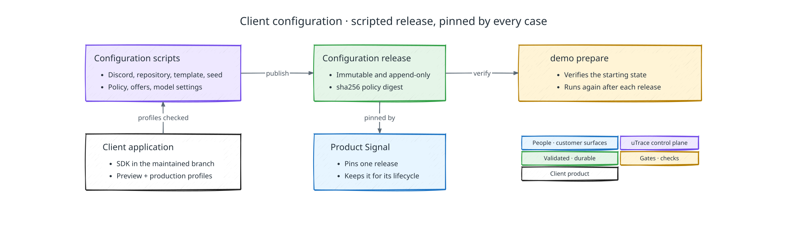

# Client configuration

[Back to uTrace architecture](../ARCHITECTURE.md)

The following diagram shows how the demo's scripted configuration becomes the release every Product Signal pins:

## Configuration ownership

uTrace configures the demo's client with scripts rather than a self-service flow.
A client has exactly one owner and zero or more admins. They can stop a case and,
for the owner, authorize the Outreach Offers budget; they cannot edit runtime state
or approve individual actions. A product may use several services, but each
implementation stays within one authorized repository.

## Immutable configuration releases

Publishing a configuration atomically creates an immutable
`ClientConfigurationRelease`. Every Product Signal pins one release for its
lifecycle, and later configuration governs new signals only. Offboarding,
credential revocation, and platform security prohibitions are immediate deny-only
overrides.

A release has no lifecycle state of its own, because it never changes state.
Releases are append-only, enforced in the database rather than by convention: a
client's releases are numbered, the highest number is the active one, and nothing
is retired, superseded in place, or deleted. A Product Signal pins a release by
its identity, so the pinned contract survives any number of later releases.

Each release carries a `sha256:` digest over the canonical serialization of its
policy. Equal digests mean equal policy, which is what lets publication recognize
a re-publish as a no-op and lets a dashboard or an SDK compare what it holds
against what the case pinned. The digest is an identity for comparison, not a
second copy of the policy.

The release manifest pins typed versions and digests for the B2B account model;
Discord installation and watched channels; repository and branch scope; GitHub
grant; browser SDK, Server SDK, observation schemas and redaction; the seed
manifest; Vercel Sandbox preview and implementation templates; preview build and
front-door contracts; Autonomy Policy; model, prompt, tool and Jev schemas; Product
Overview sources; Outreach Offers policy, issuance limit, and customer mapping; and
operational telemetry.

The client compatibility contract explicitly declares repository, environment,
startup, health, and seeding requirements. uTrace does not infer an arbitrary
application stack or invent startup and health behavior from repository contents.

Model configuration pins the GPT-6.1 Sol and voice provider settings described in the
[model access contract](./deployment.md#model-access). These are uTrace platform
integrations, not provider accounts that the originating user must supply.

## SDK source integration

The client adds browser/server SDK dependencies, preview entry points, product
annotations, and build/startup configuration through its normal code-review process
and merges them into its maintained application branch, usually `main`. This is
client-owned setup, not a product Implementation Attempt. A permanent divergent
uTrace branch is not part of the configuration.

The same source revision supports distinct production and preview profiles:

- The preview profile loads the browser bootstrap before application hydration
  and the server runtime before backend modules, then requires authenticated
  preview activation.
- The production profile excludes active uTrace runtime code and startup hooks.
  Retained annotation helpers are inert and must not affect business behavior.

Preparing the configuration checks both profiles: complete correlated observation
in a prepared preview, and no active uTrace runtime, hooks, connections, or exports
in a production build and startup smoke check. Dependency installation alone never
activates collection. The [browser SDK](./browser-sdk.md#package-and-bootstrap-boundary)
and [server SDK](./server-sdk.md#preview-only-ownership-and-startup) own their
loading contracts.

## Verification by the demo harness

The demo harness's `demo prepare` brings a target control plane to the
[scenario's](../SCENARIO.md#starting-state-and-fixture) starting state and
verifies it before a run. A configuration change publishes a new release and runs
`demo prepare` again; existing Product Signals keep the release they pinned.

Configuration verification covers platform compatibility; it does not
pre-authorize a participant's session. Each encounter must satisfy the
[conversation and observation readiness boundaries](./interview-and-voice.md#readiness-has-two-boundaries),
including a compatible extension and the session-specific binding. Every interview
uses the uTrace session tab for voice and controls and a separate customer product
preview tab.

Long-lived provider credentials live in the control plane's
[credential custody](./deployment.md#secrets-and-credentials); release manifests
contain scoped references only.
