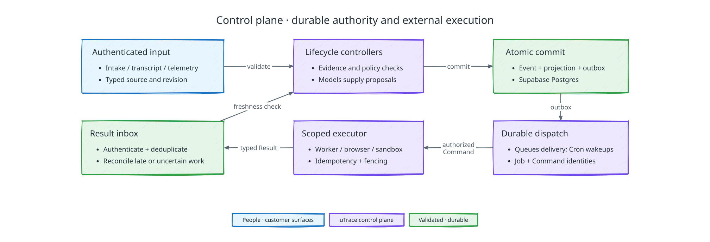

# Control plane internals

[Back to uTrace architecture](../ARCHITECTURE.md)

The control plane commits state before it dispatches external work:

Diagram key

## Control-plane responsibility

Within the [demo scope](../PRD.md#product-scope), the control plane owns durable
authority, revisions, dispatch, reconciliation, and lifecycle transitions. An
eligible Product Signal owns at most one Case File and at most one draft PR.

## Runtime shape and modules

The control plane is a modular application whose one transaction authority is
Supabase Postgres. Its API and worker run on Supabase Compute and its voice agent
on Pipecat Cloud, each scaling per the
[deployment contract](./deployment.md#scaling-and-availability). Supabase Queues
and Cron wake durable work. Supabase Realtime distributes notifications and
projection changes but never owns state, media delivery, command proof, or
authorization.

The API and workers share the
[implementation stack](../ARCHITECTURE.md#implementation-stack): FastAPI handles
request validation and HTTP routing, and shared modules own lifecycle and policy
logic. Durable Jobs run in the separate worker process, and each call's voice
agent Job in its Pipecat Cloud session, under the
[dispatch and lease contracts](#jobs-commands-and-scheduling), never as FastAPI
in-process background tasks.

Modules own identity and membership, policy, intake, Product Signals, outreach and
sessions, implementation and leases, preview and validation, Case Files and
delivery, Outreach Offers and invoice credits, context, evidence, execution,
connectors, and authenticated APIs. Other modules may submit typed facts or
intents but never mutate the owner's projection.

Connectors adapt Discord, OpenAI (GPT-6.1 Sol), Daily, Pipecat Cloud and the voice
agent's providers (Deepgram and ElevenLabs), Jev (through Vercel AI Gateway), Vercel
(web, front door, and Sandbox), GitHub, Stripe, and Supabase services to
provider-neutral contracts, keeping credentials in server-side
[credential custody](./deployment.md#secrets-and-credentials).

## Authority and transactions

Product Signal, Interview Session, Implementation Attempt, Preview Version,
Validation Attempt, Case File, and delivery are independent lifecycles, each with
one controller and explicit transition guards. Only an accepted, authenticated,
typed Result advances product state; a provider acknowledgement, Realtime
notification, transcript fragment, or model claim never does.

Every stream has a monotonic revision. Transactions lock affected rows in
deterministic order and compare expected revisions, so only one conflicting
transition wins.

### No operator authority

There is no operator identity, runtime state editor, human handoff, or per-action
client approval. An owner or admin may invoke the audited, deny-only
[**Stop this case** control](./policy-and-permissions.md#client-case-stop); the
normal controller applies its revocation and reconciliation rules, and the staff
member cannot choose a replacement state. Engineering may repair and redeploy
infrastructure outside product authority; the normal controllers then resume from
durable facts only while the case-level return-and-closure deadline is open.

## Cognitive roles and context

The [cognitive roles](../ARCHITECTURE.md#system) return advisory results; the
control plane owns evidence admission, readiness, policy, gate acceptance,
lifecycle transitions, and effects. Jev neither preapproves speech serially nor
needs another model's routine approval.

Model calls follow the [model access contract](./deployment.md#model-access).
The control plane authorizes [call setup](./interview-and-voice.md#call-setup)
and binds the call's Daily room to the current voice run. No provider runs a
second lifecycle controller or authorizes application tools: the voice agent's
tools run in its session under the control plane's guards, and the Codex harness
runs only in a workspace sandbox the control plane fences.

[Context Assembly](./context-assembly.md) owns revisioned role-specific bundles,
source selection, and freshness; the control plane supplies current lifecycle and
policy revisions and rejects results with invalidated dependencies.

## Product lifecycles

The durable product lifecycles are distinct: `IntakeItem`, `ProductSignal`,
`OutreachAttempt`, `InterviewSession`, `PreviewRuntimeAllocation`,
`EnvironmentLease`, `ImplementationAttempt`, `PreviewVersion`,
`ValidationAttempt`, `CaseFile`, and delivery
([how they relate](./data-and-schema.md#lifecycle-records)).
`ImplementationGateDecision` and evidence windows are immutable records. `Job`,
`JobRun`, and `Command` are execution lifecycles, never product outcomes.

Every lifecycle pins a machine version, a Product Signal its client configuration
release, and every separately approved revision its gate decision,
interview-established classification revision, and acceptance criteria.
Running work never migrates silently. Deny-only offboarding, credential
revocation, deletion, or platform security events may remove authority.

### Intake Item

An Intake Item moves `received` → `routing` → `routed`, recovers through
`routing_blocked` → `routing`, and is canceled only when authorized before
commitment. The [routing contract](./signal-and-outreach.md#routing-contract) owns
what routing commits.

### Product Signal

The [Product Signal lifecycle diagram](../ARCHITECTURE.md#authority-and-lifecycle)
owns the states; all three `closed_*` states require Case File publication.

`closed_blocked` is reachable from every nonterminal state through terminal
expiry, an unrecoverable blocker, or a client stop after participation, and from
`validating` through unsuccessful validation. Its guard, not the source state,
constrains it: closing as blocked requires recorded participation or an
already-published Case File, so declaring the state is never enough.

The [output contract](./client-outputs.md#variants-and-evidence-threshold) maps
terminal outcomes to Case Files or separate cancellation or escalation records. A
resumable blocker is not a closed outcome.

### Interview Session

The [voice contract](./interview-and-voice.md) owns session states and the two
readiness boundaries. At most one active encounter exists per authenticated
participant; a return after departure creates a later bound encounter without
resetting the Product Signal's budgets.

Session transitions propagate through the
[implementation interruption contract](./implementation.md#conversation-pause-and-interruption)
once the controller distinguishes lost transport, explicit Pause, departure, client
case stop, and participant cancellation.
Finish-later, departure, expired reconnection, and recoverable blockers share the
fixed [case-level return-and-closure deadline](./failure-recovery.md#bounded-return-and-terminal-expiry).

### Outreach Offers entitlement and issuance

The [Outreach Offers controller](./outreach-offers.md) owns offer reservations,
participation entitlement, and credit issuance records. Case transitions emit an
idempotent eligibility evaluation with their evidence. Credit issuance may continue
after case closure but cannot reopen the case or authorize further implementation.

### Preview Runtime Allocation and Environment Lease

A [Preview Runtime Allocation](./preview-runtime-and-seeding.md) binds a full
product environment to a base interview or exact candidate, grants no
code-writing authority, and stays separate from the implementation workspace.

Only an active attempt-scoped Environment Lease grants workspace mutation, and it
[fences the workspace sandbox](./implementation.md#enforcement-model). Accidental
lease loss pauses and verifies the same attempt; deliberate revocation does not
reacquire.

### Implementation Attempt and Preview Version

An attempt progresses through authorized, queued, environment acquisition,
executing and checking, and candidate publication to `candidate_ready`. The
[implementation contract](./implementation.md#outcomes-and-budget-exhaustion) owns
its other outcomes, and the [attempt protocol](./implementation.md#attempt-protocol)
its creation. A Product Signal holds at most one attempt in flight and at most its
pinned `implementation_limit` in all, one per approving gate decision.

Each candidate Preview Version binds one attempt and an exact source and build
artifact, needs the complete observation path to be ready, and cannot be replaced
while a Validation Attempt references it.

### Validation Attempt

The [validation controller](./validation.md) owns exact-candidate binding,
criterion evidence, and outcomes. The control plane accepts its frozen result
before authorizing delivery or closure.

### Case File and delivery

Case File assembly, verification, delivery, sealing, and publication are durable
stages; the [output contract](./client-outputs.md#case-file-identity-and-assembly)
owns their order and immutable digest. Unknown GitHub effects enter reconciliation.

## Jobs, Commands, and scheduling

A Job is one durable responsibility; a Job Run is one leased execution. Each Job
freezes its input, deadline, run and resource budget, timeout, lease, backoff,
retry classes, concurrency key, and cancellation scope. The scheduler decides only
whether another run is legal; the owning controller decides product consequences.

One Job Run ends in an accepted Result or a recorded failure:

A Command moves `created` → `queued` → `dispatching` →
`dispatched`/`acknowledged` → `reconciling` → one terminal Result. Cancellation
cannot pretend to reverse a completed external effect. Each failed run logs and
audits its category, code, message, and, for a refused guard, the guard's machine,
trigger, and reason.

A worker with nothing to claim waits one poll interval but wakes when one of its
own running Jobs finishes, which has usually committed its chain's next step, and
when any process commits a ready Job, which notifies the `utrace_jobs_ready`
channel in the committing transaction.
Inbox deduplication, revisions, concurrency keys, and fencing make repeated
delivery safe.

## Recovery, cancellation, and cleanup

No in-memory state is authoritative. Restart and resumption follow the
[recovery contract](./failure-recovery.md), which owns reconciliation, workspace
integrity checks, and exact-candidate reconstruction.

Every Product Signal owns a product-work cancellation scope. Cancellation
atomically prevents new product descendants, cancels queued product work, revokes
leases, and reconciles dispatched Commands. Credit reservations and earned
obligations follow the
[Outreach Offers contract](./outreach-offers.md#completion-and-entitlement). Late
Results remain history but cannot reopen the lifecycle.

[Repaired infrastructure blockers](./failure-recovery.md#blockers-and-recovery)
never fabricate product evidence or become user rejection. Required artifacts
become durable before workspaces or runtimes are destroyed. Expiry atomically
commits the
reason-specific terminal outcome, revocation, and durable reconciliation,
offer-evaluation, and cleanup intents; external effects settle afterward, and late
repair cannot reopen work.
