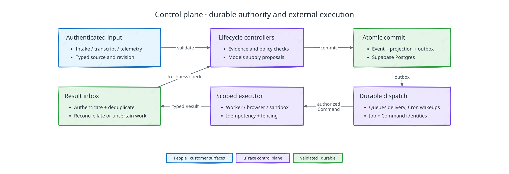

# Control plane internals

[Back to uTrace architecture](../ARCHITECTURE.md)

The following diagram shows how the control plane commits state before it dispatches external work:

## Control-plane responsibility

Within the [demo scope](../PRD.md#product-scope), the control plane owns durable
authority, revisions, dispatch, reconciliation, and lifecycle transitions. An
eligible Product Signal owns at most one Case File and at most one draft PR.

## Runtime shape and modules

The control plane is a modular application with one Supabase Postgres transaction authority. Persistent API, Discord, telemetry, and session-coordinator processes run on Supabase Compute and scale as the [deployment contract](./deployment.md#scaling-and-availability) defines, while Supabase Queues and Cron wake durable work. Supabase Realtime distributes notifications and projection changes but never owns state, media delivery, command proof, or authorization.

The [implementation stack](../ARCHITECTURE.md#implementation-stack) applies to both
the API and workers. FastAPI handles request validation and HTTP routing; shared
application modules own lifecycle and policy logic. Durable Jobs execute in
separate worker processes using the committed dispatch and lease contracts below,
not FastAPI in-process background tasks.

Modules own identity and membership, policy, intake, Product Signals, outreach and sessions, implementation and leases, preview and validation, Case Files and delivery, Outreach Offers and invoice credits, context, evidence, execution, connectors, and authenticated APIs. Another module may submit a typed fact or intent; it may not mutate the owner's projection.

Connectors adapt Discord, OpenAI (GPT-Live and GPT-6.1 Sol), Jev (through Vercel AI Gateway), Vercel (web, front door, and Sandbox), GitHub, Stripe, Supabase services, and OpenTelemetry to provider-neutral contracts. Credentials remain in the server-side [credential custody](./deployment.md#secrets-and-credentials) the deployment contract defines.

## Authority and transactions

Product Signal, Interview Session, Implementation Attempt, Preview Version, Validation Attempt, Case File, and delivery are independent lifecycles. Each has one controller and explicit transition guards. One Postgres transaction appends accepted Events, advances projections, and creates Jobs or Commands. External work begins only after commit. A provider acknowledgement, Realtime notification, transcript fragment, or model claim never advances product state; an authenticated typed Result must be accepted.

Every stream has a monotonic revision. Transactions lock affected rows in deterministic order and compare expected revisions. Only one conflicting transition wins. External work is saga-like: the system persists intent, executes after commit, reconciles uncertainty, and applies the Result in another transaction.

There is no operator identity, runtime state editor, human handoff, or per-action client approval. An owner or admin may invoke the audited, deny-only [**Stop this case** control](./policy-and-permissions.md#client-case-stop); the normal controller applies its revocation and reconciliation rules, and the staff member cannot choose a replacement state. Engineering can repair and redeploy infrastructure outside product authority, then the normal controllers resume from durable facts while the case-level recovery deadline remains open.

## Cognitive roles and context

The [system overview](../ARCHITECTURE.md#system) defines the cognitive roles.
Their results are advisory: the control plane owns evidence admission, readiness,
policy, gate acceptance, lifecycle transitions, and effects. Jev does not
preapprove speech serially or require another model's routine approval.

Model calls follow the [model access contract](./deployment.md#model-access).
The control plane authorizes the [GPT-Live handshake](./interview-and-voice.md#webrtc-session-setup)
and binds its provider session to the current voice run. No provider runs a second
lifecycle controller or authorizes application tools, and the Codex harness runs
only inside a workspace sandbox the control plane fences.

[Context Assembly](./context-assembly.md) owns revisioned role-specific bundles,
source selection, and freshness. The control plane supplies current lifecycle and
policy revisions and rejects results whose dependencies are no longer valid.

## Product lifecycles

The durable product lifecycles remain distinct: `IntakeItem`, `ProductSignal`, `OutreachAttempt`, `InterviewSession`, `PreviewRuntimeAllocation`, `EnvironmentLease`, `ImplementationAttempt`, `PreviewVersion`, `ValidationAttempt`, `CaseFile`, and delivery. `ImplementationGateDecision` and evidence windows are immutable records. `Job`, `JobRun`, and `Command` are execution lifecycles, never product outcomes.

Every lifecycle pins a machine version. A Product Signal pins its client-policy release. Every separately approved revision pins its gate decision, interview-established classification revision, and acceptance criteria. Running work never migrates silently. Deny-only offboarding, credential revocation, deletion, or platform security events may remove authority.

### Intake Item

`received -> routing -> routed`, with `routing_blocked -> routing` recovery and cancellation only when authorized before commitment. Routing commits noise or one Feature Request Flow Product Signal; a batch it cannot route, including one with an unsupported flow, stays in `routing_blocked`. Routing is serialized per client.

### Product Signal

The [Product Signal lifecycle diagram](../ARCHITECTURE.md#authority-and-lifecycle) owns the states and their transitions. Case File publication is required for the three `closed_*` states.

`closed_blocked` is reachable from every nonterminal state, not only from the
late ones. Terminal expiry, an unrecoverable blocker, and a client stop after
participation all close the same way, and unsuccessful validation adds a route
out of `validating`. What constrains the closure is its guard rather than its
source: closing as blocked requires either recorded participation or an
already-published Case File, so the state cannot be reached by simply declaring
it.

The [output contract](./client-outputs.md#variants-and-evidence-threshold) maps
terminal outcomes to Case Files or separate cancellation/escalation records. A
resumable blocker is not a closed outcome.

### Interview Session

The [voice contract](./interview-and-voice.md) owns session states and its two
readiness boundaries. At most one active encounter exists per authenticated
participant. A return after departure creates a later bound encounter without
resetting the Product Signal's budgets.

Session transitions propagate through the
[implementation interruption contract](./implementation.md#conversation-pause-and-interruption).
The controller distinguishes lost transport, explicit Pause, departure, client
case stop, and participant cancellation before changing descendant authority.
Finish-later, departure, expired reconnection, and recoverable blockers share the
fixed [case-level return-and-closure deadline](./failure-recovery.md#bounded-return-and-terminal-expiry).

### Outreach Offers entitlement and issuance

The [Outreach Offers controller](./outreach-offers.md) owns offer reservations,
participation entitlement, and credit issuance records. Case transitions emit an
idempotent eligibility evaluation with their evidence; a closed state alone does
not prove the reward was earned. Credit issuance can continue after case
closure and cannot reopen the case or authorize further implementation.

### Preview Runtime Allocation and Environment Lease

A [Preview Runtime Allocation](./preview-runtime-and-seeding.md) binds a full
product environment to a base interview or exact candidate. It grants no
code-writing authority and remains separate from the implementation workspace.

Only an active attempt-scoped Environment Lease grants workspace mutation. The lease fences the workspace sandbox: the control plane stops a superseded attempt's sandbox and accepts artifacts only under the current lease. Accidental lease loss pauses and verifies the same attempt; deliberate revocation does not reacquire.

### Implementation Attempt and Preview Version

An attempt progresses through authorized, queued, environment acquisition, executing/checking, candidate publication, and `candidate_ready`; it may instead pause, become infrastructure-blocked, require a scope change, exhaust budget, or be canceled. A Product Signal holds at most one attempt in flight and at most its pinned `implementation_limit` in all, one per approving gate decision, and creation follows the [attempt protocol](./implementation.md#attempt-protocol).

The gate approves live work or records no implementation. Each candidate Preview Version binds one attempt and exact source/build artifact; readiness requires the complete observation path. A referenced candidate cannot be replaced during a Validation Attempt.

### Validation Attempt

The [validation controller](./validation.md) owns exact-candidate binding,
criterion evidence, and outcomes. It returns a frozen result; the control plane
accepts that result before authorizing delivery or closure.

### Case File and delivery

Case File assembly, verification, delivery, sealing, and publication are durable
stages. The [output contract](./client-outputs.md#case-file-identity-and-assembly)
owns their order and immutable digest. Unknown GitHub effects enter reconciliation.

## Jobs, Commands, and scheduling

A Job is one durable responsibility and a Job Run is one leased execution. Each Job freezes its input, deadline, run and resource budget, timeout, lease, backoff, retry classes, concurrency key, and cancellation scope. The scheduler decides only whether another run is legal; the owning controller decides product consequences.

A Command moves through created, queued, dispatching, dispatched/acknowledged, reconciling, and one terminal Result. Its command ID is the provider idempotency key. Cancellation cannot pretend to reverse a completed external effect.

When a failed run leaves a Job with no legal run, the owning controller commits
the product consequence in the same transaction that records the failure, so a
failure is never recorded without it. Each failed run logs and audits its
category, code, message, and, for a refused guard, the guard's machine, trigger,
and reason.

Workers claim durable rows with transactional leases. A worker that finds nothing to claim waits one poll interval, but wakes as soon as one of its own running Jobs finishes, because a finished Job has usually committed the next step of its chain. Queue delivery is at least once; inbox deduplication, revisions, concurrency keys, and fencing make repeats safe. Realtime may wake a client but cannot substitute for the committed projection.

## Recovery, cancellation, and cleanup

No in-memory state is authoritative. Restart and resumption follow the
[recovery contract](./failure-recovery.md), which owns reconciliation, workspace
integrity checks, and exact-candidate reconstruction.

Every Product Signal owns a product-work cancellation scope. Cancellation atomically prevents new product descendants, cancels queued product work, revokes leases, and reconciles dispatched Commands. Credit reservations and earned obligations follow the separate [Outreach Offers contract](./outreach-offers.md#completion-and-entitlement). Late Results remain history but cannot reopen the lifecycle.

Infrastructure blockers remain resumable after repair only before the case-level return-and-closure deadline. They never fabricate product evidence or become user rejection. Automatic remediation is limited to idempotent, evidence-preserving legal transitions. Required artifacts become durable before workspaces or runtimes are destroyed. Expiry atomically commits the reason-specific terminal outcome, revocation, and durable reconciliation, offer-evaluation, and cleanup intents. External effects settle afterward; late repair cannot reopen work.
