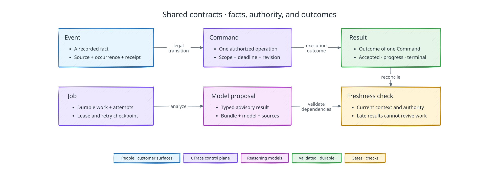

# Cross-component contracts

[Back to uTrace architecture](../ARCHITECTURE.md)

The following diagram shows the shared message and freshness contracts:

## Shared-contract responsibility

Within the [demo scope](../PRD.md#product-scope), these contracts own identity,
message, ordering, evidence, compatibility, and failure semantics across components.

## Identity and relationship rules

Every first-class entity has its own opaque UUIDv7. Knowledge of an ID grants no authority. Provider IDs remain scoped strings and W3C trace identity describes technical execution, never product identity or permission.

Supabase Auth identities and explicit client membership rows are separate. A client has exactly one owner and zero or more admins. Customer participants never inherit client-staff access. Customer accounts are B2B organizations. Each participant has a client-scoped user identity and customer membership. The first reporter whose concern creates a Product Signal is its immutable originating user and sole interview and validation participant.

Each Intake Item, Product Signal, Outreach Attempt, Interview Session, Preview Runtime Allocation, Environment Lease, Implementation Attempt, Preview Version, Validation Attempt, Case File, delivery, Job, Job Run, and Command has a distinct identity. Relationships are explicit; a generic correlation ID never substitutes for them.

A Product Signal is one independently gateable and validatable product outcome. It never shares its originating user, gate decisions, attempts, leases, candidates, validation outcomes, Case File core, or delivery authority with another Product Signal.

Every Validation Attempt binds one originating user, Product Signal, Implementation Attempt, exact Preview Version, prepared dataset manifest, workflow, acceptance-criteria revision, and Interview Session. Every delivered PR binds to the exact validated commit manifest.

Credit budgets, offers, reservations, entitlements, and issuance operations
have distinct identities linked to the client, Product Signal, customer account,
and scoped Stripe references. The [Outreach Offers contract](./outreach-offers.md)
owns their uniqueness and accounting constraints. Session replacement never
creates a second entitlement for an existing offer.

## Domain messages

Internal domain communication uses exactly three families:

- **Event:** an immutable past-tense fact.
- **Command:** one immutable, single-purpose request with `command_id` as its idempotency boundary.
- **Result:** accepted, progress, or one canonical terminal outcome for a Command.

Provider outcomes enter as Results the adapter that caused them reads back; uTrace takes no inbound provider webhooks. Media, OpenTelemetry, and bulk telemetry keep their native transport; only control-relevant facts enter domain messaging. Read-only queries cannot change state or confer later authority.

The common envelope carries `message_id`, versions, producer, optional actor, client scope, typed domain IDs, authority references, causation, timestamps, optional trace context, primary lifecycle stream, expected revision, payload, and digest. Optional values are omitted unless `null` has defined meaning. Every producer and consumer runtime-validates the envelope and payload.

Actors include customer participant, client member, uTrace agent role, provider identity, service, and system. Model roles never impersonate a person whose evidence informed their proposal.

## Ordering, idempotency, and replay

Delivery is at least once. Events and Results deduplicate by message ID; Commands deduplicate by command ID. The control plane assigns a monotonic sequence within one primary lifecycle stream after acceptance. Producer timestamps and Supabase Realtime arrival order never decide workflow order.

State-sensitive Commands declare lifecycle, policy, permission, target, candidate, and lease revisions. A mismatch rejects before side effects. Targets replay the canonical terminal Result for a repeated Command. An uncertain dispatched effect enters reconciliation by stable provider identity rather than blind repetition.

Historical replay preserves IDs, versions, causation, timestamps, and sequence. It may rebuild projections or evaluation inputs, but cannot resend outreach, run code, publish a candidate, create a PR, or issue invoice credits.

## Conversation and cognitive results

Voice transcript fragments are provisional transport artifacts. An application evidence claim has an explicit identity and revision and cites its source fragment span; Flux's end of turn bounds a fragment but does not establish what the user meant. The record also distinguishes what the user said from what uTrace can prove it delivered or the user heard. Corrections append superseding facts and invalidate downstream claims whose cited premises no longer hold.

Voice agent tool calls, GPT-6.1 Sol gate proposal, Codex coding agent, intake assistance, and Case File drafting, and Jev intake decisions and semantic attention all return typed advisory Results with context and dependency revisions. Jev returns bounded semantic judgments under the [decision contract](#jev-decision-contract); it is not a serial speech gate. The control plane rejects stale results and alone authorizes effects. Advisory means the application commits and enforces the decision; it does not require another model to approve Jev's result.

Orchestration supplies each role with a revisioned view of active conversation, critical facts, corrections, telemetry, implementation state, criteria, and open contradictions. Product Overview references carry the overview version and each section's content digest. Code references must identify exact files and revisions read inside Vercel Sandbox.

OpenAI response references and Daily room references are scoped to the pinned
[model configuration](./deployment.md#model-access) and the current voice
connection, not just a model label or opaque provider ID. Browser-supplied voice
events cannot authorize backend tools or replace the voice agent's own record.

## Jev decision contract

Jev evaluates focused semantic questions over supplied facts and alternatives.
Use [Noul](https://docs.typesafe.ai/primitives/noul) for a yes/no probability,
[Choice](https://docs.typesafe.ai/primitives/choice) for supplied alternatives,
and [Score](https://docs.typesafe.ai/primitives/score) for one dimension with
concrete descriptive levels. Include an unknown or no-match alternative where
appropriate. Select source references and targets from supplied IDs; use the
owning workflow's reasoning model when new prose, query formulation, or deeper
interpretation is required.

Batch independent questions sharing relevant context. Answers in one request do
not consume each other; a dependent question requires another request with its
premises supplied. Code resolves logical combinations and exact facts: counts,
dates, budgets, identity, permissions, citation presence, and target freshness.
Do not interpolate scores into exact amounts or assume probabilities from
separate questions obey complementary or independence relationships.

Python checks answer types, supplied-reference membership, required evidence,
context revisions, question-specific thresholds, and explicitly defined
consistency rules. Missing information, an uncertain distribution, or conflicting
answers prevents acceptance; code chooses scoped retrieval or conditional
reasoning under the owning workflow. A reasoning model does not run to decide
whether it should be called. Valid structure and references do not prove semantic accuracy.

Choice/Score confidence measures distribution concentration, not guaranteed
correctness; Noul has no separate confidence field. Pin the model ID, question
definitions, criteria, and thresholds together, retain returned probabilities and
evidence references, and evaluate each decision separately. Do not transfer
thresholds between question types. Vercel AI Gateway serves Jev only under the
unversioned ID `typesafe-ai/jev` and reports no Jev version, so a new Jev release
can change answers behind an unchanged model ID. See
[confidence](https://docs.typesafe.ai/confidence) and the
[Jev 1.13 limitations](https://docs.typesafe.ai/model-jaggedness/jev-1.13).

## Versioning and compatibility

Envelopes and payloads have independent positive major versions. Additive optional fields may remain compatible; removed, renamed, newly required, or semantically changed fields require a new major. A versioned contract package owns JSON Schema definitions, Python and TypeScript bindings, validators, compatibility manifests, and canonical fixtures.

Client-installed extension and SDK components advertise contract versions and capabilities during authenticated readiness. Missing required compatibility fails readiness. There is no lower-fidelity substitution.

## Failure contract

Four vocabularies describe one failure, and none substitutes for another: the
Command's terminal disposition, the certainty of its side effect, the technical
category of the cause, and the retry advice. All four are closed sets owned by the
contract package for both languages: disposition is `succeeded`, `rejected`,
`failed`, `canceled`, or `expired`; effect state is `absent`, `partial`,
`completed`, or `indeterminate`; retry advice is `never`, `after_delay`, or
`after_condition_change`; and the technical category is one of
`authentication`, `authorization`, `policy_denied`, `validation`,
`incompatible_version`, `not_found`, `conflict`, `integrity`, `timeout`,
`rate_limited`, `payload_too_large`, `provider_unavailable`, `provider_rejected`,
`budget_exhausted`, `capacity_exhausted`, `readiness_incomplete`,
`configuration`, or `internal`. A
connector maps its provider's raw errors into them instead of keeping a private
taxonomy.

The categories deliberately admit no transport or contract-violation member: an
unreachable or unresponsive provider is provider unavailability, and a malformed
or contract-breaking payload is a validation failure. A provider message that
merely mentions a network problem is retry-classifier input, not a category.

The component detecting a failure reports it accurately with redacted actionable detail. The control plane decides lifecycle consequences. Provider adapters retry only when idempotency, reconciliation, or proof of no side effect makes it safe. An unknown mapping fails closed.

Product outcomes such as no implementation, terminal unvalidated completion, and cancellation remain distinct from infrastructure failures.

## Artifact references

Large evidence uses opaque immutable references containing artifact ID, type and schema version, media type, SHA-256 digest, size, creation time, client scope, and retention classification. References contain no storage path, permanent public URL, or credential. Resolution rechecks tenant and object linkage; missing, expired, redacted, or deleted artifacts fail explicitly.
