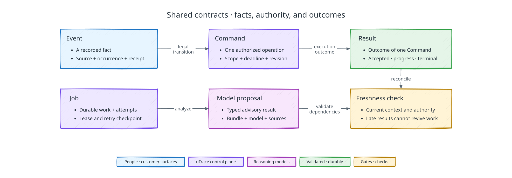

# Cross-component contracts

[Back to uTrace architecture](../ARCHITECTURE.md)

Each message family carries distinct authority and ordering:

## Shared-contract responsibility

Within the [demo scope](../PRD.md#demo-scope), these contracts own
cross-component identity, message, ordering, evidence, compatibility, and failure
semantics.

## Identity and relationship rules

Every first-class entity has an opaque UUIDv7; knowing an ID grants no
authority. Provider IDs remain scoped strings, and W3C trace identity describes
technical execution, never product identity or permission.

The [identity contract](./identity-and-access.md) separates Supabase Auth
identities, client staff membership, and client-scoped customer participation;
customer participants never inherit client-staff access. Each Product Signal has
one immutable
[originating user](./signal-and-outreach.md#originating-user-and-invitation-lifecycle).

Every [product and execution lifecycle](./control-plane.md#product-lifecycles)
record has a distinct identity and explicit
[relationships](./data-and-schema.md#lifecycle-records); a generic correlation ID
never substitutes for them.

A Product Signal is one independently gateable and validatable product outcome and
never shares its originating user, gate decisions, attempts, leases, candidates,
validation outcomes, Case File core, or delivery authority with another. Every
Validation Attempt binds the exact tuple in the
[validation binding](./validation.md#validation-binding), and every delivered PR
the exact validated commit manifest.

Credit budgets, offers, reservations, entitlements, and issuance operations have
distinct identities linked to the client, Product Signal, customer account, and
scoped Stripe references; the [Outreach Offers contract](./outreach-offers.md)
owns their uniqueness and accounting constraints. Session replacement never
creates a second entitlement for an existing offer.

## Domain messages

Internal domain communication uses exactly three families:

- **Event:** an immutable past-tense fact.
- **Command:** one immutable, single-purpose request with `command_id` as its
  idempotency boundary.
- **Result:** accepted, progress, or one canonical terminal outcome for a Command.

Provider outcomes enter as Results their causing adapter reads back; uTrace takes
no inbound provider webhooks. Media, OpenTelemetry, and bulk telemetry keep their
native transport; only control-relevant facts enter domain messaging. Read-only
queries cannot change state or confer later authority.

The common envelope carries `message_id`, versions, producer, optional actor,
client scope, typed domain IDs, authority references, causation, timestamps,
optional trace context, primary lifecycle stream, expected revision, payload, and
digest. Optional values are omitted unless `null` has defined meaning. Every
producer and consumer runtime-validates the envelope and payload.

Actors include customer participant, client member, uTrace agent role, provider
identity, service, and system. Model roles never impersonate a person whose
evidence informed their proposal.

## Ordering, idempotency, and replay

Delivery is at least once. Events and Results deduplicate by message ID, Commands
by command ID. The control plane sequences each accepted message monotonically
within one primary lifecycle stream; producer timestamps and Supabase Realtime
arrival order never decide workflow order.

State-sensitive Commands declare lifecycle, policy, permission, target,
candidate, and lease revisions; a mismatch rejects before side effects. Targets
replay the canonical terminal Result for a repeated Command. An uncertain
dispatched effect is reconciled by stable provider identity, never blindly
repeated.

Historical replay preserves IDs, versions, causation, timestamps, and sequence. It
may rebuild projections or evaluation inputs but never resends outreach, runs
code, publishes a candidate, creates a PR, or issues invoice credits.

## Conversation and cognitive results

Voice transcript fragments are provisional transport artifacts. Each application
evidence claim has its own identity and revision, and the [transcript and
evidence contract](./interview-and-voice.md#transcript-and-evidence-contract)
owns how claims cite fragment spans and separate said, delivered, and heard
speech. Corrections append superseding facts and invalidate downstream claims
whose cited premises no longer hold.

Every [model role](../ARCHITECTURE.md#system) returns typed advisory Results with
[Context Assembly](./context-assembly.md) context and dependency revisions; the
control plane rejects stale results and alone commits, enforces, and authorizes
their effects. Jev returns bounded semantic judgments under the
[decision contract](#jev-decision-contract); it is neither a serial speech gate nor
subject to another model's approval.

OpenAI response and Daily room references are scoped to the pinned
[model configuration](./deployment.md#model-access) and the current voice
connection, never a bare model label or opaque provider ID. Browser-supplied voice
events cannot authorize backend tools or replace the voice agent's own record.

## Jev decision contract

Jev evaluates focused semantic questions over supplied facts and alternatives.

### Question types

| Primitive | Use for | Confidence |
| --- | --- | --- |
| [Noul](https://docs.typesafe.ai/primitives/noul) | A yes/no probability | No separate confidence field |
| [Choice](https://docs.typesafe.ai/primitives/choice) | Supplied alternatives | Distribution concentration, not correctness |
| [Score](https://docs.typesafe.ai/primitives/score) | One dimension with concrete descriptive levels | Distribution concentration, not correctness |

Include an unknown or no-match alternative where appropriate; take source
references and targets from supplied IDs. New prose, query formulation, or deeper
interpretation needs the owning workflow's reasoning model.

### Batching and exact facts

Batch independent questions that share relevant context. Answers in one request
do not consume each other, so a dependent question needs another request with its
premises supplied. Code resolves logical combinations and exact facts: counts,
dates, budgets, identity, permissions, citation presence, and target freshness.
Never interpolate scores into exact amounts or assume probabilities from separate
questions are complementary or independent.

### Acceptance checks

Python checks answer types, supplied-reference membership, required evidence,
context revisions, question-specific thresholds, and explicitly defined
consistency rules. Missing information, an uncertain distribution, or conflicting
answers blocks acceptance; code then chooses scoped retrieval or conditional
reasoning under the owning workflow. No reasoning model runs to decide whether it
should be called. Valid structure and references do not prove semantic
accuracy.

### Pinning and evaluation

Pin the model ID, question definitions, criteria, and thresholds together;
retain returned probabilities and evidence references; evaluate each decision
separately; and never transfer thresholds between question types. Vercel AI
Gateway serves Jev only as the unversioned `typesafe-ai/jev` and reports no Jev
version, so a new Jev release can change answers behind an unchanged model ID.
See [confidence](https://docs.typesafe.ai/confidence) and the [Jev 1.13
limitations](https://docs.typesafe.ai/model-jaggedness/jev-1.13).

## Versioning and compatibility

Envelopes and payloads have independent positive major versions. Additive optional
fields may stay compatible; removed, renamed, newly required, or semantically
changed fields need a new major. A versioned contract package owns JSON Schema
definitions, Python and TypeScript bindings, validators, compatibility manifests,
and canonical fixtures.

Client-installed extension and SDK components advertise contract versions and
capabilities during authenticated readiness; missing required compatibility fails
readiness, with no lower-fidelity substitution.

## Failure contract

Four closed vocabularies, owned by the contract package for both languages,
describe one failure; none substitutes for another:

| Vocabulary | Values |
| --- | --- |
| Command disposition | `succeeded`, `rejected`, `failed`, `canceled`, `expired` |
| Side-effect certainty | `absent`, `partial`, `completed`, `indeterminate` |
| Technical category | `authentication`, `authorization`, `policy_denied`, `validation`, `incompatible_version`, `not_found`, `conflict`, `integrity`, `timeout`, `rate_limited`, `payload_too_large`, `provider_unavailable`, `provider_rejected`, `budget_exhausted`, `capacity_exhausted`, `readiness_incomplete`, `configuration`, `internal` |
| Retry advice | `never`, `after_delay`, `after_condition_change` |

A connector maps its provider's raw errors into these sets, never a private
taxonomy. No category covers transport or contract violations: an unreachable or
unresponsive provider is `provider_unavailable`, and a malformed or
contract-breaking payload is `validation`. A provider message merely mentioning a
network problem is retry-classifier input, not a category.

The detecting component reports a failure accurately with redacted actionable
detail; the control plane decides lifecycle consequences. Provider adapters retry
only when idempotency, reconciliation, or proof of no side effect makes it safe,
and an unknown mapping fails closed. Product outcomes such as no implementation,
terminal unvalidated completion, and cancellation are not infrastructure failures.

## Artifact references

Large evidence uses opaque immutable references containing artifact ID, type and
schema version, media type, SHA-256 digest, size, creation time, client scope, and
retention classification, but no storage path, permanent public URL, or
credential. Resolution rechecks tenant and object linkage; missing, expired,
redacted, or deleted artifacts fail explicitly.
