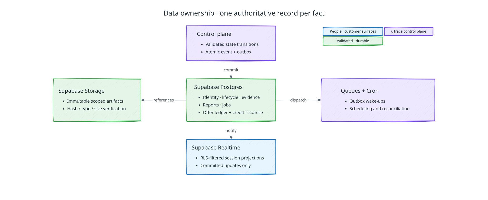

# Durable data, artifacts, and schema evolution

[Back to uTrace architecture](../ARCHITECTURE.md)

The following diagram shows how Supabase services divide durable truth, artifacts, notifications, and scheduled work:



<details><summary>Diagram key</summary>


</details>
<p></p>

## Schema ownership

The schema stores the demo's B2B Discord product loop with live implementation,
the configuration releases that pin it, and the records its cleanup and
reconciliation need.

## Authoritative stores and identifiers

Supabase Postgres is durable workflow truth. Supabase Storage holds encrypted evidence and build artifacts addressed by digest. Realtime is not authority, queue delivery is not proof of execution, and an object upload is not publication. Durable rows carry a stable uTrace identifier, `client_id` where tenant-scoped, a creation time, a schema version, and typed lifecycle fields. Provider IDs live in `provider_refs` with provider, installation, client, resource type, and uTrace owner; provider IDs are never primary product identity.

Core tables cover clients, members, users, customer accounts and memberships, provider identities, configuration releases, Intake Items, Product Signals, invitations and return attempts, Interview Sessions, evidence, gate decisions, Implementation Attempts, workspace and runtime leases, Preview Versions, validation criteria and outcomes, Case Files, deliveries, events, commands, results, jobs, provider references, and audit records.

Outreach Offers records follow the [credit issuance contract](./outreach-offers.md#issuance-and-reconciliation):
authorized allowance, fixed offers and reservations, billing-customer mappings,
entitlements, and Stripe adjustment references. They remain separate from the
immutable Case File core. Retention preserves earned obligations and reconciliation
evidence without copying unrelated billing data or deleting credits when cases close.

## Tenant access and row-level security

Client-facing tables exposed through the Data API have RLS enabled. Policies require an active explicit `client_members` row and the matching `client_id`; `TO authenticated` alone is insufficient. Updates use both `USING` and `WITH CHECK`. Internal lifecycle writes run through restricted server identities and still validate the target tenant and expected state. Service-role credentials never reach browsers.

## Events, projections, and transactions

The append-only event log records accepted facts; lifecycle tables are transactional projections optimized for constraints and reads. Events do not substitute for state, and Realtime delivery does not substitute for either. Each transition locks the aggregate, checks expected revision and legal predecessor, writes the state mutation, event, outbox work, and audit record in one transaction, then commits once.

Persist the typed envelopes and authority references defined by
[Cross-Component Contracts](./cross-component-contracts.md#domain-messages).
[Control Plane](./control-plane.md#jobs-commands-and-scheduling) owns Job leases,
Command transitions, and scheduling; storage does not infer execution success.

Supabase Realtime publishes committed changes to `session_projections`, which the session tab receives as Postgres changes filtered by that table's RLS policy. It is not workflow authority, media transport, command acknowledgement, or proof that a user heard speech. Supabase Queues (`pgmq`) carries only outbox wake-ups; the outbox and Job rows remain the durable record. Cron runs per-minute scans that reclaim expired Job leases, enqueue due outbox rows, keep the preview warm pool filled, tear down unneeded previews, release prepared workspaces, and recheck stale telemetry readiness. Consumers remain idempotent because delivery can repeat.

## Evidence and artifacts

Postgres stores each artifact's type, media type, digest, size, retention class, producer, and source revision. The `utrace-telemetry` and `utrace-artifacts` buckets are private and have no Storage access policies, so only the control plane's server credentials reach them. Object paths start with the client ID, and readers resolve objects only through the control plane, which checks the client scope first. Transcripts, telemetry bundles, candidate manifests, check logs, diffs, validation evidence, and generated Case File cores are immutable after acceptance. Realtime payloads contain identifiers and safe summaries, never artifact bodies or secrets.

## Cross-system consistency

The transactional outbox is the only path from committed workflow state to Discord, GitHub, Stripe, Vercel, or other external effects. An adapter records the provider operation ID before acknowledging completion. The adapter confirms an effect by reading the provider's own record, resolving `provider_refs` and evaluating the expected state. Ambiguous external outcomes remain pending investigation and never advance optimistically.

## Model data and cleanup

The OpenAI Responses API (with `store=False`), Jev through Vercel AI Gateway,
Deepgram, ElevenLabs, Daily, and Pipecat Cloud keep no workflow state for uTrace,
and Codex runs with `--ephemeral` inside a workspace sandbox that is destroyed once
its required artifacts are durable. uTrace persists the scoped context and accepted
results it needs, and provider retention follows each provider's API data terms. Apply the permitted data classes
to model inputs; keep authoritative evidence in uTrace. No training corpus or
fine-tuning store exists.

Cancellation deletes non-required derived work and produces no Case File. After the
journey, the seeded dataset, the implementation workspace, expired invitations, and
unneeded preview runtimes follow their cleanup policy; durable records keep the
minimized evidence the Case File cites. Routine reconciliation compares durable
state with provider reality through idempotent provider references; it never
fabricates missing evidence or reruns an effect without proving its prior outcome.

## Migrations

Schema migrations are expand-and-contract, and one path applies them: the
versioned SQL files committed to the repository, applied in order by the
repository's own migration runner and recorded in the applied-migration table, so
a deployed database and a checkout agree on what has run. Nothing applies schema
from an editor session or a linked CLI push.

The history starts from one baseline generated from the declarative schema,
followed by the hand-written migration that creates the Storage buckets. Every
later change adds a migration after them.

Workers tolerate adjacent schema versions while active lifecycles drain. Destructive constraints and column removal wait until all pinned readers and writers have moved. Migration evidence includes RLS and tenant-isolation probes and event/projection reconciliation.

### Declarative schema

The declarative schema in `supabase/schemas/` is the source of truth for the
database's shape, and schema migrations are generated from it. It uses the layout
of the Supabase CLI's pg-delta export: one file per object, grouped by Postgres
schema. A table's file holds its indexes, row-level security policies, and
grants; `_cluster/` holds the extensions, the `supabase_realtime` publication
membership, and the `pg_cron` jobs and `pgmq` queue. pg-delta orders the files by
dependency, so file names and directories are for readers only.

To change the schema:

1. Edit or add files under `supabase/schemas/`. Declare a new table's row-level
   security and grants in its file, as the existing table files do; otherwise the
   generated migration grants the platform defaults to `anon` and `authenticated`.
2. From the repository root, generate the migration with a snake_case name, which
   the migration runner requires:

   ```sh
   npm run supabase -- db schema declarative sync --no-apply -f <snake_case_name>
   ```

   The command diffs the schema files against a database built from
   `supabase/migrations/`, never against a live database, so a change made in
   Studio, the SQL editor, or `psql` is invisible to it. With nothing to change,
   it reports `No schema changes found`.
3. Review the generated file. It must hold only the intended change, and the CLI
   flags destructive statements. A column rename comes out as a drop and an add,
   so rewrite it as `alter table … rename column`.
4. Apply it like any other migration, with the
   [migration runner](../../apps/api/README.md#commands).

### Hand-written migrations

A schema diff cannot express some changes, so they stay hand-written migrations,
created with `npm run supabase -- migration new <snake_case_name>`:

- Data changes (`insert`, `update`, `delete`), such as backfills and the
  `utrace-telemetry` and `utrace-artifacts` Storage buckets, which are rows in
  `storage.buckets`. A schema diff never captures data, and a declarative file
  can't contain it.
- Functions, indexes, and other objects of your own inside Supabase-managed
  schemas such as `auth` and `storage`, which the diff excludes. RLS policies on
  their tables, and triggers that call functions outside them, stay declarative.
- Object kinds pg-delta doesn't model, such as casts, operators, and text search
  configurations. Their SQL also goes in `supabase/schemas/_custom/` so the
  objects that depend on them still load.

A hand-written migration that depends on a schema change takes a later timestamp
than the generated one. The
[declarative schema caveats](https://supabase.com/docs/guides/local-development/declarative-database-schemas#known-caveats)
list every construct the diff omits.
