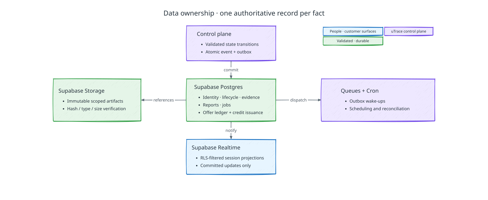

# Durable data, artifacts, and schema evolution

[Back to uTrace architecture](../ARCHITECTURE.md)

Supabase services divide durable truth, artifacts, notifications, and scheduled
work:



<details><summary>Diagram key</summary>


</details>
<p></p>

## Schema ownership

The schema stores the demo's B2B Discord product loop, its pinning configuration
releases, and the records cleanup and reconciliation need.

## Authoritative stores and identifiers

Supabase Storage holds encrypted evidence and build artifacts addressed by digest.
Queue delivery is not proof of execution, and an object upload is not publication.

Durable rows carry a stable uTrace identifier, `client_id` where tenant-scoped, a
creation time, a schema version, and typed lifecycle fields. Provider IDs live in
`provider_refs` with provider, installation, client, resource type, and uTrace
owner, never as primary product identity.

### Lifecycle records

The main lifecycle records hang off one Product Signal, and the
[control plane](./control-plane.md#product-lifecycles) owns their lifecycles:


<details><summary>Diagram key</summary>


</details>
<p></p>

Other core tables cover clients, members, users, customer accounts and
memberships, provider identities, configuration releases, invitations and return
attempts, evidence, workspace and runtime leases, validation criteria and
outcomes, events, commands, results, jobs, provider references, and audit records.

### Outreach Offers records

Outreach Offers records (authorized allowance, fixed offers and reservations,
billing-customer mappings, entitlements, and Stripe adjustment references) follow
the [credit issuance contract](./outreach-offers.md#issuance-and-reconciliation).
Retention keeps earned obligations and reconciliation evidence, copies no
unrelated billing data, and deletes no credits when cases close.

## Tenant access and row-level security

Client-facing Data API tables enable RLS, with policies requiring an active
explicit `client_members` row and the matching `client_id`; `TO authenticated`
alone is insufficient, and updates use both `USING` and `WITH CHECK`. Internal
lifecycle writes run through restricted server identities that still validate the
target tenant and expected state.

## Events, projections, and transactions

The append-only event log records accepted facts but does not substitute for
state; lifecycle tables are transactional projections optimized for constraints
and reads. Each transition locks the aggregate, checks the expected revision and
legal predecessor, and writes the state mutation, event, outbox work, and audit
record in one transaction.

Rows persist the typed envelopes and authority references of the
[domain messages](./cross-component-contracts.md#domain-messages). The
[control plane](./control-plane.md#jobs-commands-and-scheduling) owns Job leases,
Command transitions, and scheduling; storage never infers execution success.

### Realtime session projections

The session tab receives committed `session_projections` changes from Supabase
Realtime, filtered by that table's RLS policy. Realtime does not replay changes
missed while a channel is unjoined, and the server closes a channel when its token
expires, so the tab rejoins with its current token and re-reads the projection on
every join. Realtime is not workflow
authority, media transport, command acknowledgement, or proof a user heard speech.

### Queues and Cron

Supabase Queues (`pgmq`) carries only outbox wake-ups; the outbox and Job rows
stay the durable record. Cron runs per-minute scans that reclaim expired Job
leases, enqueue due outbox rows, keep the preview warm pool filled, tear down
unneeded previews, release prepared workspaces, and recheck stale telemetry
readiness. Consumers stay idempotent because delivery can repeat.

## Evidence and artifacts

Postgres stores each artifact's type, media type, digest, size, retention class,
producer, and source revision. The `utrace-telemetry` and `utrace-artifacts`
buckets are private with no Storage access policies, so only the control plane's
server credentials reach them. Object paths start with the client ID, and readers
resolve objects only through the control plane, which checks client scope first.

Transcripts, telemetry bundles, candidate manifests, check logs, diffs, validation
evidence, and generated Case File cores are immutable after acceptance. Realtime
payloads carry identifiers and safe summaries, never artifact bodies or secrets.

## Cross-system consistency

The transactional outbox is the only path from committed workflow state to
Discord, GitHub, Stripe, Vercel, or other external effects. The
[dispatch sequence](./control-plane.md#jobs-commands-and-scheduling) shows how an
adapter records provider operation IDs and confirms effects through
`provider_refs`. Ambiguous external outcomes stay pending investigation, never
advancing optimistically.

## Model data and cleanup

The OpenAI Responses API (with `store=False`), Jev through Vercel AI Gateway,
Deepgram, ElevenLabs, Daily, and Pipecat Cloud keep no workflow state for uTrace,
and Codex runs with `--ephemeral` in a workspace sandbox destroyed once its
required artifacts are durable. uTrace persists the scoped context, accepted
results, and authoritative evidence it needs; provider retention follows each
provider's API data terms, and model inputs carry only permitted data classes. No
training corpus or fine-tuning store exists.

Cancellation deletes non-required derived work. After the journey, the seeded
dataset, implementation workspace, expired invitations, and unneeded preview
runtimes follow their cleanup policy; durable records keep the minimized
evidence the Case File cites. Routine reconciliation compares durable state with
provider reality through idempotent provider references, never fabricating
missing evidence or rerunning an effect without proving its prior outcome.

## Migrations

Schema migrations are expand-and-contract with one path: committed, versioned
SQL files the repository's own migration runner applies in order and records in
the applied-migration table, so a deployed database and a checkout agree on what
ran. Nothing applies schema from an editor session or a linked CLI push.

History starts from one baseline generated from the declarative schema, then the
hand-written migration creating the Storage buckets; every later change adds a
migration after them.

Workers tolerate adjacent schema versions while active lifecycles drain.
Destructive constraints and column removal wait until all pinned readers and
writers have moved. Migration evidence includes RLS and tenant-isolation probes
and event/projection reconciliation.

### Declarative schema

The declarative schema in `supabase/schemas/` is the source of truth for the
database's shape, and schema migrations are generated from it. Its layout follows
the Supabase CLI's pg-delta export: one file per object, grouped by Postgres
schema. A table's file holds its indexes, row-level security policies, and grants;
`_cluster/` holds the extensions, `supabase_realtime` publication membership,
`pg_cron` jobs, and `pgmq` queue. pg-delta orders files by dependency, so file
names and directories are for readers only.

To change the schema:

1. Edit or add files under `supabase/schemas/`. Declare a new table's row-level
   security and grants in its file, as the existing table files do; otherwise the
   generated migration grants the platform defaults to `anon` and `authenticated`.
2. From the repository root, generate the migration with a snake_case name, which
   the migration runner requires:

   ```sh
   npm run supabase -- db schema declarative sync --no-apply -f <snake_case_name>
   ```

   The command diffs the schema files against a database built from
   `supabase/migrations/`, never against a live database, so a change made in
   Studio, the SQL editor, or `psql` is invisible to it. With nothing to change,
   it reports `No schema changes found`.
3. Review the generated file. It must hold only the intended change, and the CLI
   flags destructive statements. A column rename comes out as a drop and an add,
   so rewrite it as `alter table … rename column`.
4. Apply it like any other migration, with the
   [migration runner](../../apps/api/README.md#commands).

### Hand-written migrations

Changes a schema diff cannot express stay hand-written migrations, created with
`npm run supabase -- migration new <snake_case_name>`:

- Data changes (`insert`, `update`, `delete`), such as backfills and the
  `utrace-telemetry` and `utrace-artifacts` Storage buckets, which are rows in
  `storage.buckets`. A schema diff never captures data, and a declarative file
  can't contain it.
- Functions, indexes, and other objects of your own inside Supabase-managed
  schemas such as `auth` and `storage`, which the diff excludes. RLS policies on
  their tables, and triggers that call functions outside them, stay declarative.
- Object kinds pg-delta doesn't model, such as casts, operators, and text search
  configurations. Their SQL also goes in `supabase/schemas/_custom/` so the
  objects that depend on them still load.

A hand-written migration that depends on a schema change takes a later timestamp
than the generated one. The
[declarative schema caveats](https://supabase.com/docs/guides/local-development/declarative-database-schemas#known-caveats)
list every construct the diff omits.
