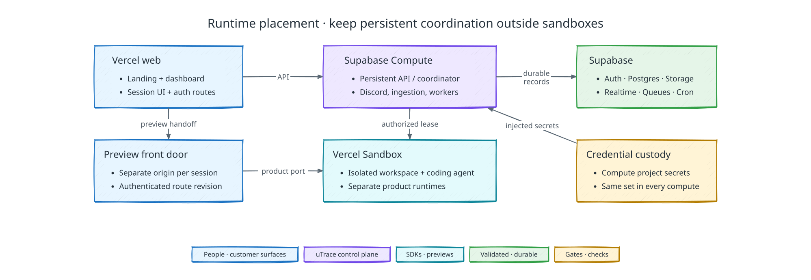

# Deployment and network topology

[Back to uTrace architecture](../ARCHITECTURE.md)

The following diagram shows where uTrace services run and how requests cross provider boundaries:

## Deployment scope

The demo deploys the B2B Discord loop with live implementation in one primary
application region.

One Supabase project holds the demo database and runs the deployed control
plane, which is the database's only writer. Development and test runs use throwaway projects of their own, so a
deployed worker and a local suite never share a database: a worker that can see a
test's Jobs claims them, and a suite that can truncate the demo's tables will.
Both sides resolve the database from one connection setting, which makes the
separation an operational rule rather than something the code can infer.

The control plane's computes reach Postgres directly inside Supabase's network
(`db.<ref>.supabase.co:5432`), not through the session pooler that workstation
tools use, so the pooler's fixed client limit does not apply to them. Each
compute caps its connection pool at six, and every live voice session and
extension socket holds one more dedicated listener connection. Together they must
stay within the database's own connection limit: a listener that cannot connect
stalls that session's cues.

## Provider and runtime placement

Vercel hosts `utrace.dev`, the normal client dashboard, session UI, and the preview
front door at `preview.utrace.dev`, and Vercel Sandbox supplies isolated compute.
Supabase supplies Postgres, Auth, Storage, Realtime, Queues, and Cron. The
control plane runs on Supabase Compute, which is in private alpha, as two computes
in the same Supabase project, both built from `apps/api/Dockerfile`. The public
`api` compute serves the HTTP API, the extension's control sockets, and telemetry
ingestion. The private `worker` compute has no URL and runs durable Jobs and the
Discord gateway. Together they cover Discord ingestion, telemetry ingestion,
session coordination, model delegation, jobs, callbacks, and provider adapters.
Compute project secrets hold long-lived credentials.

The application region is AWS `us-west-2`. Supabase Compute's private alpha runs
computes there, so the Supabase project, with its Postgres, Auth, Storage, and
Realtime, is in `us-west-2` too, and each control-plane query is a same-region
round trip of a few milliseconds. The web surfaces' Vercel functions run in
`pdx1`, beside the API they call on every request. The preview front door's
functions run in `iad1`, beside the Vercel Sandbox preview runtimes it proxies
every preview request to.

The OpenAI API supplies GPT-Live voice, and GPT-6.1 Sol for answers to GPT-Live's
delegations and for Implementation Gate proposals; Codex in each workspace calls
GPT-6.1 Sol for code investigation and implementation, and GPT-6.1 Sol also
assists intake and drafts Case Files. The [voice contract](./interview-and-voice.md#webrtc-session-setup)
defines backend-authenticated session setup and direct browser-to-OpenAI audio.
Jev, reached through Vercel AI Gateway, supplies default intake decisions and
concurrent interview attention.
The [intake contract](./signal-and-outreach.md#routing-context-and-cognition)
limits additional model calls to work that needs them.

Product knowledge is the client's Product Overview, a versioned, source-linked record in Supabase that travels whole with the contexts that need it; no search index is deployed. Code investigation happens through filesystem search and exact-file reads at the pinned repository revision inside Vercel Sandbox; there is no separate code index dependency.

Vercel Sandbox supplies every isolated implementation workspace and every full base or candidate preview runtime. A preview allocation grants product access only. An attempt-scoped fenced workspace lease grants bounded code access only. Client data and production credentials never enter the implementation workspace.

OpenTelemetry supplies operational tracing. GitHub holds branches, diffs, checks, and validated draft PRs; humans own production merge.

Stripe stores customer invoice credits in the uTrace-controlled Stripe sandbox that
stands in for the client's billing account. The control plane's computes issue
and verify credits. See the [Outreach Offers contract](./outreach-offers.md).

## Model access

The control plane's API and worker retain orchestration, tool execution, and
lifecycle authority over every model call. Jobs and voice runs pin the
configuration revision they ran under.

The workers request Implementation Gate proposals from GPT-6.1 Sol through the
OpenAI Responses API with the official OpenAI Python SDK, as one structured-output
request that stores nothing at OpenAI. Answers to GPT-Live's delegations are
function-calling runs on the same API: strict function tools, a per-session
`prompt_cache_key`, and no stored state, so each turn resends the earlier output with
its encrypted reasoning. Each OpenAI role pins the model ID
(`gpt-6.1-sol`), the reasoning effort, the service tier, and the credential
reference; every role runs on the Fast tier, at low effort except intake assistance
and Case File synthesis, which interpret or write for a reader and run at medium.

No model is ever substituted for another. A rate-limited request retries after the
provider's `retry-after` delay within the Job's retry budget.

GPT-Live runs through the OpenAI API. The backend creates each WebRTC session and
holds its sideband; the [voice contract](./interview-and-voice.md#webrtc-session-setup)
owns that flow. Codex in each workspace sandbox calls the OpenAI API with the
attempt's pinned model; its credential is added at egress, as the
[harness contract](./implementation.md#agent-harness) describes. The API and workers
call Jev through Vercel AI Gateway's evaluation endpoint as `typesafe-ai/jev`, with
the gateway API key from the project secrets, and restrict every request to the
`typesafe-ai` provider. Neither an outage nor a configuration omission
redirects requests to another provider.

## Network and public boundaries

Public endpoints are limited to the Vercel web/session surfaces, preview front
door, authenticated telemetry ingestion, provider callbacks, and the signaling
paths required for GPT-Live WebRTC. Vercel Sandbox port URLs are public, so runtime
middleware verifies uTrace route context and the runtime's entry token on every
request; the [front-door contract](./preview-front-door.md#vercel-to-sandbox-request-path)
owns that hop. Supabase client access uses publishable credentials plus RLS; secret
and service-role credentials stay server-side.

The `api` compute's public base URL is `https://api.utrace.dev/compute/v1/api`, and
its WebSockets use `wss://api.utrace.dev/compute/v1/api`. `api.utrace.dev` is the
Supabase project's custom domain, so it also serves the project's Auth, Storage,
and REST APIs. Compute strips the `/compute/v1/api` prefix before a request reaches
the API, so the API's own routes carry no prefix. Every client of the control
plane (the extension, the browser and server SDKs, the preview front door, and the
web surfaces) therefore takes a base URL that may include a path. Signed extension
proofs keep the bare origins `https://api.utrace.dev` and `wss://api.utrace.dev`
as their audiences.

The control plane's model adapters call the OpenAI API over authenticated TLS. The
session setup route accepts authenticated browser SDP, while the backend owns
GPT-Live session creation and the sideband WebSocket. Browser media connectivity to
OpenAI is independent of the control plane's connectivity to the OpenAI API; both
belong in voice health checks.

Each session origin `<opaque>.preview.utrace.dev` shares the `utrace.dev` site in
the demo; the [front-door origin contract](./preview-front-door.md#one-origin-per-session)
owns that boundary. All service egress is allowlisted by role where supported. The
sandbox network policy gives implementation workspaces only the repository,
package, test, and OpenAI API access the pinned policy requires, and it gives
preview runtimes only the dependencies required to run the prepared product;
outbound side effects are neutered.

## Secrets and credentials

Supabase Compute project secrets are the custody boundary for Discord, GitHub, Stripe, OpenAI, Vercel, and other server-side grants. Secrets never enter prompts, telemetry, logs, Storage artifacts, build outputs, browser bundles, or Case Files. uTrace-issued session and provider-hop credentials are short-lived and audience-bound.

Compute injects every project secret into every compute as an environment
variable, so custody is scoped to the project: the `api` and `worker` computes
receive the same set, and no per-compute identity narrows which credentials a
compute can read. Compute reserves the `SUPABASE_` prefix for the values it
injects itself, so the control plane reads its Supabase keys as
`UTRACE_SUPABASE_SECRET_KEY` and `UTRACE_SUPABASE_PUBLISHABLE_KEY`. A deployment
syncs the project secrets from the operator's local environment, verifies each by
digest, and removes any secret the control plane no longer names; the
[deployment runbook](../../deploy/README.md) owns that procedure.

The OpenAI API key stays server-side. The browser receives no provider key; the
voice contract owns session authorization. The workspace sandbox receives no key
either, because the sandbox firewall adds it at egress. Authentication failure never selects another credential implicitly.

## Scaling and availability

The persistent API scales horizontally with request volume, active sessions, and
telemetry load by running more `api` instances. The worker does not. It hosts the
Customer Surface consumers beside its Job loop, so it holds the client's single
Discord gateway session, and a second instance would deliver every watched-channel
message twice. The `worker` compute therefore runs exactly one instance. That is a
correctness constraint on the intake path, not a cost decision, and it caps
worker throughput for as long as the gateway lives in the worker process.

Ordering that matters is serialized per client or aggregate in Postgres; unrelated clients remain concurrent. Supabase Realtime may disconnect without losing truth because clients resynchronize from committed rows.

Temporary GPT-Live or network loss enters bounded reconnect. Already-authorized implementation and checks may continue, but new scope and validation cannot. Provider outages create typed blocked work; an outage never changes the kind of work, weakens evidence requirements, or hands workflow authority to a provider.

## Client application profiles

Client production and preview builds use the maintained SDK integration and
separate [build/startup profiles](./client-configuration.md#sdk-source-integration).
Vercel Sandbox base and candidate runtimes use the preview profile. Client production
builds exclude active uTrace instrumentation; runtime credentials are injected only
into authorized previews. No long-lived uTrace branch supplies a different product.

## Deployment and rollback

Platform releases are immutable and identify web, API, worker, database, prompt,
tool-schema, and policy versions. Database changes use expand-and-contract
sequencing. Deploy between Interview Sessions; an active session keeps its pinned
compatible package. Rollback cannot reinterpret committed evidence or revert an
irreversible provider effect. The
[deployment runbook](../../deploy/README.md) gives the release order: database
migrations, then project secrets, then the computes.
