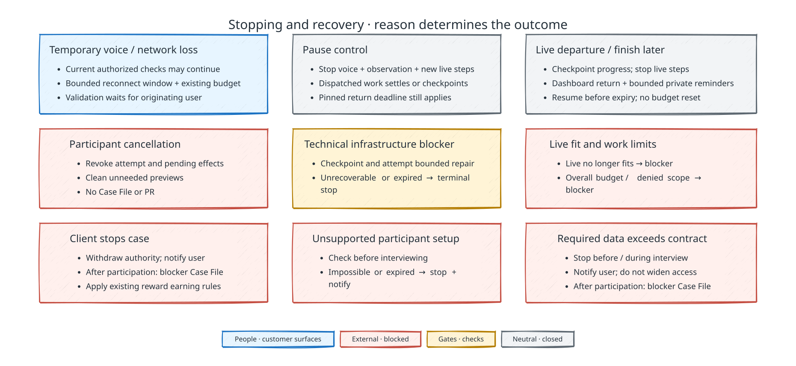

# Failure recovery and operations

[Back to uTrace architecture](../ARCHITECTURE.md)

The following diagram distinguishes interruption, departure, cancellation, blockers, and budget exhaustion:

Diagram key

## Failure boundary

Failures never substitute another participant, combine lifecycle authority, or expand repository scope, and a failure never changes the kind of work.

## Typed failure and retry contract

Command disposition, side-effect certainty, technical category, and retry advice remain separate. Unknown or partially applied external effects enter reconciliation and are never blindly repeated. Provider adapters map raw errors to closed typed categories; unmapped errors fail closed and create an engineering-visible finding.

Retries use durable budgets, jittered backoff, idempotency keys, and provider circuit breakers. Supabase Queues and Cron may wake and schedule work, while authoritative Job, Command, lifecycle, and projection state remains in Postgres. Realtime notifications are hints, never proof of completion.

## Voice, cognition, and observation failure

The voice agent holds full-duplex voice in a private Daily room the session tab joins over WebRTC. Temporary transport or voice loss starts a bounded reconnect window. Current already-authorized implementation and checks may continue; new validation evidence cannot be accepted without the same user.

Voice transcript fragments are provisional. They do not establish what the user meant or prove that synthesized speech was heard. A replacement call creates a new transport identity and context revision; accepted corrections invalidate derived claims that depended on the earlier wording.

Room creation, rejoin, and voice agent failures follow the
[call setup contract](./interview-and-voice.md#call-setup). A voice agent that is
not in the call makes voice unready for dependent probing and validation. While
the call's voice agent Job is still live and its room has at least 15 minutes
left, a reconnecting participant rejoins the same room with a new meeting token
and keeps the connection and `voice_run_id`. Otherwise the reconnect repeats
backend-authorized setup with a new room. Neither path refreshes a browser-held
credential. Delete superseded rooms and reject their late results. Voice failures
never trigger a switch to another provider.

OpenAI API, voice provider, or Jev unavailability pauses only work that requires that role. There is no silent substitute or lower-fidelity path, and no model is substituted for another. Routine Jev intake with complete pinned context does not depend on GPT-6.1 Sol availability; a Jev outage blocks that route after bounded retries. Conditional assistance follows the [intake contract](./signal-and-outreach.md#conditional-assistance). During interviews Jev supplies concurrent semantic attention and never a serial speech preapproval gate. Product-specific claims and validation pause whenever extension, browser SDK, Server SDK, trace correlation, target freshness, or exact candidate readiness is incomplete.

## User intent during interruption

The diagram owns the reason-specific outcomes. A spoken request for a quiet
moment suppresses speech without activating the Pause control. Pause takes effect
for voice, observation, and new live implementation steps immediately;
already-dispatched operations settle or checkpoint, with their outcomes recorded. Reopening a session preserves
consumed budgets and never restores revoked authority.

After successful validation, departure does not stop sealed Case File assembly, draft-PR delivery, or cleanup.

A terminal product outcome also triggers [Outreach Offers eligibility evaluation](./outreach-offers.md#completion-and-entitlement).
Temporary blockers keep the offer pending. Credit issuance failures use their own recovery
path and do not reopen the case, change validation, or erase an earned reward.

## Bounded return and terminal expiry

At the first Pause, **Finish later**, participant departure, expired reconnection window, or recoverable technical blocker, the controller records a case-level return-and-closure deadline using the pinned policy. Pause, retry, repair, and repeated departures do not extend or reset it. Stop live compute after dispatched operations settle or checkpoint; retain only the durable artifacts needed to verify and reconstruct the authorized scope, dataset, attempt, and candidate.

While the deadline remains open, the originating user can return from their dashboard through a private return link. uTrace may send bounded private Discord reminders within the pinned contact allowance. Re-entry proves the same identity and reruns current policy, permission, budget, extension, SDK, dataset, preview, and observation-readiness checks before work resumes. Restored resources must reproduce the exact authorized scope and data lineage; reconstruction does not create new evidence or reset consumption.

Expiry is terminal. The controller fences remaining leases, revokes invitations and credentials, reconciles dispatched effects, destroys unneeded runtime resources after durable extraction, resolves the Outreach Offer under its existing participation rules, and closes with an explanatory blocker Case File when participation occurred. Before participation, it creates the applicable cancellation or compatibility record and no Case File. Recovery or resumed work cannot extend an already recorded case
deadline. Completion before that deadline ends its scheduling obligation; expiry
cannot rewrite a completed outcome.

After validation, the frozen result permits routine delivery once the user has
departed unless authority is withdrawn. No new coding is authorized, and later
code changes do not inherit the validation.

## Blockers and recovery

Infrastructure failures preserve a blocked attempt that can resume after engineering repair only while the case-level return-and-closure deadline remains open. The control plane verifies tenant, Product Signal, attempt, lease, policy, base revision, scope, workspace integrity, artifact hashes, candidate identity, and remaining budgets before resumption. No engineer edits product state or fabricates evidence.

Recovery must respect terminal boundaries:

- [Implementation limits](./implementation.md#outcomes-and-budget-exhaustion)
  close exhausted work with a blocker.
- Repair cannot resume a closed signal.
- [Initial outreach](./signal-and-outreach.md#originating-user-and-invitation-lifecycle)
  and explicit cancellation retain their no-Case-File outcomes.
- A participant environment that cannot satisfy the supported browser, extension,
  permission, or extension compatibility contract closes before interviewing in `canceled` with reason
  `unsupported_participant_environment`, with a user-safe notice, no Case File,
  and no earned reward. Setup timeout has the same outcome and is distinct from
  voluntary cancellation. A readiness loss after participation uses the bounded
  blocker and expiry rules above.
- Unknown GitHub outcomes remain in reconciliation. A definitive delivery failure
  records the exact draft/branch state.

An Implementation Gate that cannot decide is a technical blocker. Its bounded
recovery is the gate Job's run budget and its fresh-context retries; once no run
is left, the change cannot start. A case with a ready version keeps it and the
asked-for change is declined (`revision_declined`); any other case commits its
blocker Case File and closes `closed_blocked` when that is published. Either way
the live agent is told at once, so it never promises a version that is not coming.

These reasons differ in what they preserve, but after participation they close
into the same terminal blocked state, which is why that state is reachable from
every nonterminal state rather than only from the late ones. The
[lifecycle contract](./control-plane.md#product-signal) owns its guard.

Automatic remediation is limited to idempotent, evidence-preserving legal transitions: reclaiming Jobs, renewing fenced leases, rebuilding a workspace from pinned inputs and durable artifacts, reconstructing an exact candidate from its artifact and dataset manifest, re-dispatching an undispatched outbox entry, or reconciling a provider resource by stable identity.

## Restart and reconciliation

Before a service becomes ready after restart, it reconciles inbox/outbox state, Jobs and Queues, leases and heartbeats, session reconnect windows, provider breakers, stale preview routes, and cleanup work. The API and worker on Supabase Compute and the voice agent's sessions on Pipecat Cloud recover from Supabase-backed durable state. No in-memory worker is authoritative. Engineering response happens through code or configuration deployment outside product authority.

Structured logs support operational diagnosis while durable uTrace records remain workflow truth. Overload shedding, incident freezes, and failure drills are outside the demo.
