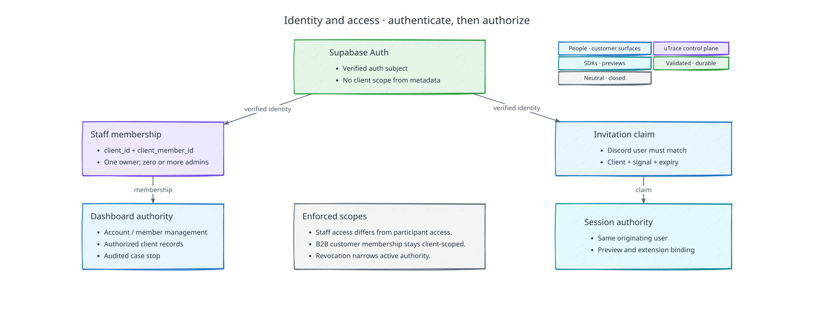

# Identity, tenancy, and access

[Back to uTrace architecture](../ARCHITECTURE.md)

The following diagram shows how uTrace authenticates staff and participants before it grants scoped authority:

## Identity boundary

uTrace serves B2B customer organizations, with one configured Discord server per
client. It requires explicit membership authorization, tenant isolation, and
same-originating-user interview and validation.

## Identity and tenancy model

`utrace_user_id` identifies a person globally inside uTrace. `client_user_id` identifies that person's isolated relationship with one uTrace Client. `customer_account_id` identifies a client-scoped B2B customer organization. `customer_membership_id` joins a customer user to that account. `client_member_id` separately identifies a staff relationship with one client.

Provider identities map through a client, provider installation, and resource scope to the applicable client user. They never replace uTrace-owned identity. Cross-client identity links are internal-only: a client cannot query another client's participation, product context, transcript, telemetry, or validation outcome.

Global user data is limited to communication and accessibility preferences, do-not-contact state, participation count, and abuse controls. Product history and evidence remain client-scoped. A participant may view artifacts of their own participation, such as sessions, transcripts, and submitted validation outcomes, but never client-only Case Files, policy decisions, implementation evidence, code artifacts, or internal inference.

## Client staff authentication with Supabase Auth

Supabase Auth authenticates owners and admins. Authorization comes from explicit uTrace-owned `client_members` rows in Supabase Postgres, never user-editable metadata or a bare `authenticated` role.

- The `utrace.dev` web application performs sign-in, sign-out, callback, and session refresh using server-safe Supabase patterns.
- The API verifies the token issuer, audience, signature, subject, session, and expiry, then resolves an active membership for the requested `client_id`.
- One client has exactly one `owner` and zero or more `admins`.
- RLS and API authorization both require the client membership predicate. Tables exposed through the Data API have RLS enabled; privileged service credentials never enter the browser.
- User-editable metadata is never an authorization source. Authorization-changing writes use restricted server-side paths and are audited.
- Offboarding, membership deactivation, session revocation, invalid tokens, conflicting identity mappings, and unavailable verification fail closed without rewriting product lifecycle state.

## Participant invitation and sign-in

The Discord invitation is private, opaque, expiring, and bound server-side to the configured Discord identity, client, Product Signal, and originating user. It carries no authoritative payload. First claim requires participant sign-in and proves control of the invited identity through the configured Discord binding. The same identity may reconnect; another person is rejected.

Validation always requires the original `client_user_id`. No colleague, client staff member, or second account may substitute. A revoked, declined, or opted-out initial invitation follows cancellation policy and produces no Case File or PR.

## Outreach Offers recipient mapping

An offer binds the originating user's `customer_account_id` to the organization's
existing Stripe Customer in the billing account. The
[customer mapping contract](./outreach-offers.md#customer-mapping)
owns verification. Discord identity, an email match, or a participant-supplied
Customer ID cannot establish that mapping. Participants need no Stripe account or
bank onboarding and cannot redirect credits.

## Session credentials

Two lanes receive uTrace-minted, audience-scoped credentials, because two callers
are services rather than the participant:

- **Server SDK.** A bootstrap credential is scoped to one preview runtime
  allocation and bound to its public preview origin. The SDK exchanges it for a
  short-lived stream credential on the control socket and rotates that credential
  before it expires; the bootstrap credential itself authenticates only the
  socket.
- **Preview front door.** A one-time claim code, valid for a couple of minutes,
  exchanges for an origin-bound session credential that the door presents to the
  control plane on every route lookup.

A credential for one lane cannot acknowledge commands or write evidence in
another, and both lanes stop verifying once the bound Interview Session closes.

The participant's own surfaces do not use a lane credential. Session routes
authorize the participant's authenticated Supabase identity directly, the
extension proves possession of its registered device key during its socket
handshake, and the browser telemetry stream carries a write-only ingestion
credential minted for one observation activation. There is no separate session-tab
token: minting one would create an audience nothing checks. Refresh is permitted
only while the durable session is eligible; revocation stops refresh and queued
effects.

GPT-Live uses a backend-created session bound to the authenticated
participant and current connection, rather than a browser-held provider token.
Revocation also closes that provider session. The
[voice setup contract](./interview-and-voice.md#webrtc-session-setup) owns the handshake.

The two required browser tabs use different origins. The session tab authenticates through the claimed invitation, the preview through a one-time handoff and origin-bound cookie, and the extension through an authenticated handshake with the embedded SDK. The control plane joins those lanes on one session ID. Cookie sharing or client-side identity transfer is never assumed. A mismatch blocks observation-dependent probing and validation.

## Authorization boundaries

Only the owner authorizes or increases the Outreach Offers budget. Configuration, policies, integrations, repositories, and memberships come from the [client configuration](./client-configuration.md); managing them from the dashboard is outside the demo. Owners and admins cannot edit, redirect, resume, approve, or mark successful an active Product Signal, Interview Session, Implementation Attempt, Preview Version, or validation outcome. They may invoke the audited, deny-only [**Stop this case** control](./policy-and-permissions.md#client-case-stop) for one Product Signal. That control withdraws future authority; it cannot rewrite evidence or revoke previously published outputs.

Participants manage their own identity, preferences, participation, and opt-out. They hold no client-side authority. Models and providers may propose or report typed facts only. The deterministic control plane owns authorization, evidence admission, lifecycle transitions, and effects.

Inbound Discord, GitHub, Stripe, Supabase, and Vercel callbacks are verified using the provider's mechanism and mapped to a client and expected resource before ingestion. Internal services use separate scoped identities; no shared all-powerful credential exists.

## Interruption, revocation, and recovery

Re-entry must prove the same originating identity and recheck current authority;
it cannot reset budgets or revive revoked credentials. The
[interruption contract](./implementation.md#conversation-pause-and-interruption)
owns which work can continue during a pause, disconnect, or departure.
The case-level return deadline and terminal cleanup live in
[Failure Recovery](./failure-recovery.md#bounded-return-and-terminal-expiry).

Initial invitation cancellation and explicit cancellation revoke affected
credential lanes. Return links remain bound to the same `client_user_id`, and
[outreach](./signal-and-outreach.md#originating-user-and-invitation-lifecycle)
owns their delivery. Credential refresh or a repaired identity provider cannot
reopen a closed Product Signal.
