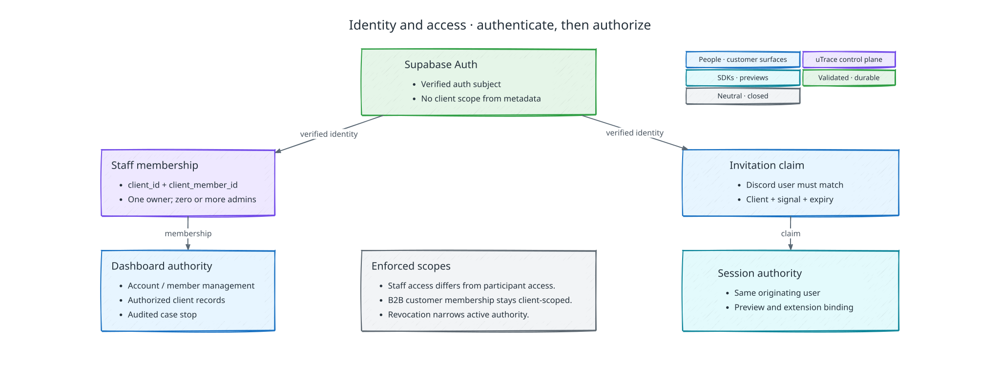

# Identity, tenancy, and access

[Back to uTrace architecture](../ARCHITECTURE.md)

uTrace authenticates staff and participants before it grants scoped authority:

Diagram key

## Identity boundary

uTrace serves B2B customer organizations, with one configured Discord server per
client, under explicit membership authorization, tenant isolation, and one
originating user for interview and validation.

## Identity and tenancy model

The [identity diagram](../ARCHITECTURE.md#identity-tenancy-and-session-anchoring)
draws these identifiers for the [PRD's account model](../PRD.md#account-model):

- `utrace_user_id`: one person, globally inside uTrace.
- `client_user_id`: that person's isolated relationship with one uTrace Client.
- `customer_account_id`: a client-scoped B2B customer organization.
- `customer_membership_id`: a customer user's membership in that account.
- `client_member_id`: a separate staff relationship with one client.

Provider identities map through a client, provider installation, and resource
scope to the client user, never replacing uTrace-owned identity.
Cross-client identity links are internal-only: a client cannot query another
client's participation, product context, transcript, telemetry, or validation
outcome.

Global user data is limited to communication and accessibility preferences,
do-not-contact state, participation count, and abuse controls; product history
and evidence stay client-scoped. Participants may view artifacts of their own
participation, such as sessions, transcripts, and submitted validation outcomes,
never client-only Case Files, policy decisions, implementation evidence, code
artifacts, or internal inference.

## Client staff authentication with Supabase Auth

Supabase Auth authenticates owners and admins; authorization comes only from
explicit uTrace-owned `client_members` rows in Supabase Postgres, never
user-editable metadata or a bare `authenticated` role.

- The `utrace.dev` web app handles sign-in, sign-out, callback, and session
  refresh with server-safe Supabase patterns.
- The API verifies the token issuer, audience, signature, subject, session, and
  expiry, then resolves an active membership for the requested `client_id`.
- One client has exactly one `owner` and zero or more `admins`; the database
  refuses a second active owner.
- RLS and API authorization both require the client membership predicate; Data
  API tables have RLS enabled, and privileged service credentials never enter
  the browser.
- Authorization-changing writes use restricted server-side paths and are audited.
- Offboarding, membership deactivation, session revocation, invalid tokens,
  conflicting identity mappings, and unavailable verification fail closed without
  rewriting product lifecycle state.

## Participant invitation and sign-in

The Discord invitation is private, opaque, expiring, and bound server-side to the
configured Discord identity, client, Product Signal, and originating user, with
no authoritative payload. First claim requires participant sign-in proving
control of the invited identity through the configured Discord binding. The same
identity may reconnect; anyone else is rejected.

Validation always requires the original `client_user_id`; no colleague, client
staff member, or second account may substitute. A revoked, declined, or opted-out
initial invitation follows cancellation policy and produces no Case File or PR.

## Outreach Offers recipient mapping

An offer binds the originating user's `customer_account_id` to the
organization's existing Stripe Customer under the
[customer mapping contract](./outreach-offers.md#customer-mapping). Discord
identity cannot establish that mapping, and participants cannot redirect
credits.

## Session credentials

Each caller authenticates in its own lane:

Diagram key

### Service lanes

The two service callers hold lane credentials:

- **Server SDK.** A bootstrap credential, scoped to one Preview Runtime
  Allocation and bound to its public preview origin, authenticates only the
  control socket. There the SDK exchanges it for a short-lived stream credential
  that it rotates before expiry.
- **Preview front door.** A one-time claim code, valid for a couple of minutes,
  exchanges for an origin-bound session credential that the door presents on
  every route lookup.

A credential for one lane cannot acknowledge commands or write evidence in
another, and both lanes stop verifying when the bound Interview Session closes.

### Participant surfaces

The two required tabs use different origins; the session tab's Supabase
identity comes from the claimed invitation. The extension proves possession of
its device key during its socket handshake, and the ingestion credential is
minted for one observation activation. Cookie sharing or client-side identity
transfer is never assumed; a mismatch blocks observation-dependent probing and
validation. Refresh works only while the durable session is eligible;
revocation stops refresh and queued effects.

The backend-created private Daily room is bound to the authenticated participant
and current connection, and revocation deletes it; the
[call setup contract](./interview-and-voice.md#call-setup) owns the handshake.

## Authorization boundaries

### Client staff

Only the owner authorizes or increases the Outreach Offers budget.
Configuration, policies, integrations, repositories, and memberships come from
the [client configuration](./client-configuration.md), not dashboard management,
which is outside the demo. Owners and admins cannot edit, redirect, resume,
approve, or mark successful an active Product Signal, Interview Session,
Implementation Attempt, Preview Version, or validation outcome. Their only
runtime control is the audited, deny-only
[**Stop this case**](./policy-and-permissions.md#client-case-stop) for one
Product Signal.

### Participants, models, and providers

Participants manage their own identity, preferences, participation, and opt-out,
with no client-side authority. Models and providers only propose or report
typed facts; the deterministic control plane owns authorization, evidence
admission, lifecycle transitions, and effects.

### Inbound events and service identities

Inbound Discord gateway events and Supabase Auth callbacks are verified with the
provider's mechanism and mapped to a client and expected resource before
ingestion. uTrace takes no GitHub, Stripe, or Vercel webhooks: the adapter that
caused an effect reads its outcome back from the provider. Internal services use
separate scoped identities; no shared all-powerful credential exists.

## Interruption, revocation, and recovery

Re-entry proves the same originating identity and rechecks current authority,
without resetting budgets or reviving revoked credentials. The
[interruption contract](./implementation.md#conversation-pause-and-interruption)
owns which work can continue during a pause, disconnect, or departure, and
[Failure Recovery](./failure-recovery.md#bounded-return-and-terminal-expiry) owns
the case-level return deadline and terminal cleanup.

Initial invitation and explicit cancellation revoke affected credential lanes. Return links remain bound to the same `client_user_id`, and
[outreach](./signal-and-outreach.md#originating-user-and-invitation-lifecycle)
owns their delivery. Credential refresh or a repaired identity provider cannot
reopen a closed Product Signal.
