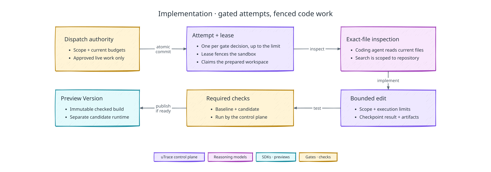

# Implementation controller and isolated workspace

[Back to uTrace architecture](../ARCHITECTURE.md)

The following diagram shows how a gated attempt becomes an immutable Preview Version:

## Supported implementation mode

The demo supports Feature Request Flow in one authorized repository. The
Implementation Gate chooses `approved_live` or `no_implementation`. A Product
Signal may use up to the `implementation_limit` its configuration release pins
(three for the demo client): the first Implementation Attempt, then one for each
change the originating user asks for while trying a new version. Each attempt
belongs to its own approving gate decision, and at most one of a case's attempts is
in flight. Async implementation and iteration after an unsuccessful validation
are outside the demo.

## Enforcement model

The coding agent, GPT-6.1 Sol in Codex, performs implementation reasoning and
coding inside a Vercel Sandbox workspace. Delegation answers during the interview
may provide retrieval or explanation and Jev may return typed semantic-attention
results, but neither can write code or authorize an effect. The control plane
alone approves the Implementation Attempt, grants its fenced Environment Lease,
accepts artifacts, and advances durable state.

The workspace starts from a uTrace-owned, digest-pinned image or snapshot. It contains the authorized repository checkout and scratch space, but no copied customer dataset, production credentials, client data, or workflow authority.

- **Network:** the sandbox's network policy permits only required public or
  client-declared registries, uTrace callback and artifact endpoints, and the
  OpenAI API. Credentials remain in uTrace-controlled services. Every blocked
  connection is logged. Repeated or exfiltration-shaped violations end the attempt
  as `unsafe`.
- **Code surfaces:** after every edit/check cycle, the diff is checked against the approved-scope object. Blocked paths remain readable when their interfaces are necessary, but cannot appear in the accepted diff.
- **Compute:** elapsed-time, token, cost, process, and artifact budgets are pinned
  by the Product Signal's policy and the gate decision. Each agent run is bounded
  by its command timeout and charged afterwards, and the control plane refuses the
  next step once a budget is spent.
- **Lease:** the lease fences the sandbox itself. The control plane creates the
  workspace sandbox for the current lease, stops the sandbox of a superseded or
  revoked attempt, and accepts artifacts only when it collects them under the
  current lease. A stale run may leave logs, but cannot publish artifacts or
  candidates.

## Agent harness

The coding agent is the Codex CLI (`@openai/codex`), pinned in the workspace
template with the model catalog of that release. The control plane runs one
`codex exec` per investigation or authoring cycle as the sandbox's non-root user,
and pins its configuration in a Codex home written for that run:

- model `gpt-6.1-sol` at low reasoning effort on the Fast service tier. On the
  demo's change it matched GPT-6 Astra on the Fast tier at a sixth of the cost,
  and ran about 30 seconds behind Astra on the Ultrafast tier at a seventeenth.
  The template's catalog adds Astra's `ultrafast` tier, because Codex requests
  only the tiers a model's catalog entry lists.
- the pinned checkout as the working directory, and a JSON Schema for the run's
  final report
- Codex's own sandbox off: its read-only and write modes need bubblewrap, which a
  Vercel Sandbox cannot start, so the workspace sandbox is the boundary. The
  control plane holds pre-gate investigation read-only by refusing the whole
  investigation when the checkout changed.
- repository instruction files, web search, plugins, analytics, update checks,
  sub-agents, goals, skills, image viewing, sleeping, and questions to a user off,
  so nothing outside the task reaches the agent and every request stays short
- the HTTP transport, because the sandbox firewall that adds the credential
  refuses WebSocket upgrades

The task carries the frozen scope, acceptance criteria, required checks, budgets,
the code findings the gate cited, and the cited files in full at the base
revision; an investigation's task carries the repository's tracked files instead.
It tells the agent that the participant is waiting, to write no progress
commentary, to batch its reads, to make the smallest complete change, to wire the
client's declared uTrace targets and milestones for the workflow it changes, to
run only the fast static checks itself once the dependency install has finished,
and to leave tests and the production build to the control plane. Codex streams
its events on the command's output; the control plane records them as attempt
logs, and every command and file change the agent makes becomes provenance. The
agent's own report of success is evidence to check, not a result: the control
plane reruns the required checks and the scope check before it accepts a
candidate. See [Codex non-interactive mode](https://developers.openai.com/codex/noninteractive).

The OpenAI credential never enters the sandbox. `CODEX_API_KEY` holds a
placeholder, and the sandbox firewall replaces the `Authorization` header on every
request bound for the OpenAI API.

A Codex turn that fails, a refusal included, is a `provider_rejected` failure the
attempt cannot continue past, and its Job does not retry it.

## Attempt protocol

The control plane dispatches a typed attempt specification containing the Product
Signal and attempt IDs, repository reference, pinned base revision, approved-scope
object, required checks, policy and gate revisions, context-bundle references,
harness options, budgets, and lease token. The attempt claims the case's
[prepared workspace](#prepared-workspace) for that lease, or creates the workspace
sandbox from the pinned template when there is none to claim, and the harness runs
inside it. Logs and artifacts are written through uTrace-controlled storage.

A later attempt, for a change the person asked for, builds on the version they
asked to change: before the change is authored, the case's newest ready Preview
Version's frozen files are written into a fresh workspace checked out at the same
base revision, so its candidate holds the earlier change and this one, and the
case's first attempt starts from the clean base. Creation counts the case's
attempts against the pinned limit in the same transaction that commits the new
one.

## Prepared workspace

When the participant claims the invitation, the control plane prepares the
workspace the case's attempt would use, beside the base preview's own
preparation: a sandbox from the pinned template, the authorized repository
checked out at the pinned base revision, its dependencies installed from the
client's recipe, and the required checks run on the clean base. It is built from
the case's pinned release alone, so it holds no case data and no authority: it has
no lease, reaches only the package registry once the checkout exists, and never
reaches the OpenAI API.

An approved attempt claims it under its lease. The claim binds the sandbox to the
attempt and its fencing token in the same row update that takes it, opens its
egress to the model, extends its execution limit to the attempt's budget, and
starts the first cycle at once with the recorded baseline. The attempt claims only
a workspace prepared from the pins its own specification carries: template
snapshot, clone URL, base revision, install command, required checks, and vCPUs.
It waits for a preparation still running, which is further along than a fresh
start; with no workspace to claim, it prepares its own as before and authors the
first cycle while the dependencies install. A prepared workspace that no attempt
claims is released, and its sandbox destroyed, once its case ends or its
one-hour window passes.

One nonterminal Implementation Attempt exists per Product Signal. Technical retries
and check-fix cycles stay inside that attempt while its scope and budget remain
valid. Changed acceptance criteria, product outcome, risk, or implementation scope
would require another attempt, which the demo does not allow, so they close the
case with a blocker Case File.

Attempt creation locks the Product Signal, rechecks lifecycle, classification,
gate and policy revisions, and remaining budgets, and atomically commits the
attempt with its dispatch intent. Replayed requests return the existing attempt.
No worker dispatches before commit. Workers recheck current authority and execution
limits before new steps and enforce limits on in-flight work. Resume preserves all
consumption; it never recreates an attempt to bypass a limit.

Live implementation runs concurrently with the conversation. Once the gate approves, implementation and checks may proceed while GPT-Live continues a fluid interview. The agent does not narrate every command or progress change. Orchestration supplies the active conversation, critical facts, accepted corrections, current telemetry, and implementation updates to the relevant model roles so they work from the same revisioned context.

## Conversation, pause, and interruption

Implementation authority follows the Interview Session state:

- Temporary transport or voice loss starts a bounded reconnection window. Already authorized live implementation and checks may continue, but no validation may occur without the same user.
- An explicit leave stops new implementation after safe checkpointing. The same originating user may explicitly return after fresh readiness checks while the case-level return deadline remains open; this does not reset its budgets. Expiry follows the terminal rule in [Failure Recovery](./failure-recovery.md#bounded-return-and-terminal-expiry).
- The session Pause control stops voice, observation, and new live implementation steps. In-flight operations reach a safe checkpoint and then stop. A spoken request such as “give me a moment” silences conversation without pausing authorized implementation.
- Cancellation revokes product-work authority, reconciles dispatched effects, discards the work from product delivery, and produces no Case File or PR.
- An infrastructure blocker checkpoints the attempt as resumable after engineering repair only before the fixed case-level deadline. It never fabricates evidence or becomes a product rejection.

After the originating user departs following successful validation, Case File assembly, draft-PR delivery, and cleanup may continue because those steps rely on already-frozen evidence and authority.

## Repository binding and exact-file inspection

The base revision is pinned before code mutation and the gate approves against that pin. A working branch exists only inside the workspace until delivery; nothing reaches the client's GitHub repository before successful validation.

The coding agent investigates code using filesystem search and exact file reads at
the pinned revision inside Vercel Sandbox. The Product Overview describes the
product; it is not a code index. Every inspected
file and revision is recorded as provenance. Candidate files suggested by
delegation answers or Jev, and the pre-gate findings the gate cited, are
hints until the workspace reads the exact source.

## Required checks and scope control

Required commands come from the Product Signal's pinned client policy and gate decision. The workspace runs them on the clean base to establish a comparable baseline and again against the candidate. The baseline runs on the base revision exported from git beside the checkout, with the installed dependencies linked in: in a prepared workspace before the attempt begins, and otherwise while the agent authors the first cycle, in which case the first comparison waits for it. The checks of one run start together, except that a check waits for the earlier checks its policy entry names in `after`, such as a build that writes files the type check reads. Pre-existing failures are reported as integration health; the candidate must not introduce new failures. While a cycle's checks run, the [candidate preview build](./preview-build.md) starts from the same staged files, so an accepted candidate only has to start.

After every correction cycle, the controller verifies files, repositories, dependencies, and other approved bounds. The diff's size in lines is not bounded: a complete change is never sent back to shrink. Mechanical violations return for correction while budget remains. A persistent violation, or a semantic discovery that the solution needs a different outcome or scope, stops mutation and closes the case with a blocker Case File. Scope never grows inside the workspace.

Dependency additions follow the approved scope's `none | allowlist | open` policy. Permitted additions use exact versions, update lockfiles, pass license policy, and appear explicitly in the Case File and PR. A newly necessary dependency outside the approved scope stops mutation the same way.

## Outcomes and budget exhaustion

Attempt outcomes are `candidate_ready`, `scope_change_required`, `checks_failed`, `unsafe`, `infrastructure_blocked`, `paused`, `canceled`, and `budget_exhausted`. Each result identifies completed side effects, retained artifacts, and whether resumption is legal.

An attempt that no longer fits the live session, needs a changed scope, or exhausts
its budgets closes the case with a blocked Case File explaining the evidence, work
attempted, and blocker, and opens no PR.

## Artifact extraction and cleanup

Before workspace destruction, uTrace extracts the final diff, file and process logs, the agent's command and file-change journal, check results, inspection evidence, approved-scope checks, dependency manifest, and source/build provenance. Each artifact is content-addressed and bound to the attempt and lease. Extraction failures retry and block cleanup; the sandbox is never the sole recovery record. Once required artifacts are durable and no incident hold applies, the workspace sandbox is deleted.
