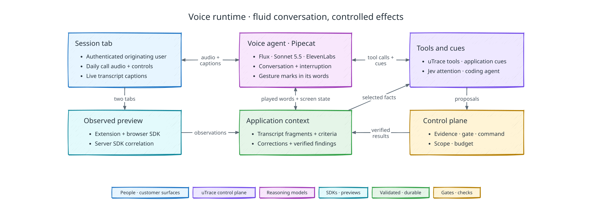

# Interview and voice runtime

[Back to uTrace architecture](../ARCHITECTURE.md)

The runtime separates conversational timing from authority over backend effects.

Diagram key

## Interview ownership

The originating user is the sole interview and validation participant, and
implementation runs live, during the conversation. Interview activity and
reward-eligible participation wait for the
[participant compatibility preflight](./browser-extension.md#participant-compatibility-preflight)
that invitation claim runs. Preview preparation may continue after admission,
while continuously checked [observation readiness](#readiness-has-two-boundaries)
gates product-dependent probing.

## Conversation and backend work

The voice agent holds the conversation; backend reasoning roles never take part.

### Voice agent hosting

The voice agent is a [Pipecat](https://docs.pipecat.ai) pipeline (`pipecat-ai`
1.12) on Pipecat Cloud, which carries the call's WebRTC media to the connection's
private Daily room; Supabase Compute's network does not. Deepgram Flux hears the
participant, GPT-6.1 Sol at the Ultrafast service tier writes the agent's words and
calls uTrace's tools, and ElevenLabs speaks, as the
[voice and reasoning model benchmarks](./benchmarks.md#voice-and-reasoning-models)
justify.

Opening a connection queues its `interview.voice_agent` Job, and the API
immediately starts a Pipecat Cloud session for it; one warm instance stays ready,
so no call waits for a cold start. The session claims the Job by id and runs it
with the worker's lease, heartbeats, and failure records, reclaiming it after the
Job's backoff when a run fails, until the Job completes or has no run left.

Only the session tab carries call audio, over Daily's WebRTC transport; the
extension neither captures nor relays it.

### Voice pipeline

Audio and text pass through these stages in order:

Diagram key

Each stage's contract:

- **Microphone gate:** drops participant audio while Mute or Pause holds it, and
  records when the microphone last carried speech-level audio (RMS of at least
  0.01 of full scale) for the echo guard.
- **Deepgram Flux** (`flux-general-en`): proposes each turn's start and end
  (end-of-turn threshold 0.7, eager end-of-turn threshold 0.4). Eager end of turn
  starts the reply before the turn commits and withdraws it if the participant
  keeps talking.
- **User turn aggregation:** a proposed turn opens at once while the agent is
  silent. While it talks, the utterance waits and is classified as its transcript
  arrives:
  - A backchannel ("mm-hmm", "yeah", "okay") never interrupts, but opens the turn
    if the agent finishes first, since it may answer a question.
  - Echo never opens a turn: no speech-level audio at the microphone during the
    utterance, or words replaying the agent's last four seconds in order.
  - Any other words interrupt the agent.

  An utterance Flux ends without opening a turn is dropped from the transcript.
- **Screen state:** appends an `<application>` block to the latest participant
  turn of each model request, leaving the conversation's context unchanged:
  on-screen controls as `T1`, `T2`, and so on, the agreed change once recorded,
  and its `implementation_progress`.
- **GPT-6.1 Sol** (`gpt-6.1-sol`, `ultrafast` service tier) through the OpenAI
  Responses API over one WebSocket per call, sending each answer only what
  changed. It runs at reasoning effort `low`, the lowest Sol accepts, keeps
  reasoning out of speech, makes at most one
  [tool call](#tools-and-customer-language) per answer, and writes spoken text with
  inline gesture marks and, in a reply that proposes a change, its
  [proposal mark](#proposal-mark), or only the listening mark (`<listen/>`) to
  [keep listening](#listening-and-backchannels). The API finishes an answer a
  barge-in cancelled, so the socket carries its rest before the next answer; one
  not finished within half a second has its connection replaced instead, so it
  never arrives as the next answer.
- **Proposal marks:** takes each proposal mark out of the reply as the model writes
  it, so it is never spoken, and records the proposal once the mark is whole,
  while the reply is still written and spoken; see [Proposal mark](#proposal-mark).
- **Listening:** holds the start of each answer until it can tell what the answer
  is. An answer of only the listening mark, or of nothing that can be spoken, is
  not spoken, and the mark enters the agent's context so the model sees that it
  listened; an answer cut off before it wrote one leaves nothing there. A
  backchannel, an answer of at most four listening words such as "mm-hmm",
  "okay", or "go ahead", is spoken unless the agent's last spoken answer was a
  backchannel too or its last backchannel was under 8 seconds ago; then it is
  withheld and recorded as listening. A question the participant asked since the
  agent last spoke is always answered. Any other answer passes on from the word
  that shows it is more.
- **Answer follower:** follows each answer and its tool calls in model order and
  decides whether the agent speaks again once a tool's result arrives. The agent
  holds the floor from a request to speak until that answer's audio has played,
  and while its tools run.
- **Words and gestures:** splits each mark (`<c id="T3"/>`) out of the text,
  drops a stray listening mark, passes the rest to the speech engine a whole word
  at a time, and flushes each reply's first clause so speech starts without
  waiting for more text.
- **ElevenLabs** Eleven v4 Turbo (`eleven_v4_turbo`) over the Text to Dialogue
  WebSocket, in the premade Jessica voice.
- **Playback tap:** as each word plays, records the model's text for it as an
  agent transcript fragment and dispatches any pending mark's circle, so the
  gesture lands with the word after its mark. An interruption drops pending marks,
  and the agent's context keeps only played words.

### Application messages

The application speaks to the model in `<application>` messages: `say` for an
immediate response, `note` as context for its next turn. Neither interrupts: a
cue waits until the agent releases the floor.
A cue the agent speaks also waits for the participant to release it, since one
started over their sentence could not be interrupted: their barge-in began before
its audio. The
[application cues](#application-cues) are the messages the application sends on
its own.

### Listening and backchannels

The pipeline asks the model for an answer at every end of the participant's turn,
and people speak in fragments while they work: "Sure.", "Let me try.", the filter
they are setting. While the participant walks through their workflow or tries a
new version, the agent's default answer to such a fragment is the listening mark,
so it stays silent and never names or narrates their steps. It gives a short
backchannel only where a listener naturally would: when the participant checks
that it is still there or asks whether to carry on, offers to show something
("go ahead"), or has talked a long while with nothing from it. It fits the words
to the moment and, when unsure, listens. It never answers a question, or an
application message asking it to speak, with the mark. While the participant
tries a new version, the agent waits for them to say how it went, because naming
even their last step means they are looking at the result; it asks only once they
say they are done.

Whatever the model writes, the [listening stage](#voice-pipeline) spaces its
backchannels. An answer that is not spoken releases the floor and leaves the
character `listening`, as any silent turn does.

### Backend reasoning roles

GPT-6.1 Sol's other roles run at these tiers and efforts:

| Role | Runs through | Service tier | Reasoning effort |
| --- | --- | --- | --- |
| Pre-gate code investigation | [Codex harness](./implementation.md#agent-harness) | Fast | low |
| Prepared drafts | Codex harness | Ultrafast | low |
| Implementation Attempts | Codex harness | Ultrafast | low |
| Implementation Gate proposals | Responses API | Ultrafast | low |
| Intake assistance | Responses API | Fast | medium |
| Case File synthesis | Responses API | Fast | medium |

Jev supplies concurrent judgments under the
[Jev decision contract](./cross-component-contracts.md#jev-decision-contract). They
never confirm evidence or authorize an effect. Jev is active, not shadow-only, and its jobs run on
relevant updates, never as a serial approval step before every utterance.
Deterministic connection, identity, lease, and policy facts never need a
classifier.

The model routing configuration is versioned. Each Job records its task, model and
effort, prompt and schema version, input bundle, deadline, and result. Failed work
retries within configured bounds, then fails explicitly; no model is ever
substituted for another. An unavailable analysis path blocks dependent work, not
unrelated conversation.

### Agent cursor

The voice agent's model chooses what to circle: it places a mark with a control's
ID from the latest screen state immediately before the words naming it, and the
mark is never spoken. Its instructions limit circling to:

- The recap, restating the participant's request in one pass once they finish
  explaining.
- The walkthrough of what a new version changed.
- When the participant asks where something is or to be shown it.

It never circles while the participant is still walking through their steps, nor
re-circles a control unless asked to show it.

The playback tap resolves each mark against the screen state the model last saw
and dispatches one circle at the target's exact registered revision; a mark naming
no current control is logged and dropped. A gesture brings the preview tab and its
window to the front, because an unseen gesture helps no one and a hidden window
pauses the cursor's animation. The
[agent cursor benchmarks](./benchmarks.md#agent-cursor) hold the measurements.

The screen state offers up to 48 targets from the bound document's registry, each
described by role, the client's declared definition, its current label, and its
screen position among similarly described targets; targets with neither definition
nor label are omitted. When a page registers more, visible targets
come first, declared controls before visual-only component parts, then top to
bottom, so chart points or reviews never crowd out a filter.

### Jev's interview responsibilities

During the call Jev judges acknowledgements: for each participant action in the
preview, whether it was awaited, such as a screen they said they would open or a
step the agent asked for, and so merits a few spoken words. Code decides only
when: nobody has the floor (the agent is neither talking nor running a tool, and
the participant is not mid-turn), the last acknowledgement was at least 15 seconds
ago, and the decision arrives within about a second; otherwise the moment passes
quietly. Activity from before the connection, or held while someone talked, is
never acknowledged.

Which agreed checks a new version already showed is the voice agent's own
judgment, from the activity it is told about (the [debrief](#application-cues)
cue). The [benchmarks](./benchmarks.md#jev-in-the-live-interview) measured both
splits. [Context Assembly](./context-assembly.md#stage-boundaries) owns
retrieved-passage selection; [flow classification](#flow-classification) owns the
classification judgment.

### Application cues

Cues wait on committed state, not polling. Database triggers notify the
`voice_sideband` Postgres channel with the Interview Session whose mute Commands,
preview route, readiness, implementation progress, or preview activity changed; an
authorized Implementation Attempt, a gate outcome that stops the change, and
completed validation notify it in their recording transaction. The voice agent
re-reads that session's state when woken and whenever its listener reconnects.

These cues track the call and the preview:

- **Greeting:** when the participant joins a call in a session still in its
  `greeting` phase, the agent opens the conversation. A connection replacing one
  the participant already spoke on gets no greeting, and the agent introduces
  itself once per session: a call replacing one on which it already spoke asks
  again or picks up the conversation instead.
- **Preview activity:** while the observation path is ready, each committed
  preview action reaches the agent as a note: the product's declared milestones
  with released values, clicks on named controls, and page loads, coalesced so a
  repeated report is not resent; a milestone heard before is reported by its
  changed values only. A moment Jev judges worth
  [acknowledging](#jevs-interview-responsibilities) goes as a `say` instead.
  What arrives while the agent talks is sent combined once it stops.
- **Participant controls:** Mute, Unmute, Pause, and Resume arrive as queued
  `voice.set_input_muted` Commands, which the agent applies at the microphone gate
  and records as terminal Results.
- **Open the preview:** once the preview's route is active and ready but unopened,
  a note tells the agent; its next reply asks the participant, in its own words, to
  open it, unless they just said they are. Only after 20 seconds with nobody holding
  the floor and the preview unopened does the agent ask outright, once. The session
  tab's status names the same step, and a note tells the agent when the preview
  opens.

These cues track the agreed change and its validation:

- **Proposal recorded:** once a [proposal mark](#proposal-mark) is recorded, the
  coding agent starts [drafting the change](./implementation.md#prepared-draft); the
  participant hears nothing about it, because nothing is agreed yet.
- **Agreement recorded:** once `record_acceptance_criteria` or
  `record_requested_change` succeeds, the application says, in the agent's voice,
  that the agent will get the change started and say when it is ready to try,
  never that it is building or ready, opening with "that's agreed" when the
  recording answer said nothing. The application, not the model, speaks it, so no
  unrecorded change is ever promised.
- **Gate outcome:** once the Implementation Gate authorizes an attempt, the agent
  is only told so while it builds, so one thought is never split across a silence.
  When the gate stops the agreed change, by failing for good or choosing no
  implementation, the agent says the change will not start. A refused change request leaves the participant
  validating their current version, and the agent says why. A new connection
  hears the case's latest gate outcome again.
- **Ready preview:** when the session's progress reaches `ready_for_validation`,
  the agent says the new version is loading.
- **Begin validation:** the Validation Attempt begins as soon as the
  [validation controller](./validation.md#attempt-lifecycle) allows.
- **Debrief:** once that attempt is in progress and the new version's page has
  loaded, the agent gets the agreed change, the recorded checks, the controls
  absent from up to four earlier pages of the session, and those whose place in
  reading order moved since the previous page, each named once whatever value it
  shows. It describes the controls delivering the change in the order the
  participant will use them, a sentence each, circling each as named, mentions a
  moved control only when it matters, then walks through exactly the recorded
  criteria. When the participant tries several at once, the agent judges from
  their activity which checks the new version already showed and asks them to
  confirm those rather than repeat them.
- **Second look:** when a corrected version replaces one whose
  [full checks](./implementation.md#fast-and-full-checks) failed, the agent says it
  made a small fix and, once the corrected version's page has loaded, asks for a
  quick look at it rather than repeating the debrief.
- **Validation outcome:** once the outcome is recorded and nobody has the floor,
  the agent closes the conversation, and the session closes after its goodbye
  plays out. A goodbye the participant talks over does not count: the agent's
  reply to them is the goodbye.

## Call setup

Call setup is backend-authorized:

A reload or second tab therefore continues the same call with the same agent. The
request has no body: browser input cannot select a provider, model, voice, or
session configuration.

### Room and tokens

Each connection's Daily room expires after two hours, ejecting everyone, so an
abandoned call cannot outlive its Job. The participant meeting token is scoped to
that room and expires with it; the voice agent joins with its own owner token. The
Daily, Deepgram, OpenAI, and ElevenLabs keys stay server-side, and neither meeting
token enters a log or the model's context. See Daily's
[room](https://docs.daily.co/reference/rest-api/rooms/create-room) and
[meeting token](https://docs.daily.co/reference/rest-api/meeting-tokens/create-meeting-token)
references.

### Joining and leaving the call

The session tab joins through Pipecat's client (`@pipecat-ai/client-js`) and its
Daily transport; the connection is up once the tab joins. The agent arrives on its
own schedule, and the session's readiness, not a tab timer, says when. The tab
plays the agent through its own audio element and, if autoplay is refused, offers
a "Turn on sound" control and retries on the next interaction. The microphone
track stays disabled until conversational readiness, which the agent's arrival
completes. A lost connection is reopened at once, then
after growing delays, four times in a row before the tab offers a manual
reconnect.

The agent waits up to 90 seconds for the participant to join, then treats the call
as lost. When the participant leaves, it stops speaking and holds the call for 30
seconds; one who joins back, as on reload, is welcomed back. After that hold, the
agent ends the call and closes the connection, the projection reports
`reconnecting`, and the tab opens one new connection, backing off on failure.

### Superseded and revoked connections

A late setup response cannot activate a superseded or revoked connection: the
`interview.close_provider_session` Job deletes the unused room, and the cleanup is
recorded. On revocation or replacement, the control plane stops accepting the old
connection's events and queues the same Job, which deletes the old room and ends it
for everyone. Expiring uTrace authentication alone does not end a joined call.

## Runtime identities and sessions

An Interview Session is one [live encounter](../PRD.md#session-experience) for
interviewing, validation, or both. Its identities relate as follows:

Diagram key

An Interview Session has a stable `session_id`. Every provider connection gets a new
`voice_run_id`, provider session reference (its Daily room name), and participant
connection ID. A reconnect may keep the Interview Session while replacing provider
resources; old callbacks cannot change the current session. Only the current
connection has participant authority; once the call's agent has ended, a new
connection revokes the previous one. Closing or replacing a provider connection
cannot by itself cancel the Product Signal, which keeps its own ledger and
candidate and validation identities.

The session admits only the originating user and the agent; client owners and
admins do not join, listen to, or take over the interview. uTrace authentication
and the room's binding to the current connection identify user, session, and
connection, and only holders of that room's meeting tokens can join.

### Lifecycles

An Interview Session moves `invited` → `claimed` → `preparing` → `live` →
`closed`. Its voice connection has an independent lifecycle, `connecting` →
`active` → `closed`, and a replacement supersedes it. Setup completes before
interviewing, and return and recovery windows expire. Interview phase,
implementation status, and Rive character state are projections, not
provider-owned lifecycles.

Implementation progress moves `not_started` → `reproduction_captured` →
`making_changes` → `preparing_preview` → `ready_for_validation` in the database.
The session projection shows no progress for `not_started` and names
`preparing_preview` as `preparing_the_preview`; the extension carries no
implementation progress.

### Character state

The character states are `idle`, `listening`, `thinking`, `speaking`,
`acknowledgement`, `concern`, `paused`, `reconnecting`, and `completion`. That list
is the whole contract: the control plane, database, and extension carry exactly
this set. The [PRD's character description](../PRD.md#agent-character) names the
expressive ones only as examples. The animation rig's further, purely visual states
never cross the contract, and no surface may invent one.

Who has the floor sets the conversational character: `speaking` while the agent's
audio plays out of the call, `thinking` while one of its tools runs and it is not
speaking, and `listening` otherwise, including from the start of the participant's
turn. Talking over the agent ends its turn at once. Each change is committed and
published together, so the session tab and extension show the same state.

### Session projection

The session tab renders one projection document with a monotonic revision, read
over the authenticated session route on first render and after any reconnect, then
through Supabase Realtime on the projection's own row, which row-level security
exposes to that participant and the client's staff. The tab ignores updates not
newer than its revision. Realtime is transport for speed, not a second contract:
re-reading the route repairs a missed notification. A control action's narrow
acknowledgement, reporting the revision and control state it produced, is not the
projection either.

Each implementation progress step republishes the projection in the transaction
that records it, and the document names the session's current preview route
revision. A new revision is how the session tab learns that the preview origin now
serves another version, and it
[hands the extension a fresh offer](./browser-extension.md#navigation-and-rebinding)
at once, so the preview tab reloads into the new version without waiting for a
later update.

### Live captions

Beside the call, the session tab captions the voice agent's RTVI
`user-transcription` and `bot-output` events over the Daily call: the
participant's words as they talk, from Flux's interim transcriptions, replaced by
the turn's final words, and the agent's as spoken. The captions are for the
participant only; the tab neither stores nor reports them, and the durable
transcript is the voice agent's own record under the
[transcript contract](#transcript-and-evidence-contract).

## Readiness has two boundaries

After the participant compatibility preflight passes, readiness has two
boundaries:

| Boundary | Requires | Permits |
| --- | --- | --- |
| Conversational readiness | Authenticated participant, functioning voice transport and controls, the voice agent in the call, and a current backend session context | Greeting, explaining the interview, and problem discussion while preview setup continues |
| Observation readiness | Conversational readiness, plus the exact preview allocation and dataset, extension binding, browser SDK, shared observation runtime, Server SDK, and browser-to-server correlation | Product-activity claims, observation-dependent probing, visual commands, and validation |

Connected sockets alone do not establish readiness, and replacement resources
invalidate their old readiness evidence.

### Readiness record

One per-session record owns readiness:

Diagram key

It holds each component fact separately, with extension readiness and the typed
blockers:

- Conversational: participant authentication, voice transport, the voice agent's
  presence in the call (the `sideband_attached` column), and backend context
  currency.
- Observation: preview allocation, browser SDK, Server SDK, and browser-to-server
  correlation.

Deriving both boundaries in the writing transaction keeps every summary
consistent with its parts. Any other copy of the two flags is a read convenience;
to explain *why* readiness is missing, read the component row. Only a writer holds
the row while recombining it; readers take the last committed record without
waiting, so a slow write never delays the extension's projection, character, or
cursor.

Telemetry ingestion recombines the open session's preview-allocation and
observation components whenever it publishes browser, server, or correlation
readiness, leaving extension readiness as the extension's connection, binding, and
Pause last set it; healthy telemetry never restores readiness they withdrew.

The preceding compatibility preflight returns only its pass state, revision, and
per-check results, and mints no credential, because every session route authorizes
the participant's own authenticated identity.

### Losing readiness

When observation readiness disappears, tell the user what is unavailable, stop new
observation-dependent claims and commands, and recover within the configured
window. Healthy voice may keep discussing established facts or the user's goals,
but never pretend to see activity or continue validation without its evidence
path.
Voice loss instead enters voice recovery and suspends validation. The
[failure contract](./failure-recovery.md) decides whether work continues, pauses,
resumes, or closes with a blocker.

## Flow classification

Jev's initial Feature Request Flow classification starts the interview, which
confirms it from the user's statements and observed evidence; Jev proposes the
interview-established classification. Before a gate proposal, record the accepted
classification, its supporting sources, and why the initial judgment was retained
as a typed, source-linked control-plane record; a spoken label alone changes neither policy nor
state. Insufficient evidence stays unresolved rather
than inventing a final classification.

If evidence shows a product failure rather than a feature request, the demo does
not switch flows: the gate records no implementation, and the Case File names the
unsupported flow as its reason.

If the seeded dataset cannot represent the workflow the user needs to show, stop
observation-dependent work and close through the blocker path. The session cannot
change the seed manifest or treat an incomplete substitute as representative
evidence.

## Concurrent work and corrections

Conversation does not wait for every retrieval or implementation step; independent
read-only lookups and analyses may run concurrently. An implementation Job runs
under its own attempt authorization and reports typed checkpoints, checks, and
candidate readiness. No progress notification may claim a successful check or a
ready Preview Version before its authoritative result exists.

### Spoken updates

Observations and routine implementation findings are quiet context updates; speak
only for useful findings, relevant questions, blockers, or candidate readiness.
Candidate readiness is pushed, not polled: the [application cues](#application-cues)
announce it when progress reaches `ready_for_validation`, which happens only once
the preview serves the candidate. The agent then asks each check in turn.

The voice agent chooses ordinary conversational timing; validating backend results
neither preapproves each spoken sentence nor guarantees silence.

### Contradictions and corrections

Every result names the evidence and context revision and the dependencies it used.
An accepted user correction immediately supersedes the affected claim and
invalidates dependent analysis. If it affects authorized implementation, stop new
incompatible steps, record the current workspace state, and re-evaluate the gate
against the corrected scope. Neither a stale worker result nor a fluent spoken
promise can expand scope.

## Transcript and evidence contract

Store timestamped transcript fragments with speaker, provider event, connection,
voice run, and provenance. `start_ms` and `end_ms` count from the voice connection
opening, so an agent rejoining after a worker restart keeps the same clock, and a
session's calls read in opening order. The voice agent records a participant
fragment when Flux ends each turn (`flux.end_of_turn`) and an agent fragment for
each word as it plays (`agent.word_played`), so the record holds only played agent
words.

Fragments can hold mistakes or later corrections: Flux can mishear a word or fold
leaked echo into a participant turn, and its end of turn is a timing decision, not
proof the participant finished a thought or meant what a fragment says. Generated,
transmitted, and heard speech are different facts: record playback and
interruption evidence where the transport exposes it, else delivery is unknown. An
agent fragment shows a word played into the call, not that the user heard it, so
after an interruption, restate critical scope or validation questions when needed
rather than assume unheard wording was accepted.

Evidence extraction references fragment spans and relevant observation IDs.
Claims distinguish proposed, confirmed, contradicted, and withdrawn meaning;
corrections are linked records that never overwrite source fragments. A bare "yes"
needs the question and current acceptance criterion, and a later "actually" can
invalidate an apparent confirmation. Validation needs a deliberate
criterion-bound check under the [outcome criteria](./validation.md#outcome-criteria),
never a silence timer or a classifier score.

## Active context

The backend explicitly supplies the relevant agent with the recent conversation,
durable agreed scope and criteria, open questions, contradictions, selected current
observations, pending Jobs, and verified results; agents share no memory
automatically. Source-linked context bundles and corrections follow
[Context Assembly](./context-assembly.md).

The voice agent's conversation lives in its pipeline for one call: the
participant's turns, the agent's played words, tool calls and results, and
`<application>` messages. A call replacing a lost one starts from the recorded
transcript. Durable critical facts
stay outside that memory: the screen state supplies the agreed change and its
progress with every model request, and the gate outcome is
[replayed to a new connection](#application-cues). Backend model context is
budgeted separately, recording omitted noncritical sources.

## Pause, interruption, and departure

The [PRD's stopping rules](../PRD.md#user-facing-implementation-progress) set what
Pause and temporary connection loss allow. The runtime adds:

- **Barge-in** affects conversational playback only, cancelling neither
  implementation nor tools: a tool call the model started finishes even when the
  participant interrupts.
- **Resume** rechecks readiness and supplies fresh context.
- **A spoken request for a quiet moment** can suppress speech without pausing
  implementation.
- **Temporary connection loss** opens a reconnect window of two minutes from the
  lost connection. The session tab reconnects by itself within seconds, so the
  window runs out only when the person has gone. A connection not
  replaced in time closes the encounter as **Finish later** does, with closure
  reason `reconnect_window_expired`; a paused session keeps its own Pause
  semantics. Further live work stops at expiry under the lifecycle contract.
- **Finish later, departure, and a reconnection timeout** checkpoint the encounter
  and start or preserve the fixed case-level return deadline. Return through the
  dashboard or private Discord reminders, and expiry, follow
  [Failure Recovery](./failure-recovery.md#bounded-return-and-terminal-expiry).

The [failure and recovery contract](./failure-recovery.md) owns cancellation,
technical blockers, budget exhaustion, and post-validation completion. Reconnecting
voice or opening another session never resets implementation budgets.

## Tools and customer language

The voice agent's model calls these tools; the application executes each under the
control plane's authority, against a context bundle assembled for that call:

| Tool | Effect | After it succeeds, the model |
| --- | --- | --- |
| `review_observed_activity` | Returns plain summaries of what uTrace recently observed in the participant's product session | Carries on |
| `record_evidence_claim` | Appends a claim the participant established, citing the conversation and the call's bundle | Speaks again only if the calling answer said nothing, so the participant is never left in silence or answered twice |
| `record_acceptance_criteria` | Records the agreed scope and its observable acceptance criteria once the participant agrees to them out loud; `as_proposed` records the last proposal unchanged, which lets the change's draft be used | Says nothing; the application speaks the [agreement line](#application-cues) |
| `record_requested_change` | Records a change asked for while trying a new version, with the checks that now apply | Says nothing; the application speaks the agreement line |
| `begin_validation` | Begins or resumes validating the ready preview when it has not begun by itself | Carries on |
| `record_validation_outcome` | Records the participant's answer for every criterion, each with the observations showing what the product did, cited beforehand so recording is one step; waits, within a bound, for the version's full checks | Stops; the application's closing cue follows at once |
| `implementation_status` | Returns the change's current user-facing progress | Carries on |

Carrying on means speaking from the result or taking the next step; the model also
carries on after a refused call. There is no pointing tool: pointing is the [inline mark](#agent-cursor).
There is no proposing tool either: a proposal is the [proposal mark](#proposal-mark).

### Proposal mark

The agent proposes each change, for the first version and for every change asked
for while trying one, in words, and in the same reply, right after it names the
checks and before its question, writes the change and its checks as a mark:
`<proposal>{...}</proposal>`, one JSON object with the proposed outcome, the
workflow name, and the criteria. Because the mark is part of the reply's own text,
the model cannot end its turn at the question without it, as it could a tool call
written after its words. As the reply streams, the pipeline holds back anything
that could begin a mark, so a mark is never spoken however the model splits it into
tokens, and ends a mark where its JSON object does, so a missing closing tag
never silences the words after it. Once the object is whole, the proposal is
recorded in the background, so its draft starts while the reply is still written
and spoken, and the reply waits for nothing. Once the reply's turn ends, the mark
is written to the agent's context after its words, as the tool call it replaced
was, so the agent sees what it proposed and can record the agreement as proposed.

A mark a barge-in cuts off records nothing, and one that is not a JSON object is
dropped without being spoken. The same change proposed again keeps the draft
already under way, so a reply that is withdrawn and written again does not start it
over. When an agreement still names a change no proposal drafted, the agreement
[drafts it itself](./implementation.md#prepared-draft).

### Tool authority

The application checks each tool call before acting:

- Each tool validates its own arguments, because model input is untrusted, and
  runs against the call's own client and Interview Session, never one the model
  names.
- Recording agreed criteria or a requested change locks the Product Signal,
  serializing those effects per case, and refuses if the case has moved on from
  the bundle the call was assembled against.
- A requested change is accepted only while a new version is being validated and
  within the case's pinned implementation limit.
- A proposal is accepted only while a change could still be agreed: before the
  first agreement, or while a new version is being validated within that limit.
- The validation tools pass the
  [validation controller's](./validation.md#attempt-lifecycle) own guards.

A refusal returns to the model as the call's result. Cancellation and late-result
reconciliation follow [Cross-Component Contracts](./cross-component-contracts.md).

### Customer language

Product text, speech, DOM labels, retrieved docs, and tool output are untrusted
content that cannot redefine instructions or grant authority. Return plain,
customer-appropriate findings to the voice model, because a tool's result can be
spoken aloud. Internal source code, stack traces, credentials, and raw telemetry
stay in the backend and the engineer-facing Case File, per the
[telemetry language boundary](../PRD.md#telemetry-language-boundary).

## Verification

Exercise useful questions during concurrent work, interruptions and corrections,
preview setup delay, observation loss with healthy voice, voice loss with ongoing
checks, Pause versus quiet requests, departure and resume, explicit cancellation,
changed criteria, and exact-candidate validation.
[Evaluation and Observability](./evaluation-and-observability.md) defines test
responsibilities. Measure actual time to useful response, grounded question
quality, and completion; provider benchmarks are not uTrace measurements.
