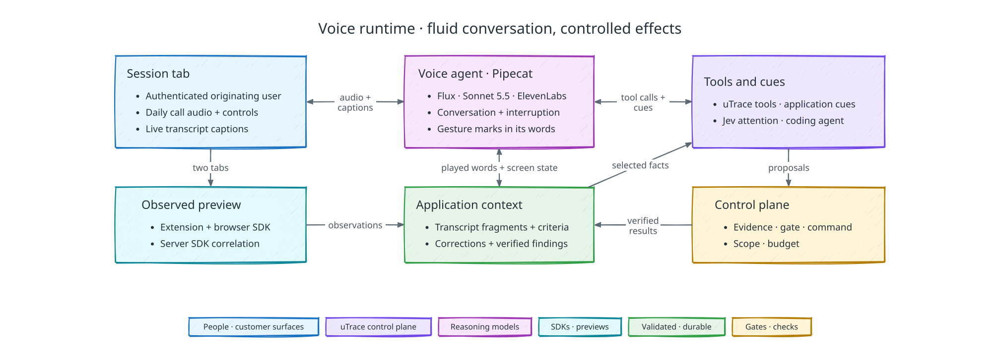
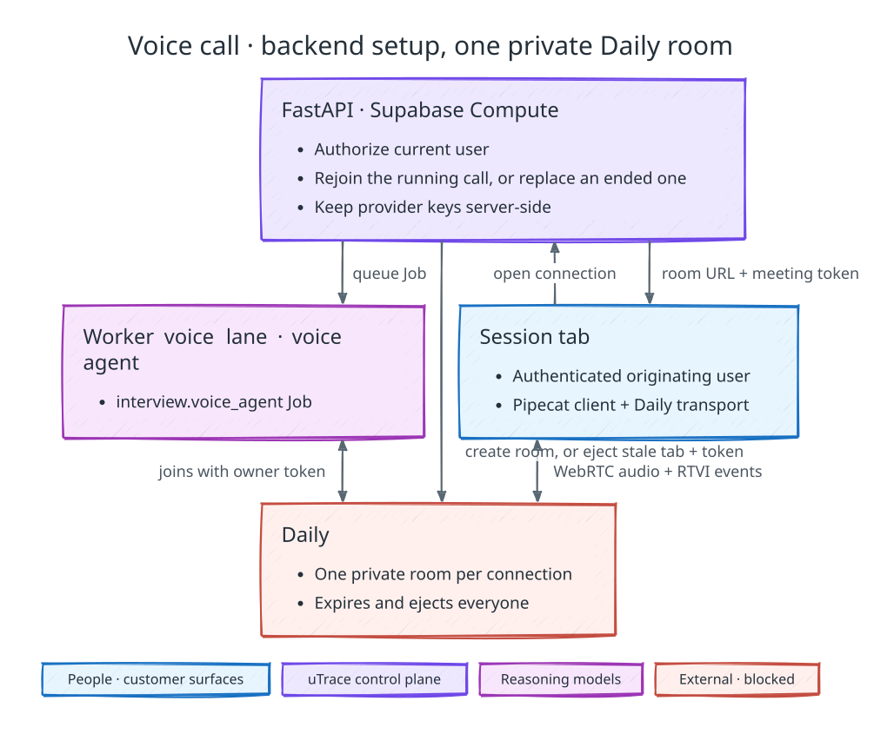

# Interview and voice runtime

[Back to uTrace architecture](../ARCHITECTURE.md)

The runtime separates conversational timing from authority over backend effects.

## Interview ownership

The originating user remains the sole interview and validation participant.
Implementation runs live, during the conversation. Validation requires the session
tab, separate preview tab, extension, and browser/server observation path.

Before interviewing begins, invitation claim runs the [participant compatibility preflight](./browser-extension.md#installation-identity-permissions-and-packaging). The user may receive setup guidance, but the Interview Session does not enter interview activity and reward-eligible participation does not begin until the supported browser, extension, required permission, connectivity, and protocol checks pass. Preview preparation may continue after admission; runtime observation readiness still gates product-dependent probing and is checked continuously.

## Conversation and backend work

The voice agent holds the conversation. It is a [Pipecat](https://docs.pipecat.ai)
pipeline (`pipecat-ai` 1.12) that runs in the worker as the `interview.voice_agent`
Job and joins the connection's private Daily room. Deepgram Flux hears the
participant, Claude Sonnet 5.5 writes the agent's words and calls uTrace's tools,
and ElevenLabs speaks them. The session tab carries the call's audio over Daily's
WebRTC transport. The extension does not capture or relay audio. Supabase Realtime
carries application updates, not media. The
[voice and reasoning model measurements](./evaluation-and-observability.md#voice-and-reasoning-model-measurements)
are the evidence for this pipeline and for GPT-6.1 Sol in the reasoning roles.

Audio and text pass through these stages in order:

1. **Daily input:** the participant's audio from the room.
2. **Microphone gate:** drops the participant's audio while Mute or Pause holds it,
   and records when the microphone last carried speech-level audio (RMS of at
   least 0.01 of full scale), which the echo guard reads.
3. **Deepgram Flux** (`flux-general-en`): proposes each turn's start and end, with
   an end-of-turn threshold of 0.6 and an eager end-of-turn threshold of 0.4.
   Eager end of turn starts the reply before the turn is committed and withdraws
   it if the participant keeps talking.
4. **User turn aggregation:** while the agent is silent, a proposed turn opens at
   once. While it talks, the utterance waits and is classified as its transcript
   arrives. Any other words interrupt the agent. A backchannel
   ("mm-hmm", "yeah", "okay") never interrupts, but opens the turn if the agent
   finishes first, because it may answer a question. Echo never opens a turn: no
   speech-level audio at the microphone during the utterance, or words that replay
   the agent's last four seconds in order. An utterance that Flux ends without
   opening a turn is dropped from the transcript.
5. **Screen state:** appends an `<application>` block to the latest participant
   turn of each model request: the controls on the participant's screen as `T1`,
   `T2`, and so on, the agreed change once it is recorded, and the change's
   `implementation_progress`. The conversation's own context stays unchanged.
6. **Claude Sonnet 5.5** (`claude-sonnet-5-5`) through the Anthropic API: thinking
   only between tool calls, low effort, and prompt caching. It writes spoken text
   with gesture marks inline and calls the [uTrace tools](#tools-and-customer-language).
7. **Words and gestures:** splits each mark (`<c id="T3"/>`) out of the text and
   passes the rest to the speech engine a whole word at a time. The first clause
   of each reply is flushed, so speech starts without waiting for more text.
8. **ElevenLabs** Eleven v4 Turbo (`eleven_v4_turbo`) over the Text to Dialogue
   WebSocket, in ElevenLabs' shared Siren voice.
9. **Daily output:** the agent's audio into the room.
10. **Playback tap:** as each word plays, records it as an agent transcript
    fragment and dispatches the circle for a pending mark, so the gesture lands
    with the word after its mark. An interruption drops marks still pending, and
    the agent's context keeps only the words that played.

The application speaks to the model in `<application>` messages, either to have
it respond now (`say`) or as context for its next turn (`note`). Neither interrupts
the agent: a cue that must not talk over it waits until its audio has gone quiet.
The [application cues](#application-cues) are the messages the application sends
on its own.

GPT-6.1 Sol on the Fast tier does not take part in the conversation. It runs
pre-gate code investigation and Implementation Attempts in the
[Codex harness](./implementation.md#agent-harness), and Implementation Gate
proposals, at low effort; intake assistance and Case File synthesis run it at
medium. Jev supplies concurrent judgments under the
[Jev decision contract](./cross-component-contracts.md#jev-decision-contract).
These judgments can initiate scoped read-only work or direct attention; they
cannot confirm evidence or authorize an effect. Deterministic connection,
identity, lease, and policy facts never require a classifier.

The model routing configuration is versioned. Each Job records its task, selected
model and effort, prompt/schema version, input bundle, deadline, and result.
Failed work retries within its configured bounds and fails explicitly. No model
is ever substituted for another. An unavailable analysis path blocks dependent work, not unrelated
conversation. Jev is an active component, not a shadow-only feature or an
additional serial approval step for every utterance.

### Agent cursor

The voice agent's model chooses what to circle. It puts a mark with a control's
ID immediately before the words that name it, using only IDs from the latest
screen state, and the mark is never spoken. Its instructions limit circling to
three moments: the recap, when it restates the participant's request in one pass
once they have finished explaining; the walkthrough of what a new version
changed; and whenever the participant asks where something is or to be shown it.
It never circles while the participant is still walking through their steps, and
never circles a control it already circled in the conversation.

The playback tap resolves each mark against the screen state the model last saw
and dispatches one circle at the target's exact registered revision. A mark that
names no current control is logged and dropped. A gesture brings the preview tab
and its window to the front, because a gesture the participant cannot see helps
no one and a hidden window pauses the cursor's animation. The measurements behind
this design are in the
[voice and reasoning model measurements](./evaluation-and-observability.md#voice-and-reasoning-model-measurements)
and the [agent cursor measurements](./evaluation-and-observability.md#agent-cursor-measurements).

The screen state offers up to 48 targets from the bound document's registry.
Targets are described by role, the client's declared definition, the label they
currently show, and where they sit on screen among targets described alike; a
target with neither definition nor label is not offered. When a page registers
more targets than are offered, visible ones come first, declared controls before
the visual-only parts of components, then top to bottom, so a filter is never
crowded out by chart points or reviews.

### Jev's interview responsibilities

- **Evidence coverage:** for each supplied objective or acceptance criterion,
  identify whether relevant statements or observations address it, leave it
  unanswered, or contradict it. Code checks missing records; Jev assesses meaning.
  The voice agent uses the gaps to formulate follow-up questions.
  During validation, each time new product milestones arrive from the candidate,
  Jev judges per agreed check whether the participant's activity since the
  Validation Attempt opened shows the product doing it. A check judged shown or
  contradicted reaches the voice agent in the same note as the activity that
  showed it, so it asks the participant to confirm what they saw instead of
  repeating it, and answers once; the judgement records no outcome. The activity
  itself is described by what changed: a milestone heard before is reported by the
  values that changed, not repeated whole.
- **Claim relationships:** compare a new contextualized statement with supplied
  relevant claims: supports, contradicts, unrelated, or unclear. A flag does not
  rewrite the canonical account.
- **Attention and routing:** identify relevant observations and choose among
  supplied lookup or reasoning tasks. The controller checks scope and budgets.
- **Acknowledgements:** each time the participant does something in the preview,
  Jev judges from the conversation and that activity whether it is a moment the
  conversation was waiting on, such as the screen they said they would open coming
  up or a step the agent asked for, and so worth a few spoken words. Code only
  decides when one may be spoken: nobody has the floor (the agent is not talking
  or running a tool, and the participant is not mid-turn), the last
  acknowledgement was at least 15 seconds ago, and the decision arrives within
  about a second of the activity, or the moment passes quietly. Activity from
  before the connection, or held while someone was talking, is not acknowledged.

These jobs run on relevant updates, not as mandatory checks before every utterance.
[Context Assembly](./context-assembly.md#stage-boundaries) owns retrieved-passage
selection; [flow classification](#flow-classification) owns the classification judgment.

### Application cues

Each cue waits on committed state rather than polling. Database triggers notify
the `voice_sideband` Postgres channel with the Interview Session whose mute
Commands, preview route, readiness, implementation progress, or preview activity
changed, and a gate outcome that stops the change notifies it in the transaction
that records it. The voice agent re-reads that session's state when woken, and
again whenever its listener reconnects. The cues are:

- **Greeting:** when the participant joins a call in a session still in its
  `greeting` phase, the agent opens the conversation. A connection that replaces
  one the participant already spoke on gets no greeting.
- **Preview activity:** while the observation path is ready, what the participant
  does in the preview goes to the agent as a note as soon as it is committed: the
  product's declared milestones with their released values, clicks on named
  controls, and page loads, coalesced so a repeated report is not sent again. A
  moment Jev judges worth [acknowledging](#jevs-interview-responsibilities) goes
  as a `say` instead. What arrives while the agent is talking is held and sent,
  combined, once it stops.
- **Participant controls:** Mute, Unmute, Pause, and Resume reach the agent as
  queued `voice.set_input_muted` Commands, which it applies at the microphone gate
  and records as terminal Results.
- **Open the preview:** once the preview's route is committed and it has stayed
  unopened for 20 seconds, the agent asks the participant to open it at the next
  natural pause, and the session tab's status names the same step; if the
  preview opens before the agent speaks that ask, a note retracts it.
- **Gate outcome:** the agent says it is building only once the Implementation
  Gate has authorized an attempt, while that attempt is still building. When the
  gate stops the agreed change, by failing for good or by choosing no
  implementation, the agent is told the change will not start, so it never
  promises a version that is not coming. A refused change request leaves the
  participant validating the version they have, and the agent says why. A new
  connection hears the case's latest gate outcome again.
- **Ready preview:** when the session's progress reaches `ready_for_validation`,
  the agent says the new version is loading.
- **Begin validation:** the Validation Attempt begins as soon as the
  [validation controller](./validation.md#attempt-lifecycle) allows it.
- **Debrief:** once that attempt is in progress, the agent is told what the new
  version shows that up to four earlier pages of the session did not, the agreed
  change, and the recorded checks, so it walks through what changed and then
  exactly the recorded criteria.
- **Validation outcome:** once the outcome is recorded and nobody has the floor,
  the agent closes the conversation; after its goodbye plays, the session closes.

## Call setup

The diagram separates authenticated call setup from the call itself:

The session tab opens a connection with `POST /v1/sessions/{session_id}/voice/connections`,
which has no body. FastAPI validates the originating user and the current
Interview Session, supersedes any open connection, and commits the new connection
row before calling Daily. Browser input cannot select a provider, model, voice, or
session configuration.

The backend creates one private Daily room per connection. The room expires after
two hours and ejects everyone at expiry, so an abandoned call cannot outlive its
Job. A participant meeting token, scoped to that room and expiring with it, admits
the browser; the response carries the room URL, that token, the connection ID, and
the `voice_run_id`. Binding the room to the connection queues the
`interview.voice_agent` Job, which joins the same room with its own owner token.
The Daily, Deepgram, Anthropic, and ElevenLabs keys stay server-side, and neither
meeting token enters a log or the model's context. See
[Daily's room](https://docs.daily.co/reference/rest-api/rooms/create-room) and
[meeting token](https://docs.daily.co/reference/rest-api/meeting-tokens/create-meeting-token)
references.

The session tab joins through Pipecat's client (`@pipecat-ai/client-js`) with its
Daily transport and waits up to 30 seconds for the agent's RTVI `bot-ready`. Its
microphone track stays disabled until conversational readiness, which the agent's
arrival in the call completes. The agent waits up to 90 seconds for the
participant to join, then treats the call as lost. The call ends when the
participant leaves the room.

A late setup response cannot activate a superseded or revoked connection: the
unused room is deleted through the `interview.close_provider_session` Job and the
cleanup is recorded. On revocation or replacement, the control plane stops
accepting the old connection's events and queues the same Job, which deletes the
old room and ends it for everyone in it; expiring uTrace authentication alone
does not end an already joined call.

## Runtime identities and sessions

An Interview Session represents one live encounter for interviewing, validation,
or both, and has a stable `session_id`. A case may span several such sessions when
the originating user leaves and returns. Every provider connection has a new
`voice_run_id`, provider session reference (its Daily room name), and participant
connection ID. A reconnect may preserve the Interview Session while replacing
provider resources; old callbacks cannot change the current session. When the
session tab leaves the call, the voice agent ends it, closes the connection, and
the projection reports `reconnecting`; the tab then opens one new connection,
retrying a few times if that fails. Only one connection has current
participant authority. Authenticated takeover revokes the previous connection.

An Interview Session moves `invited` → `claimed` → `preparing` → `live` →
`closed`. Its voice connection has an independent lifecycle, `connecting` →
`active` → `reconnecting` → `closed`; setup completes before interviewing, and
return and recovery windows expire.
Interview phase, implementation status, and Rive character state are projections;
none is a provider-owned lifecycle. Each Product Signal keeps its own ledger and
candidate and validation identities.

The character states are `idle`, `listening`, `thinking`, `speaking`,
`acknowledgement`, `concern`, `paused`, `reconnecting`, and `completion`. The
user-facing implementation-progress states are `reproduction_captured` →
`making_changes` → `preparing_the_preview` → `ready_for_validation`. Those lists
are the whole contract: the control plane, the database, and the extension carry
exactly the same sets. The
[PRD's character description](../PRD.md#agent-character) names the expressive ones
as examples rather than enumerating them. The animation rig carries further states
for purely visual purposes; those never cross the contract, and no surface may
invent one.

During the conversation, who has the floor sets the character: `speaking` while
the agent's audio plays out of the call, `thinking` while one of its tools runs,
and `listening` otherwise, including from the start of the participant's turn. An
agent turn ends when its last audio has played, not when generation stops, and
talking over the agent ends it at once. Every
change is committed and published together, so the session tab and the extension
show the same state.

The session tab renders one projection document, published with a monotonic
revision. The tab reads it two ways, and both carry the same document: once over
the authenticated session route, for the first render and after any reconnect, and
then continuously through Supabase Realtime on the projection's own row, which
row-level security exposes to that participant and to the client's staff. The tab
ignores any update whose revision is not newer than what it holds. Realtime is
transport for speed, not a second contract — a missed notification is repaired by
re-reading the route. The narrow acknowledgement a control action returns is not
the projection either; it reports the revision and control state that action
produced.

Beside the call, the session tab shows a live transcript built from the voice
agent's RTVI `user-transcription` and `bot-output` events over the Daily call. It
is a caption for the participant only: the tab neither stores nor reports it, and
the durable transcript is the voice agent's own record under the
[transcript contract](#transcript-and-evidence-contract).

The session admits only the originating user and agent. Client owners/admins do
not join, listen, or take over the interview. uTrace authentication and the
room's binding to the current connection identify the user, session, and
connection; only holders of that room's meeting tokens can join it.
Closing or replacing a provider connection cannot by itself cancel the Product
Signal.

## Readiness has two boundaries

After participant compatibility preflight passes, conversational readiness requires
the authenticated participant, functioning
voice transport and controls, the voice agent in the call, and a current backend
session context. It permits
greeting, explaining the interview, and asking the user to describe the problem
while preview setup continues.

Observation readiness additionally requires the exact preview allocation and
dataset, extension binding, browser SDK, shared observation runtime, server SDK,
and browser-to-server correlation. Product-activity claims, observation-dependent
probing, visual commands, and validation require this complete path. Connected
sockets alone do not establish readiness. Replacement resources invalidate their
old readiness evidence.

One record owns readiness. A per-session readiness row holds each component fact
separately — participant authentication, voice transport, the voice agent's
presence in the call (the `sideband_attached` column), and backend context currency
on the conversational side; preview allocation, browser
SDK, Server SDK, and browser-to-server correlation on the observation side —
together with extension readiness and the typed blockers. The two summary
boundaries above are derived from those components in the same transaction that
writes them, so a summary can never disagree with its parts. Any other copy of
those two flags is a read convenience, never a second source, and a reader that
must explain *why* readiness is missing reads the component row.

Each time telemetry ingestion publishes browser, server, or correlation
readiness, it recombines the open session's preview-allocation and observation
components into this record. It leaves extension readiness as the extension's
connection, binding, and Pause last set it, so a healthy telemetry path never
restores readiness they withdrew. A changed record republishes the session
projection and is pushed to the extension.

The compatibility preflight that precedes all of this returns only its pass
state, revision, and per-check results. It mints no credential, because every
session route authorizes the participant's own authenticated identity.

When observation readiness disappears, tell the user what is unavailable, stop
new observation-dependent claims and commands, and recover within the configured
window. Healthy voice may continue discussing already established facts or the
user's goals. Never pretend to see activity or continue validation without its
evidence path. Loss of voice instead enters voice recovery and suspends validation.
The [failure contract](./failure-recovery.md) determines whether work can continue,
pause, resume, or close with a blocker.

## Flow classification

The interview starts from Jev's initial Feature Request Flow classification and
confirms it from the user's statements and observed evidence. Jev proposes the
interview-established classification. Before a gate proposal, record the accepted classification,
supporting sources, and why the initial judgment was retained. The control plane
accepts a typed, source-linked record; a spoken label alone does not change policy
or state. Insufficient evidence remains unresolved rather than inventing a final
classification.

If the evidence shows that the concern is a product failure rather than a feature
request, the demo does not switch flows. The gate records no implementation, and
the Case File names the unsupported flow as its reason.

If the seeded dataset cannot represent the workflow the user needs to show, stop
observation-dependent work and close through the blocker path. The session cannot
change the seed manifest or treat an incomplete substitute as representative
evidence.

## Concurrent work and corrections

Conversation does not wait for every retrieval or implementation step. Independent
read-only lookups and analyses may run concurrently. An implementation Job runs
under its own attempt authorization and reports typed checkpoints, checks, and
candidate readiness. A progress notification cannot claim a successful check or
ready Preview Version until its authoritative result exists.

Use quiet context updates for observations and routine implementation findings;
request spoken updates only for useful findings, relevant questions, blockers, or
candidate readiness. Candidate readiness is pushed, not polled: the
[application cues](#application-cues) announce it once the session's progress
reaches `ready_for_validation`, which it does only once the preview serves the
candidate, so the agent tells the participant without first having to ask. The
agent asks each check in turn, then cites the observations and records the
answers with its validation tools. The voice agent chooses ordinary
conversational timing. Application
validation of backend results does not preapprove each spoken sentence or guarantee
silence. The user experience avoids repeated filler and constant progress narration.

Every result names the evidence/context revision and dependencies it used. A
plausible Jev contradiction flag against a requirement used by active implementation
places new dependent steps on hold while interpretation or participant clarification
resolves it. Conversation and independent work continue; dispatched operations
settle or checkpoint with their outcomes recorded. A flag is not a confirmed
correction. Dismissed flags release the hold after dependency checks; unresolved
flags remain within existing time and execution budgets and use the blocker path
if they cannot be resolved.

This hold is an internal dependency check, not the participant's Pause control.
An accepted user correction supersedes the affected claim immediately. Dependent
analysis is invalidated; if authorized implementation is affected, stop new
incompatible steps, record the current workspace state, and re-evaluate the gate
against corrected scope. Neither a stale worker result nor a fluent spoken promise
can expand scope.

## Transcript and evidence contract

Store timestamped transcript fragments with speaker, provider event, connection,
voice run, and provenance; `start_ms` and `end_ms` count from the agent joining the
call. The voice agent records a participant fragment for each turn when Flux ends
it (`flux.end_of_turn`), and an agent fragment for each word as it plays
(`agent.word_played`), so the record holds only the agent's words that were played.
A transcript can contain mistakes or later corrections: Flux can mishear a word or
fold leaked echo into a participant turn. Flux's end of turn is a timing decision,
not proof that the participant finished a thought or meant what a fragment
says.

Evidence extraction references spans of fragments and relevant observation IDs.
Claims distinguish proposed, confirmed, contradicted, and withdrawn meaning.
Keep corrections as linked records rather than overwriting source fragments.
A bare “yes” needs the question and current acceptance criterion; a later “actually”
can invalidate an apparent confirmation. Validation requires a deliberate
criterion-bound check with the originating user and proportionate affirmative evidence,
not a silence timer or a classifier score.

Generated speech, transmitted audio, and heard speech are different facts. Record
playback/interruption evidence where the transport exposes it; otherwise delivery
is unknown. An agent fragment shows that a word played into the call, not that the
user heard it. After interruption, restate critical scope or validation
questions when needed instead of assuming unheard wording was accepted.

## Active context

The backend keeps the recent conversation, durable agreed scope and criteria,
open questions, contradictions, selected current observations, pending Jobs, and
verified results available to the relevant agent. Those facts are explicitly
supplied; agents do not share memory automatically. Source-linked context bundles
and corrections follow [Context Assembly](./context-assembly.md).

The voice agent's conversation lives in its pipeline for one call: the
participant's turns, the agent's played words, tool calls and results, and
`<application>` messages. A call that replaces a lost one starts from the recorded
transcript, so the agent resumes rather than greeting again. Durable critical
facts remain outside that memory: the screen state supplies the agreed change and
its progress with every model request, and a new connection hears the case's
latest gate outcome again. Backend model context is
budgeted separately, with omitted noncritical sources recorded. The system does not
index the live interview for search; ordinary persisted transcripts and explicit
working context support this loop.

## Pause, interruption, and departure

Speech barge-in affects conversational playback. It does not cancel implementation
or tools: a tool call the model started finishes even when the participant
interrupts. Explicit Pause stops voice and observation and blocks new live
implementation steps; already-dispatched operations finish or checkpoint with recorded outcomes.
Resume rechecks readiness and supplies fresh context. A spoken request for a quiet
moment can suppress speech without pausing implementation.

A temporary connection loss allows current authorized live implementation/checks
during a bounded reconnect window, within the existing attempt budget. The window is
two minutes from the lost connection; the session tab opens a new one by itself
within seconds, so it runs out only when the person has gone. A connection not
replaced in time closes the encounter as **Finish later** does, with closure reason
`reconnect_window_expired`; a paused session keeps its own Pause semantics. No validation
completes while the user is absent. When the window expires, further live work
stops under the lifecycle contract. **Finish later**, departure, and a reconnection timeout all checkpoint the encounter and start or preserve the fixed case-level return deadline in [Failure Recovery](./failure-recovery.md#bounded-return-and-terminal-expiry). The same user returns through the dashboard link or bounded private Discord reminders; return requires fresh readiness and does not reset budgets. Expiry closes the case and cleans resources.

The [failure and recovery contract](./failure-recovery.md) owns cancellation,
technical blockers, budget exhaustion, and post-validation completion. Reconnecting
voice or opening another session never resets implementation budgets.

## Tools and customer language

The voice agent's model calls these tools, each executed by the application under
the control plane's own authority against a context bundle assembled for that
call:

- `review_observed_activity`: what uTrace observed in the participant's product
  session recently, as plain summaries.
- `record_evidence_claim`: a claim the participant established, citing the
  conversation.
- `record_acceptance_criteria`: the agreed scope and its observable acceptance
  criteria, once the participant agrees to them out loud.
- `record_requested_change`: a change asked for while trying a new version, with
  the checks that now apply.
- `begin_validation`: begins or resumes validating the ready preview when it has
  not begun by itself.
- `cite_validation_evidence`: one observation cited as showing what the product
  did for one criterion.
- `record_validation_outcome`: the participant's answer for every criterion.
- `implementation_status`: the current user-facing progress of the change.

After a reading tool (`review_observed_activity`, `begin_validation`, or
`implementation_status`) or a refused call, the model speaks from the result;
after a recording tool succeeds, it does not speak again, because it has usually
said what it needed to already. There is no pointing tool: pointing is the
[inline mark](#agent-cursor).

All tool proposals pass schema, tenant, phase, readiness, policy, permission,
freshness, and budget checks before dispatch. Side effects are serialized within
the affected authority scope; independent read-only work can fan out. Cancellation
and late-result reconciliation follow [Cross-Component Contracts](./cross-component-contracts.md).

Product text, speech, DOM labels, retrieved docs, and tool output are untrusted
content. They cannot redefine instructions or grant authority. Return plain,
customer-appropriate findings to the voice model, because a tool's result can be
spoken aloud. Internal source code, stack
traces, credentials, and raw telemetry stay in the backend and engineer-facing
Case File. The agent can describe what the user experienced without narrating
implementation internals.

## Verification

Exercise useful questions during concurrent work, interruptions and corrections,
preview setup delay, observation loss with healthy voice, voice loss with ongoing
checks, Pause versus quiet requests, departure/resume, explicit cancellation,
changed criteria, and exact-candidate validation. Test responsibilities are
defined in [Evaluation and Observability](./evaluation-and-observability.md).
Measure actual time to useful response, grounded question quality, and completion;
provider benchmarks are not uTrace measurements.
