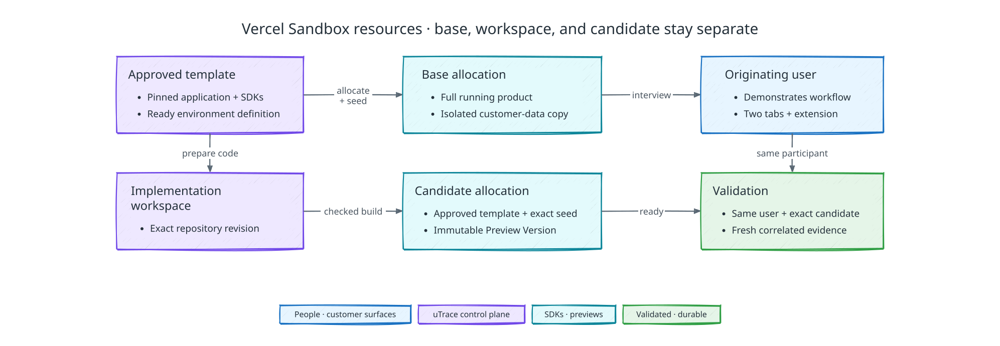

# Preview runtime allocation and data seeding

[Back to uTrace architecture](../ARCHITECTURE.md)

The following diagram shows how uTrace creates separate base and candidate runtimes with the pinned seed data:

## Runtime ownership

Every interview requires a full product runtime: frontend, backend, database,
authentication handoff, browser SDK, Server SDK, and correlated telemetry. The demo
seeds each runtime from a manually prepared synthetic manifest; see
[Seed manifest](#seed-manifest).

## Template and readiness

Each client configuration pins a Vercel Sandbox runtime template: a custom image in
Vercel Container Registry pinned by digest, a template snapshot taken after the
product is installed and built, and the product revision, SDK versions, database
shape, explicit startup and health contract, seed manifest revision, and supported
preview origin. The warm pool is created from that template. A runtime is ready
only after service health, data identity, authenticated handoff, extension
binding, browser/server correlation, redaction, and public front-door probes pass.
Failures identify the incompatible or missing configuration and the action needed
to repair it; uTrace does not infer arbitrary stack behavior.

Template identity is derived rather than chosen. The template record stores a
recipe digest, a SHA-256 over the canonical recipe, its build arguments, the
derived container definition, the pinned product source revision, the seed
manifest digest, and the resolved SDK versions, beside the image digest and
snapshot ID. Two templates differing in any of those cannot share a record, and an
allocation's recorded template digest identifies exactly what it booted. Template
snapshots are created without an expiry, because Vercel otherwise expires a
snapshot 30 days after its last use.

A template image must build the same way twice. The client repository therefore
commits its lockfile, and packages the image cannot fetch publicly, such as the
uTrace SDK packages, are vendored into the image before installation. Without the
committed lockfile the image build fails outright.

Vercel Sandbox runs each runtime in its own Firecracker microVM. It does not run an
image's `ENTRYPOINT` or `CMD`, so the control plane starts the product's supervisor
with a detached sandbox command. Preview runtimes are created non-persistent:
Vercel sandboxes persist by default and snapshot their filesystem when they stop,
which would retain seeded data after the allocation ends. See
[Understanding Sandboxes](https://vercel.com/docs/sandbox/concepts).

Runtime readiness feeds the [session readiness boundary](./interview-and-voice.md#readiness-has-two-boundaries).
Healthy voice alone cannot authorize observation-dependent work.

## Side-effect neutering

Preview safety uses two layers. Network and credential policy removes production authority and restricts egress. Application adapters replace email, payments, webhooks, queues, destructive integrations, and other side effects with recorded preview sinks. Tests prove both layers. The preview retains realistic product behavior without sending real external effects.

## Allocation lifecycle

A claimed base allocation is exclusive to one Interview Session. Candidate
allocations are separate and immutable per Preview Version. A base runtime is never
modified into a candidate, and an implementation workspace never serves the
participant. Vercel sandbox names, session IDs, and port URLs are provider
references, not lifecycle identity.

An allocation carries a pool role. A runtime provisioned into the warm pool
exists before any Product Signal claims it, so its case columns start empty and
its role is the pooled one; the claim sets the role to session base or candidate
and fills the Product Signal, Interview Session or Preview Version, and session
origin in one transaction. One base allocation per Interview Session and one live
candidate per Preview Version are database constraints rather than conventions.

Claim-time configuration is therefore a required step, not an optimization. A
pooled runtime has no Interview Session and no preview origin, so it cannot yet
hold a Server SDK bootstrap credential bound to either. After the claim mints the
session origin, uTrace writes the Server SDK's activation settings into the
runtime's application directory, restarts the product's supervisor with a sandbox
command so the supervised process reads them, and only then probes health through
the runtime's port, commits the route, and records readiness. The supervisor's own
shutdown signals only the processes it started, so the restart signals anything
deeper, such as the server a package manager's `run` wrapper spawned, as soon as
the supervisor exits; the supervisor's direct children keep a grace period to
flush.

A runtime's sandbox stops at a fixed execution limit, and a warm runtime spends
part of that limit waiting. The allocation records when its sandbox stops. Only a
warm runtime with more than the claim margin left is claimed or counts toward the
pool target, and the claim extends the sandbox so the session starts with the full
limit.

The [scenario](../SCENARIO.md#starting-state-and-fixture) starts with a claimable
healthy base runtime. If none is ready when the user arrives, a runtime is created
from the template while greeting and problem discussion continue under the session
readiness boundary. Setup that cannot finish within the readiness window follows
its recovery contract; it never authorizes reduced-observation work.

## Seed manifest

The demo's dataset is a manually prepared synthetic manifest: seed records,
frozen-data hashes, a fixture clock where the workflow depends on time, and the
authenticated identity the product handoff signs in as. The client configuration
pins it by digest. Installation writes it into the runtime's isolated database and
verifies referential integrity and the pinned hashes before readiness.

Base and candidate runtimes install the same manifest independently; a candidate
never copies data from the base. The manifest preserves the relationships and
properties the workflow depends on, and a synthetic value is never presented as
production evidence. No customer data source or production credential is
involved, and the implementation workspace never receives the dataset.

## Failure, cleanup, and reset

Seed or readiness failure is typed, preserves evidence, and blocks
observation-dependent work. Partial datasets are destroyed rather than repaired in
place.

A session preview whose preparation fails enters bounded recovery. Until a
recovery deadline pinned at the first failure, uTrace retries readiness on the
session's committed route, or finishes preparing the runtime the session already
holds; retries never extend the deadline. Past it, the session closes as blocked
and the case ends as [terminal expiry](./failure-recovery.md#bounded-return-and-terminal-expiry)
describes.

When an allocation is no longer needed, required minimized evidence is
extracted, the route and credentials are revoked, and the sandbox is stopped and
deleted. A data-bearing runtime is never reset into a warm pool. Fresh provisioning
replaces it. Pinning a new template retires the previous one: its unclaimed warm
runtimes can never serve a claim, so they are torn down and the pool refills from
the current template. A warm runtime past the claim margin is torn down the same
way, and the pool provisions its replacement.

Every allocation records the pinned configuration release, template digest, seed manifest, clock, authenticated identity, SDK versions, and route revision. Validation evidence is admissible only when it cites the exact candidate and matching dataset identity.
