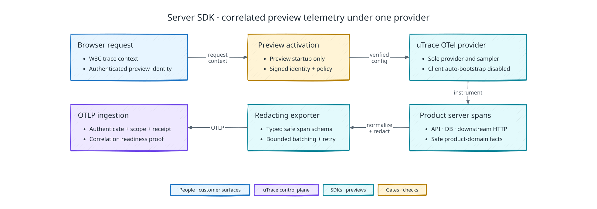

# Server SDK

[Back to uTrace architecture](../ARCHITECTURE.md)

The following diagram shows how the preview-only Server SDK produces correlated, redacted spans:

The mandatory server SDK supplies the backend half of a uTrace product trace.
It is a uTrace-owned OpenTelemetry distribution, not a bridge to the client's
production observability system.

## Support and compatibility

- The first server SDK implementation supports Node.js and TypeScript compiled
  to Node.js. It supports the current Active LTS release and the immediately
  previous Maintenance LTS release. CommonJS and ESM are supported only through
  bootstrap paths that initialize instrumentation before application modules.
- Supported deployments are long-running Node.js processes and containers,
  including serverful Next.js applications. Edge runtimes, ephemeral serverless
  functions, Bun, Deno, and non-Node services are unsupported initially.
- The SDK core is framework-neutral. A versioned compatibility matrix names the
  exact tested Node, framework, HTTP client, database, cache, queue, and RPC
  library ranges. The initial adapter surface covers Node HTTP/HTTPS, Undici,
  serverful Next.js, Express, Fastify, and PostgreSQL. Cache and queue adapters
  are not in the shipped set; a client release that needs one has it built and
  conformance-tested while that client is configured.
- A framework abstraction is not enough to claim support. Every library on a
  client release's required product path must have a tested adapter or prove the
  complete span, propagation, redaction, and readiness contract through
  conformance fixtures.
- An unsupported required runtime or library blocks configuration of that release.
  uTrace never silently reduces the server trace to whatever happens to work.
- Adding another language or deployment model requires the same contract and
  conformance suite. It is not treated as a best-effort port of the Node SDK.

## Preview-only ownership and startup

- Source integration follows [client configuration](./client-configuration.md#sdk-source-integration).
  Preview and production startup profiles share the maintained source revision.
  Only the preview profile includes and loads the server SDK runtime.
  Production deployments receive no uTrace preload, activation credential,
  instrumentation hooks, control connection, or exporter.
- The typed annotation package may remain linked in production application code,
  but without a prepared-preview activation it is inert: it installs no hooks,
  creates no provider, opens no connection, and exports nothing. Product logic
  cannot depend on an annotation call's result.
- In a prepared preview, uTrace starts before application code and owns the sole
  OpenTelemetry provider, context manager, propagator, sampler,
  auto-instrumentation set, processors, and exporter. The client's ordinary
  OpenTelemetry bootstrap, auto-instrumentation, and exporters are disabled.
- A second provider, duplicate instrumentation hook, conflicting preload, or
  non-uTrace exporter is an activation failure. The SDK does not choose one or
  merge the resulting telemetry.
- Approved manual spans created through the standard OpenTelemetry API may flow
  through the uTrace provider. Only instrumentation scopes registered in the
  signed release manifest are eligible for export, and their attributes still
  pass the uTrace schema and redaction pipeline.
- No uTrace SDK is ever active in customer production. Correlation requires the
  browser request and the required backend chain, and unrestricted bodies,
  secrets, and unrelated traces are never exported.
- Initialization or configuration failure stops the preview from becoming
  ready. A later instrumentation or exporter failure does not throw into the
  client's business request path; it withdraws uTrace readiness, reports the
  exact failure, and causes the control plane to pause product-specific probing.

## Configuration, identity, and credentials

- Client configuration produces a signed server instrumentation manifest for each client
  release. It declares required services and adapters, service identities,
  registered routes and operations, domain annotations, permitted downstream
  propagation targets, redaction rules, policy versions, and schema versions.
  Application code cannot broaden that manifest at runtime.
- The manifest is not client-side configuration. The control plane reads it from
  the configuration release the Product Signal pinned and returns it, signed,
  inside the activation record; the SDK verifies that signature against a trust
  anchor supplied with its environment and refuses to instrument otherwise. It
  never loads a manifest from the repository or from a local file, so the
  instrumented preview cannot disagree with the release the case pinned.
- A bootstrap credential is injected by the prepared-environment runtime rather
  than stored in the repository or client configuration. It authenticates the
  control connection, and the SDK exchanges it for short-lived service-instance
  credentials that it rotates ahead of their expiry. The control connection
  carries activation, credential rotation, health, pause, resume, and termination.
- Activation, not the credential, is the one-time step. The SDK's own start mints
  the server stream identity it presents, the control plane admits exactly one
  activation per stream, and that uniqueness is what prevents a replayed
  activation. A dropped control connection therefore reconnects with the same
  bootstrap credential and rotates; a restarted process presents a new stream and
  becomes a new activation.
- One observation activation binds the server streams to the exact `client_id`,
  `client_user_id`, `customer_account_id`, `session_id`, `preview_environment_id`,
  `preview_runtime_allocation_id`, and optional `preview_version_id`. A new
  session, validation encounter, Preview Version, or runtime allocation requires
  a new activation.
- Each service process creates a fresh `server_stream_id` and
  `service.instance.id`. A process restart creates a new stream. Several required
  Node services may participate in the same activation, but each authenticates
  and reports readiness independently.
- Standard OpenTelemetry resource attributes describe the process and deployment:
  at minimum `service.name`, `service.namespace`, `service.version`,
  `service.instance.id`, and `deployment.environment.name`. Dynamic user and
  session identity never appears as resource identity.
- Repeated activation identities may be encoded once in an authenticated export
  batch header, but they remain logically part of every exported span. The
  credential and ingestion-side activation record must agree with those claims.
  Knowledge of an environment, session, trace, or span ID never authenticates a
  sender.
- The activation record also names where to send spans, the export limits in
  force, the propagation probe to satisfy, and the front-door entry token the
  runtime must see before it adopts a remote trace parent. Those values are the
  control plane's to set per activation, not the client's to configure.
- A warm runtime is configured when it is claimed, not when it is provisioned:
  the pool has no Interview Session and no preview origin to bind a credential
  to. The [allocation contract](./preview-runtime-and-seeding.md#allocation-lifecycle)
  owns that claim-time step, including the restart that makes the supervised
  product process read the injected settings.
- Configuration is fixed during client configuration and release preparation. The SDK
  never asks a client or customer for a runtime decision, and an interview cannot
  weaken instrumentation or redaction to recover readiness.

## Automatic instrumentation and annotation surface

- The SDK installs only the explicit instrumentation set required by the signed
  release manifest. It does not enable an unrestricted auto-instrumentation
  bundle and then export every span it happens to create.
- Automatic coverage includes inbound HTTP route, method, status, and duration;
  one authoritative server span per request; meaningful framework handler or
  controller work; outbound HTTP and RPC calls; database operations; and backend
  exception classifications. Cache and queue coverage depends on an adapter
  added for that client, so it is not a guarantee for every client.
- Layered libraries must not create duplicate spans for the same operation.
  Framework spans are retained only when they describe distinct work beneath the
  authoritative server span. Middleware churn and per-function tracing are not
  product evidence.
- Health checks, static assets, SDK control traffic, exporter traffic, and other
  registered operational noise are excluded from the product trace. Exclusion
  cannot remove a required product route or a causal descendant of one.
- The SDK exports traces and typed exception events. It does not collect the
  client's general logs, metrics, stdout, or stderr. An exception belongs to its
  active span; operational SDK health belongs to the authenticated control path.
- The client annotation API is typed and registration-based. It may create a
  registered product operation, record a registered workflow milestone, attach
  an approved product entity class or bounded safe value, classify an expected
  product outcome, or start a registered background root during an active
  observation window.
- There is no arbitrary `setAttributes` or free-form event API in the uTrace
  annotation surface. Unknown operations, fields, values, and instrumentation
  scopes fail the SDK contract and withdraw readiness rather than becoming
  generic telemetry.
- Annotation definitions and their permitted output classes are compiled into
  the signed release manifest. Runtime code may instantiate a definition with
  valid values; it cannot create a definition or declare a value safe.

## Span model and semantic schema

- One trace represents one causal product operation. An inbound browser request
  produces one `SERVER` span beneath the browser `CLIENT` span, with internal,
  database, cache, queue, RPC, and downstream client spans beneath it as the work
  requires. The interview is never represented as one long trace.
- Spans follow the stable OpenTelemetry semantic conventions for their pinned
  schema version. The activation records the semantic-convention and uTrace
  schema versions, and a stream never changes either version while active.
- Span names are low-cardinality operations such as registered route templates,
  database operations, or registered product operations. Raw URLs, entity IDs,
  user input, and error messages never appear in span names.
- Standard concepts use standard attributes and placement. Service and
  deployment identity belongs on the resource; request-specific HTTP, database,
  messaging, RPC, and error fields belong on spans or exception events.
- The versioned `utrace.*` namespace is limited to product concepts without a
  stable OpenTelemetry equivalent, including registered product operations,
  entity classes, workflow milestones, safe outcomes, and their manifest
  definition references. It never aliases a standard attribute.
- The uTrace contract package owns span names, permitted attributes, types,
  cardinality limits, placement, output classes, and valid custom values. SDK
  constants and runtime validators are generated from that schema rather than
  copied into adapters by hand.
- Trace and span IDs retain their W3C/OpenTelemetry representation. Durable
  product identities remain in the authenticated telemetry envelope and
  ingestion correlation model; there is no generic `correlation_id` attribute.

## Trace extraction and propagation

- The provider uses W3C Trace Context and a parent-based always-on sampler. The
  browser creates sampled traces during an active interview, and the server does
  no head sampling of eligible roots or descendants.
- A syntactically valid `traceparent` is not authorization. The SDK accepts it as
  a remote parent only on a request that has already entered the authenticated,
  active prepared preview. Client, customer, user, session, preview environment,
  and runtime-allocation identity comes from the server activation, never from
  `traceparent`, `tracestate`, baggage, or an application-supplied correlation
  header.
- W3C baggage is neither extracted nor injected by the uTrace provider. The SDK
  propagates `traceparent` and compatible `tracestate` only.
- Automatic context propagation follows the operation through Node asynchronous
  execution. Outbound HTTP, RPC, and message producers inject trace context only
  toward server-SDK services or transports approved in the signed release
  manifest. Arbitrary third parties never receive uTrace context.
- Queue producers attach context to approved message metadata; consumers create
  the corresponding consumer span and continue the causal trace. Fan-out,
  batch, retry, and delayed work use span links when parent-child semantics would
  be false. Message bodies are never used as trace carriers.
- A background operation inherits the originating context when one exists. A
  root background operation is eligible only when a registered typed annotation
  starts it during an active observation window. Unregistered cron jobs,
  maintenance work, and unrelated preview traffic are not exported.
- WebSocket, SSE, custom RPC, and custom queue protocols require a typed adapter
  when they are on a required client workflow. Missing propagation on such a
  path is a readiness failure, not permission to return an incomplete trace.

## Redaction boundaries

- Redaction is enforced before a finished span enters the uTrace export buffer.
  Capture is disabled at the instrumentation library when possible; a uTrace
  processor applies the same policy again before serialization, and ingestion
  provides a separate defensive validation layer.
- Redaction order is non-overridable platform exclusions, authenticated
  activation scope, signed client policy, registered annotation definition,
  per-value evaluation, defensive sensitive-data detection, normalization and
  cardinality bounds, then schema validation. A later layer may only restrict an
  earlier result.
- Authentication headers, cookies, tokens, credentials, secrets, payment data,
  private keys, unrestricted request or response bodies, and unapproved customer
  content are never collected. The client policy cannot re-enable them.
- HTTP spans may retain registered route template, method, status, duration,
  protocol, safe sizes, and approved service destination. They exclude raw query
  strings, literal path parameters, IP addresses, user-agent strings, headers,
  and bodies.
- Database spans may retain system, operation, approved database or collection
  class, status, duration, and error classification. SQL text, bind values,
  result rows, connection strings, and credentials are never exported.
- Cache spans may retain system, operation, hit or miss, duration, and a
  registered cache class. Cache keys and values are never exported.
- Queue spans may retain system, registered destination, operation, delivery
  state, duration, and an opaque protocol message ID when required for trace
  semantics. Message bodies and application headers are never exported; only the
  approved trace carrier is injected.
- Error evidence may retain stable error type, normalized status, fingerprint,
  registered product area, and bounded repository-relative code frames. Raw
  exception messages are excluded unless an exact signed rule approves a stable
  sanitized form. Stack frames contain no arguments, local values, environment
  values, or absolute host paths.
- Product-domain spans retain only registered fields in their declared output
  class. User-authored text defaults to metadata-only; safe categorical or
  bounded values require an exact signed rule. Rejected originals never enter a
  redaction audit record.

## Export, buffering, retry, and acknowledgement

- A uTrace-owned exporter sends traces directly to telemetry ingestion using
  authenticated OTLP/HTTP with binary Protobuf and gzip. It does not export to a
  client collector, production observability backend, alternate vendor, or
  fallback endpoint.
- Each immutable export batch has a stream-scoped sequence and batch ID outside
  the OTLP span payload, carried with the rest of the activation envelope as
  `x-utrace-` request headers alongside the bearer credential. Retries preserve
  the batch ID and span identities. Ingestion deduplicates a retry by batch ID
  and by trace ID plus span ID.
- A full OTLP success acknowledges the batch. Partial success is forbidden by
  the uTrace ingestion contract because it would make the trace ambiguously
  incomplete; receiving one fails the stream and records the rejected count and
  reason. Permanent validation or authentication errors are not retried.
- Retryable transport failures and throttling use bounded exponential backoff
  with jitter and honor `Retry-After`. The SDK retries the same immutable batch
  and never switches transport or destination.
- There is no SDK-side trace sampling during an active observation window. All
  eligible spans pass through redaction and the bounded export path. Any later
  retention or evaluation sampling occurs after ingestion and cannot rewrite the
  evidence as complete.
- The SDK keeps a bounded memory-only queue of already-redacted batches. It does
  not write telemetry to the application filesystem, database, cache, or queue.
  A high-water mark withdraws readiness so observation-dependent claims,
  probing, implementation evidence, and validation pause before the hard bound
  is reached. Authenticated conversation about already established facts may
  continue.
- Telemetry failure never delays or fails the client's business request. If the
  hard bound is nevertheless reached, the affected span loss becomes an
  explicit stream integrity failure; the SDK does not silently evict older or
  supposedly lower-value spans and continue.
- Graceful shutdown performs a bounded flush and terminal stream report. A crash,
  OOM kill, or forced termination may lose an unacknowledged tail; the missing
  terminal acknowledgement is recorded as a possible evidence gap rather than
  represented as a complete trace.

## Readiness, health, and failure

- Server SDK lifecycle states are `dormant`, `activating`, `ready`, `paused`,
  `recovering`, `failed`, and `terminated`. An installed package without a
  prepared-preview activation remains dormant and performs no work.
- `ready` requires valid environment attestation and credentials; compatible
  SDK, Node, manifest, policy, and schema versions; one provider and one hook per
  library; valid resource identity; every required service and adapter present;
  an active observation grant; a healthy control connection and export queue;
  and an acknowledged end-to-end propagation probe.
- The propagation probe enters through the authenticated preview path and proves
  browser `CLIENT` to server `SERVER` parentage plus every client-declared
  downstream, database, cache, queue, or custom-protocol hop required by the
  smoke workflow. Duplicate spans, missing hops, rejected fields, or unexpected
  export destinations fail the probe.
- Health reports contain operational metadata only: SDK and capability versions,
  service and stream identity, manifest and policy versions, lifecycle state,
  last produced and acknowledged batch sequences, buffer utilization, required
  adapter status, credential expiry, probe result, and typed failure codes. They
  never include product content or rejected raw values.
- Failure codes distinguish at least invalid activation, credential rejection,
  incompatible runtime or contract, duplicate provider or hook, required adapter
  missing, resource mismatch, redaction or schema failure, propagation failure,
  unauthorized destination, ingestion unavailable, partial acceptance,
  acknowledgement integrity failure, buffer exhaustion, and unclean stream end.
- A control or export disconnect enters bounded recovery and immediately removes
  the affected service from combined readiness. Observation-dependent claims,
  probing, implementation evidence, and validation pause until fresh credentials,
  an acknowledged exporter, and the required probe restore readiness.
  Authenticated conversation may continue using already established facts, but
  it cannot imply observation of the unready interval.
- Every required service reports readiness independently. The control plane marks
  the server path ready only when the signed release manifest's entire required
  service graph is ready and browser-to-server correlation succeeds.
- Client-installed component compatibility follows the common contract rule:
  the control plane supports the current and immediately previous major during
  an explicit deprecation window. An older SDK, unsupported capability, or
  semantic-schema mismatch fails before the interview; no version changes during
  an active stream.
