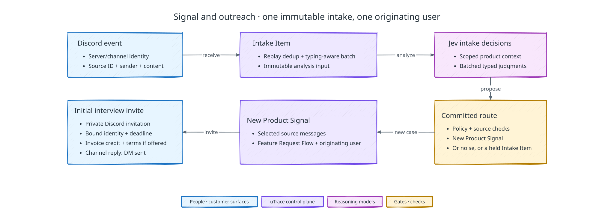

# Customer Surfaces, intake, and outreach

[Back to uTrace architecture](../ARCHITECTURE.md)

The following diagram shows how one Discord batch becomes a Product Signal and its private invitation:

## Demo scope

The demo uses one configured Discord server for its one B2B client. One sealed
batch routes to noise, to one Feature Request Flow Product Signal and private
invitation, or to a held Intake Item. Intake does not match reports against
existing signals, escalate Sensitive Accounts, or split compound intake.

## Discord ingestion and identity

Only configured watched channels are intake surfaces. Authenticated Discord message IDs are provider idempotency keys; duplicate deliveries collapse. Messages from one author in one channel debounce into an ordered immutable Intake Item, preserving replies and thread references. The quiet window only has to cover the gap before the author starts typing again: Discord's typing indicator for that author and channel holds the open batch until it lapses, never past the batch's hard deadline. Typing carries no content and never becomes a report. Inbound bot DMs route only to an invitation, active session, return link, or explicit preference action.

The connector maps server to client, author to a client-scoped provider identity and `client_user_id`, and the B2B participant to a customer account and membership. The private session invitation is bound to that Discord identity. Knowledge of a URL or Product Signal ID does not authorize participation.

The connector holds the client's Discord gateway session inside the control
plane's worker process, so one deployment carries exactly one session per bot
token. The [deployment contract](./deployment.md#scaling-and-availability) owns
what that costs in scaling.

uTrace's own posts are not customer feedback. The connector drops a message whose
author is the bot at the gateway, and the record boundary refuses any
bot-authored message that has no explicit author-attribution record mapping that
bot identity to a client user and customer account. Ordinary intake writes no
such record, so the bot cannot report to itself; the
[demo runbook](./evaluation-and-observability.md#running-the-demo) describes the
one rehearsal use.

When the gateway misses a watched-channel message, an authorized staff member may
re-ingest exactly that message through `POST /v1/clients/{client_id}/intake/messages`,
which requires an active client membership for the path client. Re-ingestion
refuses an unwatched channel before it contacts Discord, resolves the same author
mapping as the live path, and collapses on the provider message ID, so it
recovers the missing receipt instead of creating a second Intake Item.

## Routing context and cognition

The base context contains sealed messages, their direct reply and thread
references, authenticated scope, routing configuration, and a source-linked
Product Overview revision. [Context Assembly](./context-assembly.md#product-overview-lifecycle)
owns preparation and freshness of that overview.

Jev is the default semantic decision model for intake. Python
application code assembles the bounded context and composes its typed answers.
The ordinary path requires neither GPT-6.1 Sol analysis nor a second model's
approval. These responsibilities live in the existing control-plane modules,
not a separate agent or service for each routing step.

Ask focused questions about whether the batch warrants investigation, its flow
type, and missing context. Batch independent questions against the same context in
one Jev request. Use the question types and acceptance checks in the
[Jev decision contract](./cross-component-contracts.md#jev-decision-contract). Application code ignores irrelevant answers and resolves the
route.

The control plane validates schema, source scope, revisions, evidence, and
eligibility before one atomic route commits. Jev does not infer identity, grant
permissions, or mutate state. Delivery deduplication, client serialization,
contact limits, and durable dispatch remain application responsibilities.

### Conditional assistance

Code checks Jev's answers before accepting a route. When a required fact stays
unresolved under the question-specific acceptance checks, intake widens the
context once: the Product Overview sections the routing excerpt left out join it,
with the messages the batch replies to, and Jev answers again. Intake fetches no
other Discord context, has no ambient production telemetry, and does not use
repository search. A document describing a capability does not show that the
user's need is already met.

If a fact is still unresolved, GPT-6.1 Sol restates what the batch reports or asks
for, from the batch, its replied-to messages, and the Product Overview, and Jev
answers once more with that restatement as labeled context. GPT-6.1 Sol never
decides the route and never runs as a routine verifier of Jev. Each branch records
its reason and is not a silent replacement for an unavailable provider. A batch
GPT-6.1 Sol cannot interpret, or one still unresolved after its restatement,
commits `routing_blocked`, never fabricated noise.

### Product Signal evidence and presentation

A routine Product Signal records its typed classification, one source report, and
every message of the batch as `intake_source` evidence; nothing selects among the
messages. Preserve the originating user's wording for the goal, pain, expected
behavior, and impact; record unspecified details as unknown for the interview to
resolve.

Noise pointers and private invitations use fixed templates; routing generates no
narrative summary.

### Initial and interview-established classification

Jev's intake classification is initial. It guides the first questions without
constraining what the interview can discover. Preserve it with its source and
routing revision. The [interview contract](./interview-and-voice.md#flow-classification)
owns the evidence-backed confirmation; intake never silently overwrites that
result.

## Routing contract

Each successfully routed batch commits exactly one of:

- `close_as_noise`, optionally with one brief factual pointer; or
- `create_product_signal`, containing one concern classified as Feature Request Flow.

A batch that Jev classifies as a product failure stays in `routing_blocked` with
the reason `unsupported_flow`. It creates no Product Signal or invitation, and
staff can see it.

Exact delivery replays are idempotent. Intake does not compare a batch with
existing Product Signals: a later report about a concern that already has an open
Product Signal opens its own Product Signal, with its own originating user and
invitation. Routing is serialized per client; different clients remain concurrent.

## Originating user and invitation lifecycle

The first reporter whose concern creates the Product Signal is the immutable originating user and the only interview and validation participant. A colleague, client member, or operator never replaces them.

Before interviewing begins, verify the participant's supported browser, extension
installation and permissions, and linked voice and session controls. After that
participant setup passes, greeting and initial problem discussion may begin. Full
preview, SDK, and correlation readiness is a second gate before
observation-dependent probing. A known participant-setup incompatibility that
cannot be repaired within the pinned setup window ends before participation, with
no interview, Case File, or earned Outreach Offer. A technical failure after
participation follows the normal blocked-case and offer-eligibility contracts; it
does not retroactively erase completed participation.

An Outreach Attempt moves `scheduled` → `dispatching` → `awaiting_response` →
`claimed`; its alternates are `declined`, `expired`, `unreached`, and `revoked`.
A send is never retried, because Discord offers no idempotency key for a message
send: confirmed delivery enters `awaiting_response`, a failed send moves the
attempt to `unreached` and releases its offer reservation, and a send with no
recorded result refuses any resend until it is reconciled against the
direct-message channel. Claims must prove the bound Discord identity. A delivered
initial invitation is acknowledged with one short public reply to the reporter's
latest message in the request, saying a DM was sent and nothing about the offer or
the case; it is sent once, by the run that delivered the invitation, and its
failure leaves the invitation untouched. For the initial invitation, decline, opt-out, do-not-contact,
inability to reach the same user, or contact-budget exhaustion cancels the Product
Signal and produces no Case File.

Rewarded invitations must first satisfy the [offer reservation contract](./outreach-offers.md#budget-and-offer-reservations).
Include its pinned credit amount, currency, billing use, organization, and participation conditions.
Return links and reminders reuse the same offer and reservation; they do not
create another reward.

Invitations and reminders follow a policy-pinned per-person and per-client contact
budget. The [failure-recovery contract](./failure-recovery.md#bounded-return-and-terminal-expiry)
owns the private return link and its bounded reminders after a departure. Provider
sends and acknowledgements are durable delivery results rather than Product Signal
state.
