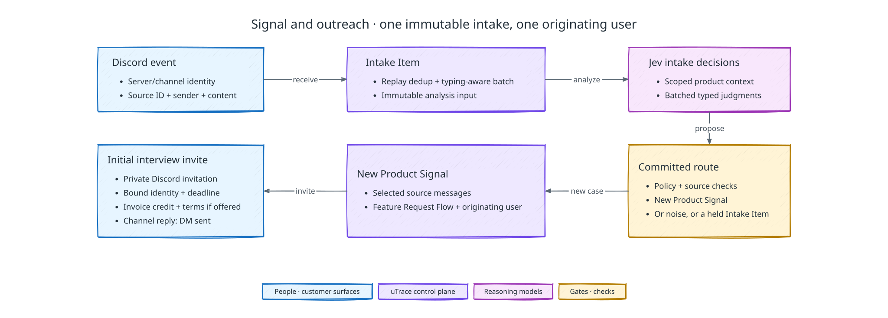

# Customer Surfaces, intake, and outreach

[Back to uTrace architecture](../ARCHITECTURE.md)

One sealed Discord batch becomes noise, a held Intake Item, or one Product Signal
and its private invitation:

Diagram key

## Demo scope

The demo uses one configured Discord server for its one B2B client. Intake neither
escalates Sensitive Accounts nor splits compound intake.

## Discord ingestion and identity

Only configured watched channels are intake surfaces. One author's messages in one
channel debounce into an ordered, immutable Intake Item preserving replies and
thread references:

The quiet window only covers the gap before the author resumes typing, since the
typing indicator holds the batch until it lapses. Typing carries no content and
never becomes a report. Inbound bot DMs
route only to an invitation, active session, return link, or explicit preference
action.

### Identity mapping

The connector maps the server to the client, the author to a client-scoped
provider identity and `client_user_id`, and the B2B participant to a customer
account and membership. The private session invitation is bound to that Discord
identity. Knowledge of a URL or Product Signal ID does not authorize
participation.

### Gateway session

The connector holds the client's Discord gateway session inside the control
plane's worker process, so one deployment carries exactly one session per bot
token. The [deployment contract](./deployment.md#scaling-and-availability) owns
the scaling cost.

### The bot's own messages

uTrace's own posts are not customer feedback. Beyond the gateway drop, the record
boundary refuses any bot-authored message without an explicit author-attribution
record mapping the bot identity to a client user and customer account. Ordinary
intake writes none, so the bot cannot report to itself; the
[demo runbook](./evaluation-and-observability.md#running-the-demo) describes the
one rehearsal use.

### Re-ingesting a missed message

When the gateway misses a watched-channel message, an authorized staff member may
re-ingest exactly that message through
`POST /v1/clients/{client_id}/intake/messages`, which requires an active client
membership for the path client. Re-ingestion resolves the same author mapping as
the live path and collapses on the provider message ID, recovering the missing
receipt rather than creating a second Intake Item.

## Routing context and cognition

The base context contains sealed messages, their direct reply and thread
references, authenticated scope, routing configuration, and a source-linked
Product Overview revision. [Context Assembly](./context-assembly.md#product-overview-lifecycle)
owns preparation and freshness of that overview.

Jev is intake's default semantic decision model. Python application code in the
existing control-plane modules, not a separate agent or service per routing step,
assembles the bounded context and composes Jev's typed answers. The ordinary path
needs neither GPT-6.1 Sol analysis nor a second model's approval.

Intake asks focused questions about whether the batch warrants investigation, its
flow type, and missing context, batching independent questions against the same
context in one Jev request under the
[Jev decision contract](./cross-component-contracts.md#jev-decision-contract).
Application code ignores irrelevant answers and resolves the route.

The control plane validates schema, source scope, revisions, evidence, and
eligibility before one atomic route commits. Jev does not infer identity, grant
permissions, or mutate state. Delivery deduplication, client serialization,
contact limits, and durable dispatch remain application responsibilities.

### Conditional assistance

Code checks Jev's answers before accepting a route and escalates only while a
required fact stays unresolved under the question-specific checks:

Intake widens context only as drawn: it fetches no other Discord context, has no
ambient production telemetry, and does not use repository search.
A document describing a capability does not show that the user's need is already
met.

GPT-6.1 Sol restates from the batch, its replied-to messages, and the Product
Overview, but never decides the route or runs as a routine verifier of Jev.
Each branch records its reason and never silently replaces an unavailable
provider.

### Product Signal evidence and presentation

A routine Product Signal records its typed classification, one source report, and
every message of the batch as `intake_source` evidence; nothing selects among the
messages. Preserve the originating user's wording for the goal, pain, expected
behavior, and impact, and record unspecified details as unknown for the interview
to resolve.

Noise pointers and private invitations use fixed templates; routing generates no
narrative summary.

### Initial and interview-established classification

Jev's intake classification is initial: it guides the first questions without
constraining what the interview can discover, and intake preserves it with its
source and routing revision. The [interview contract](./interview-and-voice.md#flow-classification)
owns the evidence-backed confirmation, which intake never silently overwrites.

## Routing contract

Each successfully routed batch commits exactly one of:

- `close_as_noise`, optionally with one brief factual pointer; or
- `create_product_signal`, containing one concern classified as Feature Request Flow.

A batch that Jev classifies as a product failure stays in `routing_blocked` with
the reason `unsupported_flow`, visible to staff, and creates no Product Signal or
invitation.

Exact delivery replays are idempotent. Intake does not compare a batch with
existing Product Signals: a later report about an already-open concern opens its
own Product Signal, originating user, and invitation. Routing is serialized per
client; different clients remain concurrent.

## Originating user and invitation lifecycle

The first reporter whose concern creates the Product Signal is the immutable
originating user and the only interview and validation participant. A colleague,
client member, or operator never replaces them.

### Participant setup

Interviewing waits on the
[two readiness boundaries](./interview-and-voice.md#readiness-has-two-boundaries).
A known participant-setup incompatibility that cannot be repaired within the
pinned setup window ends before participation, with no interview, Case File, or
earned Outreach Offer. A technical failure after participation follows the normal
blocked-case and offer-eligibility contracts; it does not retroactively erase
completed participation.

### Outreach Attempt

Each Outreach Attempt sends its invitation at most once:

Diagram key

A send is never retried, because Discord offers no idempotency key for a message
send. For the initial invitation, decline, opt-out, do-not-contact, inability to
reach the same user, or contact-budget exhaustion cancels the Product Signal and
produces no Case File.

The run that delivers an initial invitation sends one short public reply to the
reporter's latest message in the request, once, saying only that a DM was sent;
its failure leaves the invitation untouched.

### Offers, reminders, and contact budget

Rewarded invitations must first satisfy the
[offer reservation contract](./outreach-offers.md#budget-and-offer-reservations)
and include its pinned credit amount, currency, billing use, organization, and
participation conditions. Return links and reminders reuse the same offer and
reservation, never creating another reward.

Invitations and reminders follow a policy-pinned per-person and per-client contact
budget. The [failure-recovery contract](./failure-recovery.md#bounded-return-and-terminal-expiry)
owns the private return link and its bounded reminders after a departure. Provider
sends and acknowledgements are durable delivery results, not Product Signal state.
